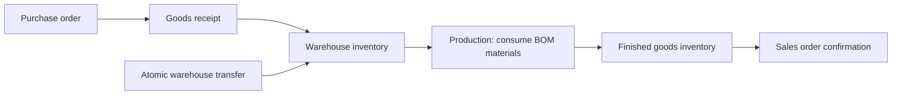
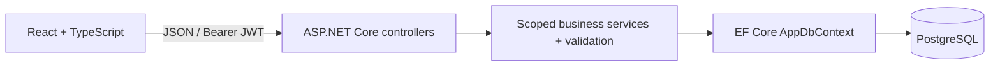
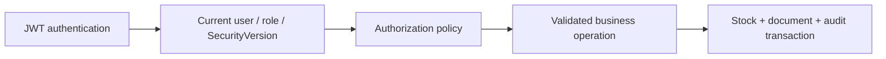
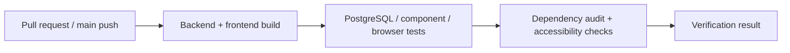
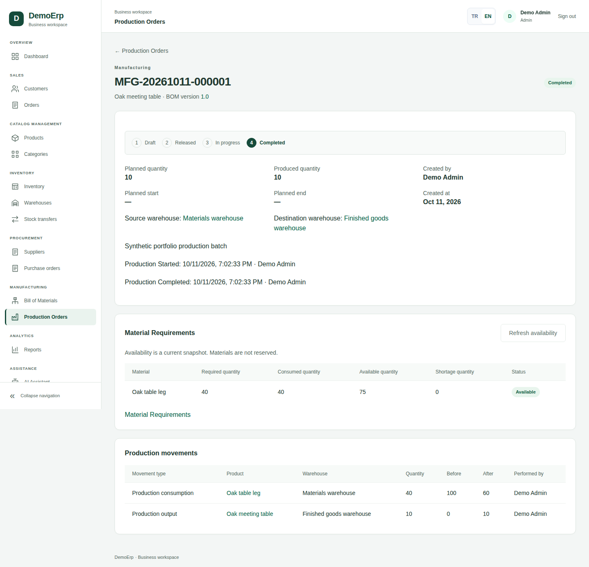

# DemoErp

A full-stack ERP engineering portfolio built with **ASP.NET Core, React and PostgreSQL**. DemoErp connects purchasing, warehouse inventory, manufacturing and sales in one business workspace, with English/Turkish localization and role-based access.

[Türkçe](README.tr.md) · [Architecture](docs/ARCHITECTURE.md) · [API](docs/API.md) · [Testing](docs/TESTING.md) · [Deployment](docs/DEPLOYMENT.md) · [Verification](VERIFICATION.md)


[Windows setup guide (Türkçe)](docs/INSTALLATION.tr.md)

## Demo accounts

Use these accounts to explore the prepared demo database:

| Role | Email | Application role |
| --- | --- | --- |
| Administrator | `admin@example.com` | `Admin` |
| Viewer | `viewer@example.com` | `Viewer` |
| Operations manager | `operation@example.com` | `Manager` |

**Password for all three accounts:** `qwe123456789`

These are public demo credentials for synthetic data only. A fresh installation does not automatically create these accounts; provision them through Admin setup and user management. Do not reuse these credentials in production.

## Implemented business workflows

| Area | Capabilities |
| --- | --- |
| Catalog and sales | Products, categories, customers, server-priced sales orders; confirmation deducts stock and eligible cancellation returns it |
| Inventory | Warehouse balances, stock in/out, adjustments, minimum levels and immutable movement history |
| Warehouses | Selected fulfillment/receiving locations, default warehouse governance and atomic stock transfers |
| Procurement | Suppliers, purchase orders, partial/full goods receipts with idempotent posting |
| Manufacturing | Versioned single-level BOMs, immutable material snapshots, release/start/complete lifecycle, atomic consumption and finished-goods output |
| Analytics | Eight executive KPIs, sales/status charts, product/customer rankings, stock alerts, procurement/manufacturing summaries and paginated CSV reports |
| Administration | Admin/Manager/Viewer policies, user activation/role management, last-Admin protection and transactional audit logging |
| Optional AI | Bounded read-only business assistant; disabled by default, no provider key needed to run the ERP or its tests |



The backend owns pricing, authorization, stock consistency and lifecycle validation. UI controls reflect those rules; hiding a button never substitutes for server authorization. Completed-order sales value is expressed in USD and is not accounting revenue. Inventory and active-record KPIs are current snapshots.

## Run locally

Install Docker Desktop with Linux containers, then:

```sh
docker compose up --build
```

Open [the application](http://localhost:3000), [API Swagger in Development](http://localhost:5080/swagger) or [readiness](http://localhost:5080/health/ready). PostgreSQL remains on the Compose network, with data in a persistent named volume. No AI credentials are required.

Registration creates a **Viewer**. For business writes, provision the initial Admin using the optional `BOOTSTRAP_ADMIN_*` variables in an ignored `.env`; see [secure Admin setup](docs/SECURITY.md). Disable bootstrap and remove its password after initial provisioning. Development defaults in [.env.example](.env.example) are explicitly unsuitable for production. Never use `docker compose down -v` on a database you want to retain.

For local source development, environment setup and disposable test stacks, see [Development](docs/DEVELOPMENT.md) and [Testing](docs/TESTING.md).

## Architecture and technologies

One ASP.NET Core application uses controllers, typed contracts, scoped business services and EF Core mappings. This is a **layered monolith**, not independently deployable modules. It keeps cross-module stock, document and audit changes in one PostgreSQL transaction.



| Concern | Technology |
| --- | --- |
| Backend | .NET 10 / ASP.NET Core, EF Core 10, Npgsql, FluentValidation |
| Frontend | React 19, TypeScript 5.9, Vite 6, Tailwind CSS 4, React Router, TanStack Query |
| Forms and charts | React Hook Form + Zod; Recharts |
| Database | PostgreSQL 17; row/advisory locks, constraints and nine committed migrations |
| Quality | xUnit v3, real PostgreSQL Testcontainers, Vitest + Testing Library, Playwright + axe |
| Delivery | Multi-stage Docker builds, unprivileged runtime containers, Docker Compose, GitHub Actions |

Dependency versions are locked in `frontend/package-lock.json` and the backend project files. Container tags remain mutable; use reviewed digests in an actual deployment.

### Consistency and security

Writers lock documents, warehouses, products and balances in a consistent order. Production consumes all required materials or rolls back; completion produces output once. Receipt idempotency binds replay to the original payload, and transfer completion creates paired movements atomically. PostgreSQL constraints provide a second boundary against negative stock and invalid history.



See [database design](docs/DATABASE.md), [security](docs/SECURITY.md), [inventory](docs/INVENTORY.md), [warehouses](docs/WAREHOUSE_MANAGEMENT.md), [procurement](docs/PROCUREMENT.md) and [manufacturing](docs/MANUFACTURING.md).

## Quality and verification

```sh
dotnet build Catalog.slnx
dotnet test Catalog.slnx
cd frontend
npm ci
npm run lint
npm run typecheck
npm test
npm run build
```

Backend integration tests create their own PostgreSQL containers. They do not use EF InMemory or the application's database. Browser workflows require a separate, disposable Compose project and test-only Admin credentials; follow [Testing](docs/TESTING.md) before running them.



The [CI workflow](.github/workflows/ci.yml) runs backend tests, frontend lint/type/component/build checks, dependency auditing and a separate browser smoke/accessibility job. It needs no paid API access. Local executed results and remote CI limitations are recorded separately in [VERIFICATION.md](VERIFICATION.md).

SQL review uses a deterministic isolated database and actual `EXPLAIN (ANALYZE, BUFFERS)` plans. In the Phase 10 fixture, filtering production-preview stock to five materials reduced rows read from 5,000 to five and the warm median from **0.421 ms to 0.031 ms**. These are database execution measurements, not HTTP latency or a production SLA. [Method, raw plans and reproduction](docs/PERFORMANCE.md).

## Interface

The forest-green design system includes grouped navigation, desktop collapse, mobile navigation, consistent status labels, keyboard focus, loading skeletons and confirmed-save feedback. Charts and figures use real API responses. Automated axe checks and four-width browser rendering support accessibility review; they do not certify WCAG conformance.



[Login](docs/screenshots/login-en.png) · [Products](docs/screenshots/products-en.png) · [Sales orders](docs/screenshots/orders-en.png) · [Inventory](docs/screenshots/inventory-en.png) · [Warehouses](docs/screenshots/warehouses-en.png) · [Purchasing](docs/screenshots/purchase-orders-en.png) · [BOMs](docs/screenshots/manufacturing-en.png)

All published screenshots come from a running application with synthetic records. [UI decisions and responsive review](docs/UI_DESIGN.md).

## Scope and deployment limits

DemoErp is a runnable portfolio demonstration. It does not implement accounting, tax calculation, multi-tenancy, multi-currency settlement, recursive BOM explosion, capacity scheduling or partial production. The AI assistant is optional and read-only; estimates require human review.

Production hosting requires HTTPS/reverse-proxy configuration, independent secrets, backup/restore drills, monitored health checks and an operational migration strategy. These are documented in [Deployment](docs/DEPLOYMENT.md); no public production deployment is claimed.

[15 engineering interview questions](docs/INTERVIEW_PREPARATION.md) · [Source usage terms](NOTICE.md)
