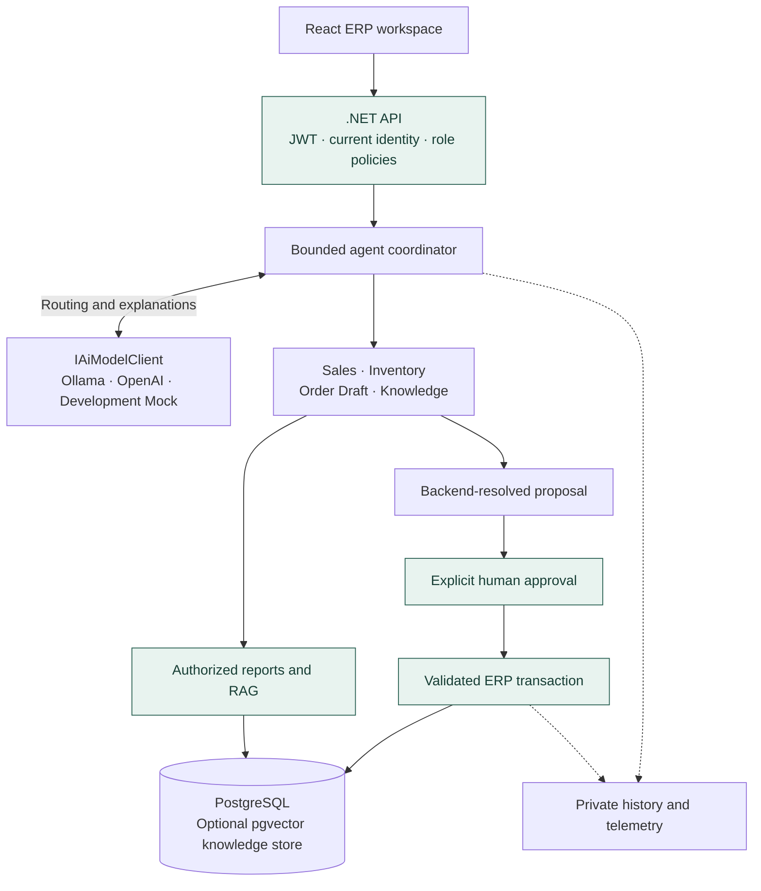

# DemoERP — AI-Native Enterprise Resource Planning

**Transactional ERP workflows. Authorized AI tools. Human-approved actions.**

DemoERP connects sales, purchasing, warehouse inventory and manufacturing in one React workspace. **Ask an agent to check stock or prepare an order, review the exact proposal, then save it with explicit approval.** This personal engineering project explores how specialized AI agents can work with real business data: the .NET backend owns calculations, permissions and transactions, while optional local or hosted models help route requests and explain verified results.

      [](.github/workflows/ci.yml)

[Türkçe](README.tr.md) · [Getting started](docs/GETTING_STARTED.md) · [Documentation](docs/README.md) · [Verified feature status](docs/FEATURE_STATUS.md)

## Application preview

**Executive dashboard — sales, order status and current inventory in one workspace.**


**Agent Control Center — an actual local Qwen3 run coordinating Sales and Inventory analysis.**


These are cropped browser captures of the running application with synthetic records, not generated mockups. The agent capture is from the verified October 20 local run; the current designer was captured October 22. [Full images, Workflow Designer and screenshot provenance](docs/assets/screenshots/README.md).

## AI agentic architecture



The agents are bounded, specialized C# services sharing a provider abstraction. They are not independent unrestricted model processes. Nine fixed read-only reporting tools coexist with typed agent reads and document retrieval. **The model cannot execute SQL, shell commands or approve its own business writes.** [Detailed architecture and seven maintainable diagrams](docs/architecture/README.md).

## A real multi-agent ERP workflow

> “Analyze sales from the last three months and inspect inventory for replenishment.”

1. The authenticated request enters a fixed **Sales → Inventory → Summary** collaboration path.
2. Sales reuses authorized reporting tools; Inventory reads current balances and completed-sales demand. The backend calculates all quantities and totals.
3. Current account state, role and security version are checked before protected work. Tool names, arguments and result sizes are bounded.
4. The model explains those verified facts. The UI separates factual tables from model interpretation and explicitly labels deterministic fallback output.
5. A replenishment recommendation does **not** create an order. A separate supported draft/procurement request can prepare a private proposal with resolved references and current prices.
6. An authorized user reviews the exact proposal. The existing business service revalidates and saves only after explicit approval, with idempotency and an actual saved-result receipt.

Actual local collaboration and draft executions are recorded in [verification](VERIFICATION.md). The collaboration example is read-only; it does not imply automatic procurement, forecasting or autonomous order confirmation. [Agent responsibilities and approval lifecycle](docs/AI_AGENTS.md).

## Check stock and save a reviewed order with an agent

### Check actual inventory in natural language

> “Which products are low on stock? Check recent sales and recommend replenishment.”

The Inventory Agent reads actual ERP balances, minimum levels and completed-sales demand. It shows current stock, quantities sold and backend-calculated replenishment suggestions beside the source reports. Zero stock and insufficient demand evidence are explicit; the model does not invent balances or write stock movements.


*Detail from the recorded local Sales + Inventory run; figures are a dated synthetic-data snapshot, not live stock.*

### Prepare, approve and save an order

> “Prepare an order for 10 units of [product name] for [customer name].”

The Order Draft Agent resolves the real customer, product and warehouse, reads current ERP prices and prepares an exact proposal. An **Admin or operations manager reviews the customer, items, quantities and prices, checks the approval box and clicks “Save order.”** The backend revalidates permissions and business data, prevents duplicate saves and returns the persisted order number and a **View order** link.

The result is a **Pending sales order** in the normal ERP order workspace. Saving does not confirm the order, reserve stock or deduct inventory; those remain separate authorized business operations. The procurement collaboration likewise saves a supported purchase **Draft** only after explicit review.


*The image shows the destination ERP order workspace with synthetic example records, not the agent approval screen. The agent-save integration is verified separately by actual browser acceptance and backend approval/replay tests; the example rows pictured are not attributed to an agent.*

**Flow:** natural-language request → backend-resolved draft → exact human review → **Save order** → verified persisted result. [Agent guide](docs/AI_AGENTS.md) · [Approval and idempotency design](docs/SECURE_WORKFLOWS.md) · [Recorded test evidence](VERIFICATION.md).

## Key features

| Area | Implemented capabilities |
| --- | --- |
| **ERP core** | Products, categories, customers, server-priced sales orders, warehouse balances/transfers, suppliers, purchase orders and goods receipts; versioned single-level BOMs and production orders; dashboard and bounded CSV reports |
| **AI assistance** | Natural-language stock checks and replenishment analysis; agent-prepared sales/purchase proposals with explicit **Save order** approval and verified persistence; read-only Assistant, Agent Control Center, Knowledge Agent, fixed tool calling and bounded sequential orchestration |
| **Knowledge** | PDF/DOCX/TXT/Markdown ingestion, versioned indexing, local embeddings, authorized pgvector + full-text retrieval and verified literal source excerpts |
| **Automation** | Deterministic proactive monitoring, deduplicated private alerts, visual acyclic workflows, weekly UTC schedules, immutable published versions, safe fixture simulations and execution history |
| **Engineering** | JWT and current-user revocation checks, Admin/Manager/Viewer policies, transactional audit, PostgreSQL concurrency tests, component/browser/accessibility tests, deterministic AI evaluations and private runtime traces |

Knowledge, monitoring, quality recording and workflow execution are opt-in. **The ERP and deterministic workflow nodes remain usable without Ollama.** OpenAI transport is implemented and tested with intercepted HTTP; successful live OpenAI inference has not been verified. [Per-feature evidence and limitations](docs/FEATURE_STATUS.md).

### Visual automation


Four starter templates cover critical inventory, overdue purchase orders with actual due dates, weekly sales and inventory-policy lookup. AI can suggest an inactive starter draft; publication and activation remain separate user actions. Business writes still require separate approval. [Workflow design, recovery, security and limits](docs/VISUAL_WORKFLOWS.md).

## Local AI and provider switching

`IAiModelClient` preserves **OpenAI**, **Ollama** and **Development Mock** implementations. The verified local chat model is `qwen3:8b`; knowledge indexing uses `nomic-embed-text`. Local inference uses loopback `127.0.0.1:11434` and makes no paid inference API calls. Ollama and Mock are currently Development-only in the code configuration.

`OLLAMA_MODEL` selects the local model. Another model must be checked for the required tool/structured-output contracts; listing or loading it is not proof of compatibility. The reviewed Windows machine has 32 GB RAM and an RTX 4060 with 8 GB VRAM. This is a tested configuration, not a minimum specification or a performance guarantee. Context size, model residency and embedding work can affect latency. [Local Ollama and hardware/setup details](docs/LOCAL_OLLAMA.md) · [OpenAI integration](docs/OPENAI_INTEGRATION.md).

## Getting started

Install Git and Docker Desktop with Linux containers. From a reviewed source revision:

```sh
git clone https://github.com/SCanerG/DemoErp.git
cd DemoErp
docker compose up --build
```

Open [the application](http://localhost:3000) or [Development Swagger](http://localhost:5080/swagger). PostgreSQL stays internal to Compose; AI is disabled by default. Public registration creates a Viewer. Admin setup is explicit and disabled by default.

For a complete clone → configuration → database → native API → frontend guide, use [Getting started](docs/GETTING_STARTED.md). It includes .NET 10/Node 22 prerequisites, safe environment configuration, startup migrations and exact PowerShell commands. For local Ollama, pgvector and the designer, use the [isolated advanced setup](docs/VISUAL_WORKFLOWS.md#windows-local-setup). Published revisions may lag this local source tree; [repository review](docs/REPOSITORY_REVIEW.md) records that distinction.

### Prepared demo accounts

| Role | Email |
| --- | --- |
| Administrator | `admin@example.com` |
| Viewer | `viewer@example.com` |
| Operations manager | `operation@example.com` |

Public synthetic-demo password: **`qwe123456789`**. A fresh installation does not automatically create these accounts; provision them using the initial Admin and user management. These credentials are exclusively for synthetic demonstrations.

## Testing and quality

```sh
dotnet test backend/Demo.Api.Tests
node --test scripts/tests/*.test.mjs
cd frontend
npm ci
npm run lint
npm run typecheck
npm test
npm run build
```

Backend tests use real PostgreSQL Testcontainers and committed migrations. Browser acceptance requires a disposable stack and explicit synthetic administrator credentials. Normal CI needs neither paid AI access nor a GPU. Live tests are separate opt-ins; a skipped test is never counted as a live success.

**Measured October 22, 2026:** 714 backend tests passed with the three live local-model cases enabled; 22 frontend unit tests and 32 script tests passed. The broad browser run passed 119 cases and skipped four opt-in/profile cases. Designer live acceptance and the model-disabled repeat passed separately. These are recorded local results, not a claim that the current GitHub Actions run is green. [Commands and test boundaries](docs/TESTING.md) · [Dated evidence and remaining limits](VERIFICATION.md).

The checked-in [GitHub Actions workflow](.github/workflows/ci.yml) builds/tests the API and frontend, runs deterministic AI evaluation and uses disposable browser smoke/accessibility checks. **No deployment job is configured.**

## Technical documentation

| Start here | Engineering details |
| --- | --- |
| [Documentation index](docs/README.md) | Current guides and preserved phase history |
| [Architecture](docs/ARCHITECTURE.md) | System, backend layers, providers, orchestration, approvals, RAG and workflow diagrams |
| [AI agents](docs/AI_AGENTS.md) | Responsibilities, fixed read tools, routing and human control |
| [Security](docs/SECURITY.md) | Current-user authorization, audit, approval and document scopes |
| [Database](docs/DATABASE.md) · [API](docs/API.md) | Business data, migrations, transactions and endpoint contracts |
| [Testing](docs/TESTING.md) · [Development](docs/DEVELOPMENT.md) | Reproducible checks and disposable environments |
| [Roadmap](docs/ROADMAP.md) · [Feature status](docs/FEATURE_STATUS.md) | Verified implementation, partial verification and future work |
| [Deployment](docs/DEPLOYMENT.md) | Local topology and remaining hosting requirements |

## Scope and roadmap

Implemented work spans ERP transactions through local AI, RAG, monitoring, evaluation and visual workflows. The next priorities are workflow-history retention, uncertain-run operator tooling, transactional event delivery and timezone-aware schedules.

This is a personal engineering demonstration, not a production certification. Multi-tenancy, full accounting/tax, unrestricted autonomous agents, recursive BOM explosion and distributed high-throughput workflow execution are not implemented. Current automation is intentionally bounded; replenishment estimates are policies, not predictive forecasts. [Roadmap and explicit status](docs/ROADMAP.md).

## Author and usage terms

**Sabri Caner Genco** · [Portfolio](https://scgenco.com) · [GitHub](https://github.com/SCanerG)

The existing [source usage notice](NOTICE.md) remains unchanged: no open-source license is granted. Contact the author for reuse or commercial use. An external contribution policy has not been established; no open contribution program is implied.
