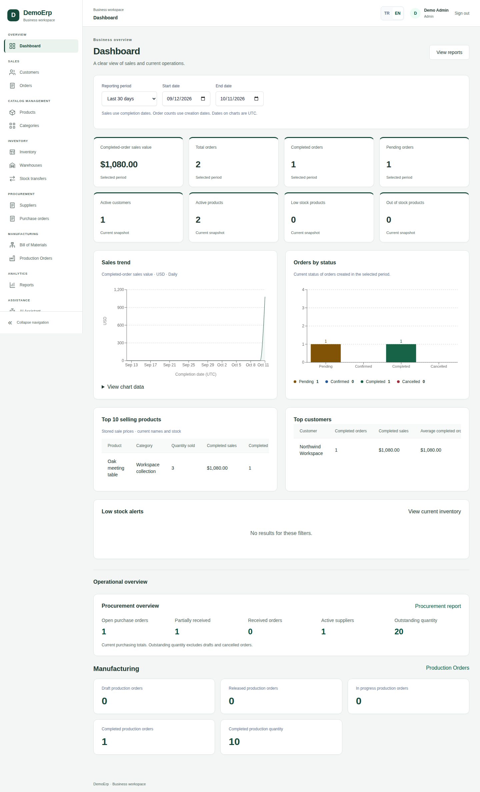

# DemoErp

DemoErp; ASP.NET Core, React ve PostgreSQL ile geliştirilmiş, satış, satın alma, çoklu depo ve üretim süreçlerini birbirine bağlayan bir ERP portföy uygulamasıdır.

[English README](README.md) · [Mimari](docs/ARCHITECTURE.md) · [Testler](docs/TESTING.md) · [Dağıtım](docs/DEPLOYMENT.md) · [Doğrulama sonuçları](VERIFICATION.md)



[Yeni bilgisayarda adım adım kurulum](docs/INSTALLATION.tr.md)

## Demo hesapları

Hazırlanmış demo veritabanını incelemek için aşağıdaki hesapları kullanabilirsiniz:

| Kullanıcı | E-posta | Uygulama rolü |
| --- | --- | --- |
| Yönetici | `admin@example.com` | `Admin` |
| Görüntüleyici | `viewer@example.com` | `Viewer` |
| Operasyon sorumlusu | `operation@example.com` | `Manager` |

**Üç hesabın ortak şifresi:** `qwe123456789`

Bu herkese açık demo giriş bilgileri yalnızca sentetik veriler içindir. Yeni kurulumlarda bu hesaplar otomatik oluşturulmaz; Admin kurulumu ve kullanıcı yönetimi üzerinden oluşturulmalıdır. Bu bilgileri üretim ortamında kullanmayın.

## Kapsam

- Ürün, kategori, müşteri ve sunucuda fiyatlandırılan satış siparişleri.
- Depo bazında stok, değiştirilemez hareket geçmişi ve atomik depo transferleri.
- Tedarikçiler, satın alma siparişleri, kısmi/tam ve idempotent mal kabulü.
- Sürümlü tek seviyeli reçeteler, malzeme anlık görüntüleri, üretim serbest bırakma/başlatma/tamamlama; atomik tüketim ve mamul girişi.
- Gerçek API verileriyle dashboard, raporlar ve sınırlı CSV dışa aktarma.
- Admin/Manager/Viewer yetkileri, kullanıcı yönetimi, son Admin koruması ve işlemle birlikte kaydedilen denetim kayıtları.
- Varsayılan olarak kapalı, salt okunur isteğe bağlı AI iş asistanı. Uygulama ve testler AI anahtarı olmadan çalışır.

## Çalıştırma

Linux konteynerleriyle çalışan Docker Desktop gereklidir:

```sh
docker compose up --build
```

[Arayüz](http://localhost:3000) · [Development Swagger](http://localhost:5080/swagger) · [Hazır olma kontrolü](http://localhost:5080/health/ready)

Kayıt olan kullanıcı Viewer rolündedir. İlk Admin hesabını, Git tarafından yok sayılan `.env` içindeki isteğe bağlı `BOOTSTRAP_ADMIN_*` ayarlarıyla oluşturun; ardından bootstrap'ı kapatıp parolayı kaldırın. [Güvenli kurulum](docs/SECURITY.md).

PostgreSQL dışarıya açılmaz; veriler kalıcı isimli hacimde tutulur. Saklamak istediğiniz verilerde `docker compose down -v` kullanmayın. `.env.example` geliştirme örnekleri üretime uygun değildir.

## Kalite

```sh
dotnet build Catalog.slnx
dotnet test Catalog.slnx
cd frontend
npm ci
npm run lint
npm run typecheck
npm test
npm run build
```

Backend testleri gerçek PostgreSQL Testcontainers kullanır. Tarayıcı testleri yazma işlemi yaptığından ayrı Compose projesinde ve sentetik verilerle çalıştırılmalıdır. [Test kılavuzu](docs/TESTING.md).

Phase 10; gruplu kenar menüsü, mobil menü, merkezi yeşil tasarım sistemi, tutarlı durum etiketleri, yükleme iskeletleri, işlem sonrası başarı mesajları ve klavye odağı iyileştirmeleri getirir. 1440/1024/768/390 genişliklerindeki gerçek görüntüler ve axe kontrolleri doğrulama belgesinde açıklanır; resmi WCAG uygunluğu iddia edilmez.

Üretim önizlemesinin stok sorgusu ayrı sentetik veri kümesinde 5.000 yerine beş satır okur: sıcak medyan 0,421 → 0,031 ms. Bu değer HTTP gecikmesi veya üretim SLA'sı değildir. [SQL planları](docs/PERFORMANCE.md).

GitHub Actions; backend, frontend, bağımlılık denetimi ve ayrı smoke/erişilebilirlik işlerini tanımlar. Yayımlanan sürümün uzak CI sonucu GitHub Actions üzerinden kontrol edilmelidir. Herhangi bir halka açık üretim dağıtımı iddia edilmez.

[Mülakat için 15 soru ve yanıt](docs/INTERVIEW_PREPARATION.md) · [Üretim tasarımı](docs/MANUFACTURING.md) · [Kullanım koşulları](NOTICE.md)
