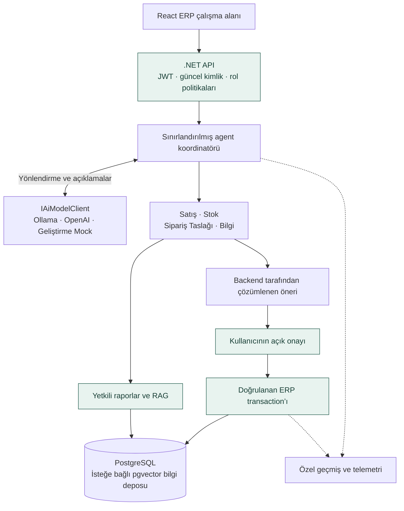

# DemoERP — AI-Native Enterprise Resource Planning

**İş kurallarıyla korunan ERP süreçleri. Yetkili AI araçları. İnsan onaylı işlemler.**

DemoERP; satış, satın alma, depo stoku ve üretimi tek bir React çalışma alanında birleştirir. **Agent’a stokları sorgulatabilir, sipariş taslağı hazırlatabilir ve tam içeriğini inceledikten sonra açık onayınızla kaydedebilirsiniz.** Bu kişisel mühendislik projesi, uzmanlaşmış AI agent’larının gerçek iş verileriyle nasıl çalışabileceğini inceler. Hesaplamaları, yetkileri ve veritabanı işlemlerini .NET backend yönetir; isteğe bağlı yerel veya harici modeller istekleri yönlendirir ve doğrulanmış sonuçları açıklar.

      [](.github/workflows/ci.yml)

[English](README.md) · [Başlangıç](docs/GETTING_STARTED.md) · [Dokümantasyon](docs/README.md) · [Doğrulanmış özellikler](docs/FEATURE_STATUS.md)

## Uygulamadan görüntüler

**Agent Kontrol Merkezi — uzman agent seçin, doğal dille sipariş taslağı hazırlayın.**


**Tek prompt → üç doğrulanmış ürün → incelenebilir sipariş taslağı ve Siparişi kaydet.**


Gerçek yerel çalıştırmada sentetik **[DEMO] Atlas Otomasyon** müşterisine **2 kontrol kartı, 3 güç adaptörü ve 5 bağlantı kablosu** için taslak hazırlandı. 164 USD toplam ERP fiyatlarından hesaplandı. Görselde teklif onay bekliyor; inceleme kutusu işaretlenmedi ve **sipariş kaydedilmedi**.

**Yapay Zekâ Asistanı — “son 30 günün satışlarına göre önerilen stok ve ikmal miktarını göster”.**


İstek, kimliği doğrulanmış DemoERP üzerinden gerçek `qwen3:8b` modeliyle çalıştırıldı. Bu görüntüde son model açıklaması doğrulamadan geçmediği için sonuç açıkça **otomatik şablon** olarak etiketleniyor. Stok hedeflerini ve ikmal miktarlarını backend, mevcut minimum stok / 14 günlük geçmiş talep politikasıyla hesaplıyor. Bu rapor tamamlanmış satışı olmayan ürünleri dışarıda bırakır; ayrı Stok Agent’ı satış geçmişi olmayan düşük stoklu ürünleri de inceler.

22 Ekim tarihli görüntüler gerçek uygulamadan ve sentetik kayıtlardan alındı. [Tam galeri, yönetici paneli ve görsel kaynakları](docs/assets/screenshots/README.md).

## Agent tabanlı AI mimarisi



Agent’lar, ortak model soyutlamasını kullanan ve sınırları belirlenmiş C# servisleridir. Sınırsız yetkili, bağımsız model süreçleri değildir. Dokuz sabit salt okunur raporlama aracının yanında tipli agent sorguları ve belge erişimi bulunur. **Model SQL veya kabuk komutu çalıştıramaz; kendi önerdiği işleme onay veremez.** [Ayrıntılı mimari ve yedi Mermaid diyagramı](docs/architecture/README.md).

## Gerçek bir çoklu agent ERP akışı

> “Son üç ayın satışlarını analiz et ve yeniden tedarik için stokları incele.”

1. Kimliği doğrulanan istek, sabit **Satış → Stok → Özet** işbirliği akışına yönlendirilir.
2. Satış agent’ı yetkili raporlama araçlarını kullanır. Stok agent’ı güncel bakiyeleri ve tamamlanmış satışlardan gelen talebi okur. Miktar ve tutarları backend hesaplar.
3. Korunan işlemlerden önce kullanıcının etkinliği, rolü ve güvenlik sürümü yeniden kontrol edilir. Araç adları, parametreler ve sonuç boyutları sınırlandırılır.
4. Model, doğrulanmış verileri açıklar. Arayüz gerçek verileri model yorumundan ayırır; deterministik yedek rapor kullanıldığında bunu açıkça belirtir.
5. İkmal önerisi sipariş oluşturmaz. Ayrı bir sipariş taslağı veya desteklenen satın alma isteği, gerçek referanslar ve güncel fiyatlarla özel bir işlem önerisi hazırlayabilir.
6. Yetkili kullanıcı önerinin tam içeriğini inceler. Mevcut iş servisi ancak açık onaydan sonra yeniden doğrulama yaparak kaydeder; tekrar gönderimler idempotency ile korunur ve gerçek kayıt sonucu gösterilir.

Yerel işbirliği ve taslak çalıştırmalarının kanıtları [doğrulama kaydında](VERIFICATION.md) bulunur. Bu işbirliği örneği salt okunurdur; otomatik satın alma, talep tahmini veya kendiliğinden sipariş onayı anlamına gelmez. [Agent sorumlulukları ve onay yaşam döngüsü](docs/AI_AGENTS.md).

## Agent ile stok kontrolü ve onaylı sipariş kaydı

### Doğal dille gerçek stokları kontrol edin

> “Hangi ürünlerde stok az? Son satışları da inceleyip ikmal öner.”

Stok Agent’ı gerçek ERP bakiyelerini, asgari stok seviyelerini ve tamamlanmış satışlardan gelen talebi okur. Güncel stok, satılan miktar ve backend tarafından hesaplanan ikmal önerilerini kaynak raporlarla birlikte gösterir. Sıfır stok ve talep verisinin yetersiz olduğu durumlar açıkça belirtilir; model stok uydurmaz veya stok hareketi kaydetmez.


*Kaydedilmiş yerel Satış + Stok çalıştırmasının ayrıntısıdır. Rakamlar tarihli sentetik örnek verilerdir; canlı stok göstergesi değildir.*

### Sipariş hazırlatın, inceleyin ve kaydedin

> “[Müşteri adı] için [ürün adı] ürününden 10 adet sipariş taslağı hazırla.”

Sipariş Taslağı Agent’ı gerçek müşteri, ürün ve depoyu çözümler; ERP’deki güncel fiyatlarla tam bir işlem önerisi hazırlar. **Yönetici veya operasyon sorumlusu müşteriyi, ürünleri, miktarları ve fiyatları inceler; onay kutusunu işaretleyip “Siparişi kaydet” düğmesine basar.** Backend yetkileri ve iş verilerini yeniden doğrular, mükerrer kaydı önler; gerçek sipariş numarasını ve **Siparişi görüntüle** bağlantısını döndürür.

Sonuç, normal ERP sipariş ekranında bir **Beklemede satış siparişidir**. Kaydetme işlemi siparişi onaylamaz, stok ayırmaz veya stok düşmez; bunlar ayrı yetkili iş adımlarıdır. Satın alma işbirliği de desteklenen satın alma önerisini ancak açık incelemeden sonra **Taslak** olarak kaydeder.


*22 Ekim tarihli gerçek teklif onay bekliyor. Siparişi kaydet düğmesi, kullanıcı inceleme kutusunu açıkça işaretleyene kadar pasif kalır. Görsel hazırlanırken sipariş kaydedilmedi.*

**Akış:** doğal dilde istek → backend tarafından çözümlenen taslak → tam içeriğin insan tarafından incelenmesi → **Siparişi kaydet** → doğrulanan gerçek kayıt. [Agent rehberi](docs/AI_AGENTS.md) · [Onay ve idempotency tasarımı](docs/SECURE_WORKFLOWS.md) · [Test kanıtları](VERIFICATION.md).

## Temel özellikler

| Alan | Uygulanan özellikler |
| --- | --- |
| **ERP çekirdeği** | Ürün, kategori, müşteri, sunucuda fiyatlanan satış siparişleri, depo bakiyeleri ve transferler; tedarikçiler, satın alma siparişleri ve mal kabul; sürümlü tek seviyeli ürün reçeteleri ve üretim emirleri; gösterge paneli ve sınırlı CSV raporları |
| **AI desteği** | Doğal dille stok kontrolü ve ikmal analizi; agent’ın hazırladığı satış/satın alma önerilerini açık **Siparişi kaydet** onayıyla gerçek kayda dönüştürme; salt okunur Asistan, Agent Kontrol Merkezi, Bilgi Agent’ı, sabit araç çağrıları ve sınırlandırılmış sıralı koordinasyon |
| **Kurumsal bilgi** | PDF/DOCX/TXT/Markdown yükleme, sürümlü indeksleme, yerel embedding, yetkili pgvector ve tam metin araması; kaynağı doğrulanan birebir alıntılar |
| **Otomasyon** | Deterministik proaktif izleme, yinelenmeyen özel uyarılar, görsel döngüsüz iş akışları, haftalık UTC zamanlaması, değişmez yayın sürümleri, güvenli sentetik simülasyon ve çalışma geçmişi |
| **Mühendislik kalitesi** | JWT ve güncel kullanıcı kontrolleri; Yönetici/Operasyon Sorumlusu/Görüntüleyici yetkileri; transaction ile tutarlı denetim; PostgreSQL eşzamanlılık testleri; bileşen/tarayıcı/erişilebilirlik testleri; deterministik AI değerlendirmeleri ve özel çalışma izleri |

Bilgi, izleme, kalite kaydı ve iş akışı çalıştırma ayrı ayrı etkinleştirilir. **Ollama olmadan ERP ve deterministik iş akışı adımları kullanılabilir.** OpenAI bağlantı katmanı uygulanmış ve taklit HTTP ile test edilmiştir; başarılı canlı OpenAI yanıtı doğrulanmamıştır. [Özellik bazında kanıtlar ve sınırlar](docs/FEATURE_STATUS.md).

### Görsel otomasyon


Dört başlangıç şablonu; kritik stok, gerçek teslim tarihi geçmiş satın alma siparişleri, haftalık satış özeti ve stok politikası sorgusunu kapsar. AI yalnızca etkin olmayan bir başlangıç taslağı önerebilir. Yayınlama ve etkinleştirme ayrı kullanıcı işlemleridir; kritik ERP kayıtları ayrıca insan onayı ister. [Tasarım, kurtarma, güvenlik ve sınırlar](docs/VISUAL_WORKFLOWS.md).

## Yerel AI ve sağlayıcı seçimi

`IAiModelClient`; **OpenAI**, **Ollama** ve **Geliştirme Mock** sağlayıcılarını korur. Yerelde doğrulanan sohbet modeli `qwen3:8b`, bilgi indeksleme modeli `nomic-embed-text`tir. Yerel çıkarım `127.0.0.1:11434` üzerinden çalışır; ücretli çıkarım API’si çağırmaz. Mevcut kodda Ollama ve Mock yalnızca Development ortamında kullanılabilir.

Yerel model `OLLAMA_MODEL` ile seçilir. Farklı bir modelin araç çağrısı ve yapılandırılmış çıktı sözleşmeleri ayrıca doğrulanmalıdır; modelin listelenmesi veya yüklenmesi uyumluluk kanıtı değildir. İncelenen Windows bilgisayarda 32 GB RAM ve 8 GB VRAM’li RTX 4060 bulunur. Bu, test edilmiş bir ortamdır; asgari donanım veya hız garantisi değildir. Bağlam boyutu, modelin bellekte tutulması ve embedding işlemleri gecikmeyi etkiler. [Yerel Ollama kurulumu](docs/LOCAL_OLLAMA.md) · [OpenAI entegrasyonu](docs/OPENAI_INTEGRATION.md).

## Başlangıç

Git ve Linux container kullanan Docker Desktop kurulu olmalıdır. İncelenmiş kaynak sürümünde:

```sh
git clone https://github.com/SCanerG/DemoErp.git
cd DemoErp
docker compose up --build
```

[Uygulamayı](http://localhost:3000) veya [Development Swagger’ı](http://localhost:5080/swagger) açın. PostgreSQL yalnızca Compose ağı içindedir; AI başlangıçta kapalıdır. Kayıt olan kullanıcı Görüntüleyici rolü alır. İlk Yönetici oluşturma işlemi açıkça yapılandırılır ve varsayılan olarak kapalıdır.

Klonlama, ayarlar, veritabanı, yerel API ve frontend adımları için [Başlangıç rehberini](docs/GETTING_STARTED.md) kullanın. Rehber .NET 10/Node 22 gereksinimlerini, güvenli ortam ayarlarını, başlangıçta uygulanan migration’ları ve PowerShell komutlarını içerir. Ollama, pgvector ve tasarımcı için [ayrı veritabanıyla gelişmiş kurulum](docs/VISUAL_WORKFLOWS.md#windows-local-setup) bulunur. Yayımlanan sürümler yerel kaynaklardan geride olabilir; [depo incelemesi](docs/REPOSITORY_REVIEW.md) bu ayrımı kaydeder.

### Hazırlanmış demo hesapları

| Rol | E-posta |
| --- | --- |
| Yönetici | `admin@example.com` |
| Görüntüleyici | `viewer@example.com` |
| Operasyon sorumlusu | `operation@example.com` |

Sentetik demo için ortak şifre: **`qwe123456789`**. Temiz kurulum bu hesapları otomatik oluşturmaz; ilk Yönetici ve kullanıcı yönetimiyle hazırlayın. Bu bilgiler yalnızca sentetik gösterim içindir.

## Test ve kalite

```sh
dotnet test backend/Demo.Api.Tests
node --test scripts/tests/*.test.mjs
cd frontend
npm ci
npm run lint
npm run typecheck
npm test
npm run build
```

Backend testleri gerçek PostgreSQL Testcontainers veritabanlarını ve mevcut migration’ları kullanır. Tarayıcı kabul testleri ayrı, gözden çıkarılabilir bir ortam ve açıkça verilen sentetik Yönetici bilgileri gerektirir. Normal CI için ücretli AI erişimi veya GPU gerekmez. Canlı testler ayrıca etkinleştirilir; atlanan test başarılı canlı doğrulama sayılmaz.

**22 Ekim 2026 ölçümü:** Üç canlı yerel model testi etkin durumdayken 714 backend testi geçti. Frontend’de 22 birim testi, scriptlerde 32 test geçti. Geniş tarayıcı çalıştırmasında 119 test geçti; dört isteğe bağlı/ortama bağlı test atlandı. Tasarımcının canlı kabulü ve model kapalı tekrarı ayrıca geçti. Bunlar yerel çalışma sonuçlarıdır; güncel GitHub Actions çalışmasının başarılı olduğu iddia edilmez. [Komutlar ve test sınırları](docs/TESTING.md) · [Tarihli kanıtlar ve sınırlamalar](VERIFICATION.md).

Depodaki [GitHub Actions yapılandırması](.github/workflows/ci.yml), API/frontend derleme ve testlerini, deterministik AI değerlendirmesini, ayrı ortamda smoke ve erişilebilirlik kontrollerini içerir. **Otomatik dağıtım adımı yoktur.**

## Teknik dokümantasyon

| Başlangıç noktası | İçerik |
| --- | --- |
| [Dokümantasyon dizini](docs/README.md) | Güncel rehberler ve korunan faz geçmişi |
| [Mimari](docs/ARCHITECTURE.md) | Sistem, backend katmanları, sağlayıcılar, agent koordinasyonu, onay, RAG ve iş akışı diyagramları |
| [AI agent’ları](docs/AI_AGENTS.md) | Sorumluluklar, sabit sorgu araçları, yönlendirme ve insan kontrolü |
| [Güvenlik](docs/SECURITY.md) | Güncel kullanıcı yetkileri, denetim, onay ve belge erişimi |
| [Veritabanı](docs/DATABASE.md) · [API](docs/API.md) | İş verileri, migration’lar, transaction’lar ve endpoint sözleşmeleri |
| [Test](docs/TESTING.md) · [Geliştirme](docs/DEVELOPMENT.md) | Tekrarlanabilir kontroller ve ayrı test ortamları |
| [Yol haritası](docs/ROADMAP.md) · [Özellik durumu](docs/FEATURE_STATUS.md) | Doğrulanan uygulama, eksik doğrulamalar ve planlar |
| [Dağıtım](docs/DEPLOYMENT.md) | Yerel topoloji ve gerçek barındırma için kalan gereksinimler |

## Kapsam ve yol haritası

İşlem güvenliği olan ERP çekirdeği, yerel AI, RAG, izleme, değerlendirme ve görsel iş akışları uygulanmıştır. Sonraki öncelikler; çalışma geçmişinin saklama politikası, belirsiz kesintiler için operatör araçları, transaction tabanlı olay teslimi ve saat dilimine duyarlı zamanlamadır.

Bu kişisel bir mühendislik gösterimidir; üretim ortamı sertifikası değildir. Çok kiracılı yapı, tam muhasebe/vergi, sınırsız otonom agent’lar, çok seviyeli reçete açılımı ve yüksek kapasiteli dağıtık iş akışı yürütmesi uygulanmamıştır. Otomasyon bilinçli olarak sınırlandırılır; ikmal hesabı bir stok politikasıdır, tahmin modeli değildir. [Yol haritası ve açık durumlar](docs/ROADMAP.md).

## Geliştirici ve kullanım koşulları

**Sabri Caner Genco** · [Portföy](https://scgenco.com) · [GitHub](https://github.com/SCanerG)

Mevcut [kaynak kullanım bildirimi](NOTICE.md) korunmuştur; açık kaynak lisansı verilmez. Yeniden kullanım veya ticari kullanım için geliştiriciyle iletişime geçilmelidir. Dış katkılar için belirlenmiş bir politika bulunmaz; açık bir katkı programı olduğu ileri sürülmez.
