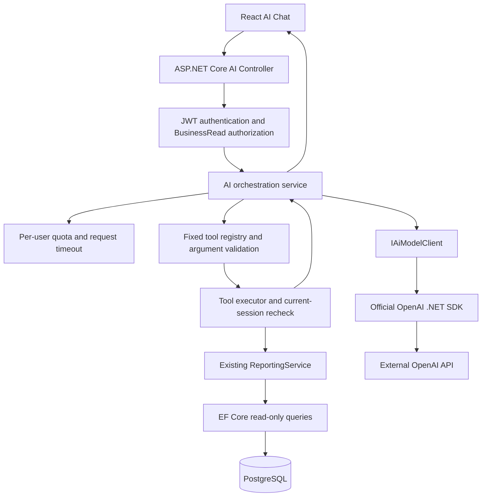

> Current entry points: [agent responsibilities](AI_AGENTS.md), [system/provider diagrams](architecture/SYSTEM.md), [human-approved operations](architecture/AGENT_WORKFLOWS.md), [knowledge/workflow pipelines](architecture/KNOWLEDGE_AUTOMATION.md). Phase 11.8 includes local RAG, durable proposals and visual workflows. Earlier phase descriptions below retain their original scope and do not mean those later capabilities are absent today.

> Phase 11.3: [Intelligent agents and Agent Control Center](INTELLIGENT_AGENTS.md) adds typed orchestration, read-only analysis, resolved non-submitted drafts and private step metadata.

> Phase 11.2 adds the optional Development-only [local Ollama provider](OLLAMA_INTEGRATION.md), Inventory Agent and review-only order drafts. Existing OpenAI behavior remains available.

> Phase 11.1: [OpenAI Responses integration](OPENAI_INTEGRATION.md) documents the current provider transport, canonical environment variables, error handling, execution correlation and opt-in live smoke. Earlier foundation design below is retained as historical context where superseded.

# AI Business Assistant

[README](../README.md) · [Security and privacy](AI_SECURITY.md) · [Reporting definitions](REPORTING.md) · [Verification](../VERIFICATION.md)

Phase 11 extends the existing Phase 6 assistant with provider-neutral validation,
opt-in persistent history and AI-only execution metadata. See [AI foundation](AI_FOUNDATION.md)
for the current architecture, API, retention and configuration. No vector database or autonomous write agent is implemented.
All tools are read-only. Viewer, Manager and Admin share BusinessRead permission.



## Request lifecycle

`GET /api/ai/status` requires BusinessRead and returns only `{ enabled, configured,
available }` plus provider, isMock and retentionDays. Available means locally configured, not confirmed provider health.
It performs no provider request and does not expose endpoint, key or internal errors.

`POST /api/ai/chat` accepts exactly the supported business input:

```json
{"message":"Summarize sales for the last 30 days.","language":"en"}
```

The server accepts 1–2,000 characters and `en` or `tr`, checks optional feature
configuration, rechecks the active authenticated identity, then consumes quota.
The model receives server-owned instructions, the question and registered schemas.
No client system messages, history, user IDs, role overrides or model selection
are forwarded. Requests remain independent by default; opt-in history is loaded
by the server from the current user's unexpired conversation.

Tool calls execute sequentially because EF Core's scoped DbContext is not safe for
parallel queries. Arguments must match the complete expected property set, with
no unknown or duplicate fields. IDs and call counts are bounded. Before each tool,
the executor checks the database user's active flag, SecurityVersion and role
against JWT claims and runs the tool's explicit authorization policy again. A
final recheck discards the answer if the session changed while the provider worked.
Revocation cannot recall data already sent to a provider during an earlier valid call.

The executor builds typed, minimized data results and server-generated source
records. Only actual successfully executed tools contribute sources. The model
cannot attach a citation or choose a report URL. Tool payloads contain UTC generation
time, range if applicable, data basis, USD currency and a `hasData` indication.
The API returns `{ answer, language, generatedAtUtc, sources, requestId }`; sources
contain type, fixed name/label, validated parameters and a fixed application report
path. Links open the report; users should apply the displayed source period there.

The provider returns strict JSON with answer and language. The server validates the
language tag, nonempty text and length. This is not a linguistic proof; live model
language quality still requires evaluation. With no tools, the server replaces the
answer with a deterministic read-only/no-data explanation. When all retrieved tools
have no matching records, it replaces the answer with a deterministic empty-data
response. Nonempty-data answers can still misinterpret facts; sources remain visible.

## Registered tools

Every tool explicitly requires **BusinessRead**. There are no mutation or Admin-only
tools exposed to the model.

| Fixed tool name | Parameters | Data and reporting reuse |
| --- | --- | --- |
| `get_sales_summary` | startDate, endDate, comparePrevious | CompletedAt sales/count/average; optional equally long preceding period, backend-calculated difference and percent; legacy exclusion count |
| `get_top_products` | startDate, endDate, limit | Existing Products report, completed sales ranking, stored item prices, current stock |
| `get_order_status_summary` | startDate, endDate | Existing Statuses report: orders created in the period, with current status |
| `get_low_stock_products` | limit | Existing Inventory report: positive quantity at or below minimum |
| `get_out_of_stock_products` | limit | Existing Inventory report: zero quantity |
| `get_top_customers` | startDate, endDate, limit | Existing Customers report, only customers with completed sales; pseudonymous identifiers, no names or contacts |
| `get_inventory_overview` | none | Small SQL aggregate of all current inventory records; in-stock includes low-stock |
| `get_pending_orders` | limit | Current all-time Pending count and oldest bounded orders; no customer fields |
| `get_stock_risk` | startDate, endDate, limit | Reuses completed-line query; SQL demand aggregation and current stock coverage, least days first |

SalesMetrics and CompletedLines are shared with existing reporting paths rather
than reimplemented in the controller. Added current-pending/overview/coverage
queries supply only capabilities missing from Phase 5. Ranking limits are 1–10;
the server default is 10, and strict schemas require an explicit limit in calls.
Date-bearing tools require both dates or two nulls. Nulls mean the last 30 rolling
days. Explicit timestamps need a timezone; the server normalizes UTC. Periods are
half-open, positive and at most 366 days; comparison periods have the same maximum.
Explicit start years must be at least 2000 and end dates at most 366 days ahead.
Stock coverage requires at least one day and excludes products with zero completed
demand. Coverage = current quantity × period days / completed quantity, calculated
by the backend, assuming constant demand. It is an estimate, not a replenishment
forecast; returns, seasonality and incoming stock are not modeled.

Completed orders without CompletedAt remain excluded from historical sales; no
legacy dates are fabricated. Pending orders are current across all creation dates.
Status distribution uses OrderDate, while completed-this-month totals use sales
summary with the month's completion window. Product names may be current names;
historical price snapshots remain stored order/item prices, not current prices.

## Provider configuration

The official **OpenAI .NET SDK 2.14.0** now uses Responses API function calling,
strict `text.format` answer JSON and `store=false`. The existing default
`gpt-4.1-mini-2025-04-14` remains configurable; actual account/model capability and
quality need deployment verification. The adapter handles refusals, incomplete
responses, stateless encrypted reasoning continuation and safe failure categories.
The SDK marks its Responses surface OPENAI001; the opt-in is confined to the adapter.
See [OpenAI integration](OPENAI_INTEGRATION.md) for the exact wire flow, configuration,
known limitations and opt-in live acceptance. No live provider success is assumed.

Copy `.env.example` to ignored `.env`; keep AI disabled until privacy/cost review.
For an authorized deployment, set `AI_ENABLED=true` and provide `OPENAI_API_KEY` through
a backend secret mechanism, then recreate the backend. Do not use a VITE variable.
No real key is committed and no billable live calls run in CI.

| Compose environment / backend option under AiAssistant | Default / allowed |
| --- | --- |
| `AI_ENABLED` / Enabled | false |
| `AI_PROVIDER` / Provider | OpenAI, or Mock in Development only |
| `OPENAI_MODEL`, fallback `AI_MODEL` / Model | gpt-4.1-mini-2025-04-14; server controlled |
| `AI_ENDPOINT` / Endpoint | https://api.openai.com/v1 only; arbitrary hosts rejected |
| `OPENAI_API_KEY`, fallback `AI_API_KEY` / ApiKey | empty; backend only |
| `AI_TIMEOUT_SECONDS` / TimeoutSeconds | 30; 1–120 |
| `AI_MAX_OUTPUT_TOKENS` / MaxOutputTokens | 1000; 100–2000 per provider response |
| `AI_MAX_TOOL_CALLS` / MaxToolCalls | 5; 1–5 total per request |
| `AI_REQUESTS_PER_MINUTE` / RequestsPerMinute | 10; 1–60 |
| `AI_REQUESTS_PER_DAY` / RequestsPerDay | 100; 1–1000 |

Missing/invalid AI configuration disables availability without failing unrelated
ERP startup. Provider and endpoint are checked before use. Azure OpenAI is not
implemented: another IAiModelClient adapter and deployment-specific endpoint and
credential validation can be added later without changing the controller/tools.

## Limits, errors and observability

At most two tool rounds and one final answer round, five tool calls total, ten rows
per ranking/list, 20,000 serialized characters per tool payload, 2,000 input characters,
8,000 answer characters and a 16 KB HTTP body. SDK retries are disabled; the runtime retries transient provider failures at most
AI_MAX_RETRIES times within the overall deadline. Linked
cancellation bounds the entire request, provider calls and EF queries. The final
round exposes no tools. Conversation UI keeps at most 20 exchanges in component
memory; refresh/navigation resets it. Cancel/unmount aborts requests. React renders
plain text, never model HTML or Markdown links. TanStack mutations neither retry nor
invalidate business reports for this read-only request.

Quotas are per authenticated user, per UTC minute and UTC calendar day, including
attempts that subsequently fail. Disabled/configuration-invalid requests do not
consume quota. A bounded 10,000-entry expiring memory cache stores counters only;
when capacity cannot admit another user it rejects the request. Quotas reset on
process restart and are per API instance. Multi-instance production deployment
needs a shared enforcement mechanism or gateway; this demo does not add Redis.

| Problem code | HTTP |
| --- | --- |
| aiInvalidRequest, aiInvalidArguments, aiUnknownTool, aiToolLimit | 400 |
| aiUnauthorized / aiForbidden | 401 / 403 |
| aiRateLimit, aiProviderRateLimit | 429 |
| aiInvalidResponse | 502 |
| aiDisabled, aiNotConfigured, aiProviderUnavailable, aiToolFailure | 503 |
| aiTimeout / aiCancelled | 504 / 499 |

Anonymous/revoked JWTs can be rejected by existing middleware before these codes.
An HTTP disconnect normally prevents delivery of the cancellation response.
Provider exceptions are replaced with safe BusinessExceptions without inner
exceptions before existing error middleware can log them. Logs contain request ID,
user ID, UTC timestamp, provider/model, executed tool names, latency, outcome and
token usage when supplied (zero when not reported). They contain no prompts,
conversations or raw tool payloads and never create business mutation audit rows.

Cost is bounded, not free: as many as three provider requests include instructions,
schemas, question and preceding tool results. MaxOutputTokens applies per response,
not a combined token budget. Input size is bounded by the question and bounded tool
results; provider tokenization varies. Use deployment budgets, provider rate/spend
controls and monitoring in addition to local quotas. No price estimate is hardcoded.

## Testing and future extension

Backend tests use fake IAiModelClient orchestration plus actual ASP.NET endpoints,
JWT policies and disposable PostgreSQL. SDK adapter tests intercept HttpClient
transport and exercise real SDK serialization, correlation and safe failure mapping
without networking. Browser tests use a real default-disabled Docker endpoint and
explicitly mocked enabled chat/status responses for UI states. Mocked answers are
not evidence of live-provider accuracy. See VERIFICATION for actual execution results.

Future RAG can add a separately authorized, bounded document-search tool to the
registry/executor. Document access, classification, ingestion, citations and provider
processing must be designed and tested separately. No uploads, embeddings, PDF
ingestion, document tools, vector search or pgvector exist in Phase 6.
