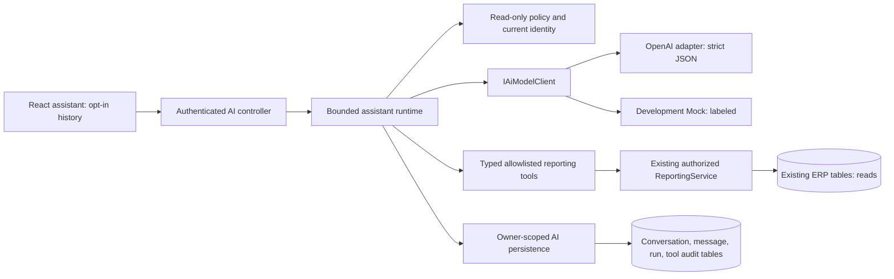

> Phase 11.1: [OpenAI Responses integration](OPENAI_INTEGRATION.md) documents the current provider transport, canonical environment variables, error handling, execution correlation and opt-in live smoke. Earlier foundation design below is retained as historical context where superseded.

# Phase 11: AI foundation

## Repository audit (before implementation)

The application is a layered ASP.NET Core 10 monolith with React/TypeScript, EF Core and PostgreSQL 17. Controllers delegate to scoped services. Catalog, sales, procurement, warehouse transfers and manufacturing share transactions, relational constraints and immutable movement/audit history. Nine existing migrations must remain unchanged. JWT validation checks the current user's active state, role and SecurityVersion on every protected request. BusinessRead includes Viewer, Manager and Admin; user administration is Admin-only.

The existing optional AI subsystem already provides an IAiModelClient abstraction, official OpenAI .NET adapter, nine fixed read-only reporting tools, strict bounded arguments, per-user in-memory quotas, a two-round/five-call loop, current-identity checks and source links generated by the server. It has no persistent conversation context, runtime strict final JSON validation, retry abstraction, per-tool durable metadata or development provider. Existing React UI is translated, accessible and uses the shared design system; its history is page-local. Tests include PostgreSQL Testcontainers, mocked AI HTTP transport, Playwright and component checks. Docker builds three services; CI builds/tests backend and frontend and runs isolated smoke/axe with no paid AI calls.

Risks: model statements remain untrusted; valid JSON does not establish factual accuracy. Prompt injection can influence prose but must not expand tool authority. Report rows may contain attacker-controlled product names. General logs must never contain prompts, tokens, tool arguments, provider error bodies or secrets. Persisted conversations introduce sensitive data, owner-isolation, expiry and concurrency requirements. In-memory quotas are per process. Existing business services are reused; no model-generated SQL, shell, arbitrary URL retrieval or business mutation is acceptable.

## Implementation boundaries and decisions

Keep IAiModelClient provider-independent and preserve the existing /api/ai/chat contract, adding optional server-owned conversation references. History is opt-in, never client-supplied role transcripts. Keep old stateless requests compatible. Add four AI-only tables: conversations, validated successful messages, execution metadata and per-tool audit metadata. Business tables and old migrations remain unchanged. Store no chain-of-thought, raw model responses, tool arguments/results or provider errors. Default content/metadata retention is seven days; expired content is inaccessible immediately and a background sweeper purges it. Backups need their own retention policy.

Use OpenAI (existing pinned model) and a clearly marked Development-only Mock provider. Strict final-answer parsing is independent of SDK schema hints. Retry only transient provider failures, bounded by the overall request deadline; tools are never retried by the model adapter. Conversation revisions prevent concurrent appends across processes. Only successful validated question/answer pairs enter history; prior answers are untrusted historical context and tools must establish current business facts again.

An execution policy rejects all non-read-only tools, including hypothetical human-approved writes. Human approval, RAG and multi-agent execution are extension boundaries, not enabled capabilities. There is no vector ingestion, autonomous scheduling or business write tool in Phase 11.



## Components and data flow

- `AiAssistantService`: feature/input checks, identity and quota checks, optional owner-scoped context, one global deadline, at most two tool rounds/five tool calls, final response validation and final identity check.
- `IAiModelClient`: provider-neutral turns, messages and tool definitions. `OpenAiModelClient` uses the existing OpenAI 2.14 SDK and pinned model. The SDK itself has zero retries. `AiProviderRunner` retries only safe transient rate-limit/unavailable codes, 0–2 times (default one), with cancellable backoff and no tool replay. Provider requests may still incur usage on ambiguous failures; this is not an exactly-once billing guarantee.
- `AiOutputValidator`: final JSON must contain exactly `answer` and `language`, with no extra/duplicate fields, correct types/language and bounded lengths. Adapter and runtime both validate. Tool results must have the registered DTO type, matching source, bounded rows/size and no recognized secret pattern. Strict model schemas are defense in depth, not authorization.
- `AiToolRegistry` and `AiToolExecutor`: nine existing typed reporting tools, strict arguments, immutable registry exposure, no dynamic SQL/shell/URL tools, fresh current-user/policy check per call. `AiExecutionPolicy` rejects any tool marked RequiresHumanApproval; approval is deliberately not an execution bypass.
- `AiConversationStore`: optional private history, at most 20 active conversations per user and ten successful turns per conversation. A per-owner PostgreSQL advisory transaction lock bounds concurrent creation. Revision comparison inside a transaction prevents conflicting appends. History retrieval is limited and includes server-generated source links; clients cannot upload system/assistant/tool messages.
- `AiExecutionJournal`: required durable run and tool-start records before provider/tool access. Completion metadata includes safe outcome, provider-call count, latency and provider-reported total tokens. Cost/currency remain null because no verified model price snapshot exists. Raw errors and unknown tool names are never recorded; denied names are `unregistered`. Tool completion persistence fails closed. Final run completion is best effort with a safe warning on database outage; crashes can leave `running`/`requested` records.
- `AiRetentionWorker`: startup/hourly deletion of expired runs (cascading tool records) and conversations (cascading messages). Reads/continuations reject expired conversations even before cleanup. Expiry is measured from creation, not extended by activity. Deleting a conversation immediately removes messages and nulls the conversation reference in metadata; non-content execution metadata remains until its own expiry.

Only validated successful question/answer pairs enter opted-in history. Stateless requests retain no question/answer content. Sources preserve historical report parameters, not raw result rows; source links open current reports and are not historical database snapshots. Saved replies are rendered as plain text. No browser storage is used for conversation bodies or IDs. The user explicitly selects saved history after reload. Clearing a page-local conversation cannot undo an already completed server request after a client cancellation; users can inspect/delete any resulting saved conversation.

## API

All endpoints require authenticated BusinessRead, with the current active role and SecurityVersion:

| Method/path | Behavior |
| --- | --- |
| `GET /api/ai/status` | Existing enabled/configured/available plus provider, isMock and retentionDays; not a live-provider health check |
| `POST /api/ai/chat` | `{message, language}` remains stateless; `{message, language, remember:true}` creates history; add returned conversationId to continue |
| `GET /api/ai/conversations` | Up to 20 unexpired conversations owned by the caller, newest first; no prompt-derived titles |
| `GET /api/ai/conversations/{id}` | Owner-only successful messages and source links; foreign/missing/expired IDs all return 404 |
| `DELETE /api/ai/conversations/{id}` | Delete own content; no ability to delete another user's history |

No generic CRUD endpoint exposes AI metadata or tool audit records. Phase 11.1 adds only an owner-scoped, expiring read of a known execution ID; see OPENAI_INTEGRATION.md. Administrative search/export is deferred pending a separate privacy/authorization design. User account deletion is already unsupported. Business audit interception excludes all new AI entities; they have separate purpose-limited metadata tables.

## Local configuration

AI remains disabled by default. ERP startup and ordinary CI need no provider credentials. Existing database settings are unchanged. Startup applies one additive `AiFoundation` migration (four new tables); review it and back up an existing database before an upgrade. The nine historical migration sources are unchanged. No RAG/vector tables are added.

For a **Development-only simulation**, set these values in an ignored `.env`:

```dotenv
ASPNETCORE_ENVIRONMENT=Development
AI_ENABLED=true
AI_PROVIDER=Mock
AI_API_KEY=
AI_MAX_RETRIES=1
AI_RETENTION_DAYS=7
```

Run `docker compose up -d --build --wait` and sign in. Open AI Assistant. The page clearly labels Development mock. It deterministically requests the real authorized inventory overview and returns canned text; it is not a language model and does not validate real provider quality. Production rejects Mock configuration as unavailable, preserving other ERP features.

For real integration, select `AI_PROVIDER=OpenAI`, supply a backend-only `AI_API_KEY` through ignored configuration/secret management, retain the existing allowed official HTTPS endpoint and configure a model supported by your provider account. Never use a VITE variable for credentials. Then perform an explicitly authorized live request with synthetic data and verify report sources. No live request is part of normal tests.

| Compose variable | Default / bounds |
| --- | --- |
| `AI_ENABLED` | false |
| `AI_PROVIDER` | OpenAI; Mock only in Development |
| `AI_MODEL` | gpt-4.1-mini-2025-04-14; existing pinned model retained |
| `AI_ENDPOINT` | https://api.openai.com/v1; OpenAI adapter rejects arbitrary endpoints |
| `AI_API_KEY` | Empty by default; backend only |
| `AI_TIMEOUT_SECONDS` | 30; 1–120 seconds for the main operation |
| `AI_MAX_OUTPUT_TOKENS` | 1000; 100–2000 |
| `AI_MAX_TOOL_CALLS` | 5; 1–5 over at most two tool rounds |
| `AI_REQUESTS_PER_MINUTE` / `AI_REQUESTS_PER_DAY` | 10 / 100; per user/process, UTC windows |
| `AI_MAX_RETRIES` | 1; 0–2 additional attempts per provider turn |
| `AI_RETENTION_DAYS` | 7; 1–30 for content and metadata |

Host configuration uses equivalent `AiAssistant__...` keys. Invalid optional feature settings make AI unavailable rather than blocking ERP startup. Metadata finalization has its own three-second deadline after the main deadline; tool completion has another bounded three-second attempt. Cleanup can lag on database outages; backup copies require independent deletion policies. PostgreSQL encryption at rest, backup access and public HTTPS are deployment responsibilities, not supplied by this local Compose demo.

## Security and limitations

Prompts, prior conversation text and every returned product label are untrusted. System instructions cannot guarantee resistance to every injection, so authority is enforced by server-side allowlists/policies and read-only services. The feature cannot modify inventory, orders, customers, balances, users or business audit rows. Only application-owned AI conversation/metadata persistence writes to the new AI tables. No chain-of-thought is stored/exposed. Recognized secret patterns/configured API keys are blocked in user input, answers and tool payloads; this is not comprehensive PII/DLP detection. Users must not submit sensitive information. Questions, opted-in history and bounded report data may leave the ERP when OpenAI is selected; organization/provider retention and residency must be reviewed.

Quotas are in memory and restart per process. Token metadata reports known successful responses, not exact billed usage on failed attempts; no cost estimate is invented. Schema conformity and actual source execution do not prove every model sentence or number is correct. No model-only business claims are accepted; responses without report data use a deterministic boundary message. Empty report results use deterministic no-data text. General model knowledge is not presented as ERP data. Historical sources are not automatically included as current facts. No live-model quality, paid integration, deployment or production security certification is claimed.

## Phase 12 extension points

1. Add authorized retrieval through a separate typed context/tool contract; scope every document/chunk to the current principal, validate sizes and mark retrieved text untrusted. Do not inject unrestricted query access into providers. Implement deletion/retention and source-version semantics before ingestion.
2. Introduce a versioned action proposal/approval state machine, separate approver permission and immutable proposal hash/expiry. Revalidate user/approver and business constraints at execution time. Do not simply remove the current read-only policy check.
3. Build multi-agent coordination above the same bounded runtime and provider interface, with shared budgets and cancellation; subagents must not obtain additional credentials or bypass tools.
4. Move quotas to shared storage, add verified per-model price snapshots/cost reconciliation, bounded distributed concurrency and operational tracing/export with explicit data redaction. Reconcile abandoned running metadata and define data-access governance before exposing it.

## Sources and verification

Official [Structured outputs](https://developers.openai.com/api/docs/guides/structured-outputs) explains schema-supported output controls; local validation remains mandatory. The existing SDK and model are retained rather than migrated in this phase. Tests use fake provider turns and intercepted official-SDK HTTP transport, real PostgreSQL and deployed browser UI. Executed results and remaining limitations are recorded in `VERIFICATION.md` separately from design intent. CI runs `test:ai` on the default-disabled stack, then enables the Development-only Mock provider and runs `test:ai-mock`; neither makes paid calls.
