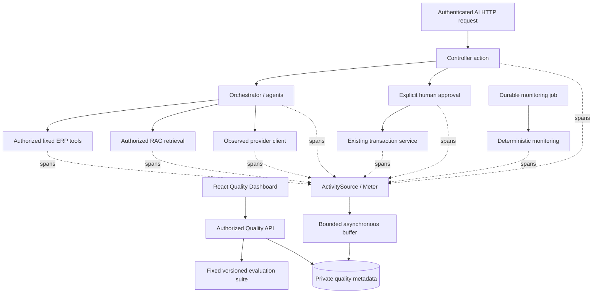

# Phase 11.7 — AI evaluation, observability and reliability

This phase measures the existing agents and preserves their security boundaries. It adds no autonomous business writes, no paid model dependency and no external telemetry service. [Executed results](../VERIFICATION.md) distinguish deterministic tests, real database tests and actual Ollama calls.

## Verified baseline and scope

Before implementation the unchanged backend passed **657 tests; two explicitly opt-in live tests were skipped** (659 total). Source and baseline output were preserved under ignored `.tools/phase11-7/`. The workspace had no HEAD commit and contained existing untracked work. That work was preserved on `codex/phase11-7-ai-evaluation-observability`; nothing was committed, pushed, merged or deployed.

Inspection confirmed these implemented capabilities:

| Existing capability | Implementation reused |
| --- | --- |
| OpenAI, Ollama and Development Mock | `IAiModelClient`, provider runner, strict parsers and bounded retries |
| Inventory, Sales, Order and Knowledge | Agent registry, typed orchestrator, step/tool budgets and verified backend facts |
| Human approval | Private proposals, current-identity revalidation and idempotent transaction services |
| Local RAG | PostgreSQL/pgvector hybrid retrieval, authorization before context, literal source grounding and local embeddings |
| Proactive operations | Durable leased monitoring jobs, deterministic findings, deduplicated private alerts and explicit user-triggered agent review |
| Audit | Existing execution journals, tool records, approval history and business audit remain independent |

The dashboard is available at **`/ai-quality`**, under the existing AI navigation, in Turkish and English. Runtime observations, synthetic evaluations and provider health have separate labels. An evaluation pass is not a claim that every possible model answer is correct.

## Architecture and correlation



`ActivitySource` **`DemoERP.AI`**, version `11.7`, emits W3C trace/span/parent IDs. Its `Meter` provides operation counts, duration histograms and known token counts. These use standard .NET instrumentation compatible with OpenTelemetry. No exporter, collector, vendor account or NuGet telemetry package is required or configured. A future exporter can subscribe to this source/meter; its destination and access controls need separate configuration.

The HTTP middleware records server processing of POST `/api/ai/*`, `/api/knowledge/chat` and `/api/operations/*`. It surrounds authentication, authorization and action/result execution; action spans are separate children. It excludes browser/network time and, for exceptions handled by the outer error handler, subsequent error-response serialization. `X-AI-Trace-Id` connects the HTTP result to the trace timeline. Existing execution IDs are carried into orchestration/agent/tool/provider spans; approval/order spans retain the proposal execution ID. Existing request/journal correlation identifiers are preserved alongside W3C trace IDs.

Background monitoring uses its own system trace and run execution ID. It does not pretend to be a user HTTP request. Provider attempts expose retry ordinal, measured context **characters**, reported token usage and safe outcomes. Character counts are not tokenizer estimates. Agent/tool durations are inclusive; adding nested durations double-counts work.

## Metadata, privacy and retention

Persisted fields are allowlisted: owner/execution IDs, static operation/component, trace hierarchy, provider/model/environment, outcome/error code, timestamps, duration, retry ordinal, retrieved count, context characters and reported tokens. Raw prompts, tool arguments/results, document text, exception messages, credentials and hidden reasoning are not captured by this subsystem. Model/component identifiers are bounded and secret-like values are redacted. External exporters would receive trusted owner/execution GUID tags; configure their access accordingly.

All Quality API routes require a current authenticated authorized identity. Ordinary users see only their own metadata/evaluations. Admin can additionally select **system-only** observations with no owner; that scope does not grant access to other users' private request/approval traces. Trace IDs alone grant no access. Business tool and approval authorization remains enforced by the existing backend services even if a model requests a prohibited action. There is no tenant model in the application; cross-tenant isolation is not claimed.

Native .NET settings (also documented in `.env.example`):

| Setting | Default | Bound |
| --- | --- | --- |
| `AiQuality__Enabled` | `true` | Boolean |
| `AiQuality__RetentionDays` | `7` | 1–30 days |
| `AiQuality__MaxSpans` | `50000` | 100–100000 |
| `AiQuality__MaxEvaluationRuns` | `200` | 2–1000 |

The buffer holds at most 1024 observations per process; a background worker flushes batches of 128 approximately every second and purges expired/excess rows approximately every minute. Cap enforcement is best effort across concurrent instances, with bounded cleanup batches, rather than a distributed hard admission limit. Expired data is excluded from queries immediately. Queue overflow/storage failures can drop observations without breaking ERP operations. The Admin drop counter covers this process lifetime, not durable global history. Shutdown can lose buffered spans. This is operational telemetry, not a complete business audit ledger.

The overview covers the last 24 hours, at most 5000 observations, with a truncation notice; trace lists inspect at most 1000 recent observations/30 traces, details at most 250 spans. Retention and query caps affect denominators. Existing execution and business audit retention is unchanged. Docker backend environment forwarding is not automatically added by the native settings example.

## Metric definitions

| Metric | Definition and limitation |
| --- | --- |
| Request volume | Persisted `request` spans for the instrumented POST routes, within selected owner/time scope; not all ERP traffic |
| Completed request rate | Success/fallback/mock/insufficient outcomes divided by observed requests; **not factual accuracy** or an independently judged task-success score |
| Error / timeout / cancellation | Failure or timeout divided by requests; timeout and cancellation are also reported separately |
| Tool success | Successful observed tool operations divided by observed tool operations |
| Provider/model usage | Observed provider attempts grouped by provider/model/environment, with Mock identified |
| Retry fraction | Provider attempts with retry ordinal above zero divided by all observed provider attempts |
| Token usage | Sum of reported values only; missing usage is nullable and missing/known observation counts are displayed |
| Duration | Mean for at least one sample; nearest-rank P50 for at least 20, P95 for at least 100, P99 for at least 1000 observations |
| Orchestration residual | Orchestration duration minus the union of its direct child intervals, clipped to the parent interval; can include journal/uninstrumented work and is **not CPU overhead** |

Percentile floors are conservative presentation rules, not a statistical confidence guarantee. Provider health is the existing safe status check, not an uptime history. GPU/CPU/RAM collectors are not installed and are not required. Error categories are counts of observations and may include several spans from one failed execution.

## Deterministic evaluation dataset

`backend/Demo.Api/AI/Quality/contracts-v1.json` is embedded as reviewed **`contracts-v1` version `1`**, currently **33 scenarios**. A SHA-256 hash identifies the exact dataset. Each scenario carries an ID, category/check, synthetic prompt and role, fixture, expected tools/constraints/outcomes. Catalog parsing rejects malformed/unknown fields, duplicate IDs, unsupported checks/roles/tools and excessive sizes. The runner dispatches only compiled check types; it executes no supplied SQL, shell or arbitrary code. There is no dataset-upload endpoint.

Representative checks cover agent routing, low/zero/missing demand basis, bounded and malicious tool arguments, fixed-registry write rejection, Viewer/anonymous/Admin policy boundaries, server-priced customer/product order drafts, strict structured JSON, unverified numerical/currency claims, agent budgets, explicit deterministic fallback, literal citations/unsupported or malicious source text, labelled retrieval ranks and monitoring significance thresholds.

The in-app Evaluation Lab runs only this fixed synthetic suite. Admin authorization, current-role recheck, concurrency/rate limits, 20-second deadline, per-owner advisory transaction lock and idempotency key protect execution. Reports are owner-private and bounded. It never calls a paid provider or reads/writes ERP business data; it persists only its own evaluation report. Draft fixtures cannot create an order.

This contract suite is one layer. Existing full backend tests additionally exercise real disposable PostgreSQL transactions, duplicate approvals, persisted approved results, private histories, revoked sessions, tool escalation, invalid handoffs, cancellation/timeouts, malicious documents, stale versions and monitoring leases/recovery/deduplication. Those transaction tests use isolated databases; the UI evaluation runner cannot approve a business transaction. A model declining an attack is not treated as proof of authorization.

### RAG evidence and manual review

Two evidence classes are deliberately separate:

1. The dashboard's fixed labelled rank fixtures check the metric implementation and citation/grounding contracts. They are labelled **synthetic**, not observed live retrieval quality.
2. The backend retrieval regression creates a separate disposable pgvector database, authorized labelled documents/chunks and fixed deterministic embedding vectors. It calls actual hybrid retrieval, verifies the expected source/version and exclusion of a private source, and writes `rag-retrieval-report.json`. Generated fixture IDs and relevance labels are recorded in that report. It measures this one reviewed fixture, not a production relevance benchmark.

For cutoff K, Recall is relevant hits / labelled relevant sources, **Precision is relevant hits / actual returned results up to K** (no padding to K), and MRR is the reciprocal rank of the first relevant result within K. Missing relevance labels yield unavailable Recall/MRR; no returned results yield unavailable Precision. Deduplicated identifiers avoid duplicate credit. Citation validity and literal source attribution are checked separately. A literal match or vector similarity alone cannot establish semantic truth, causality or forecast quality; manual semantic review is explicitly required. Actual Ollama/nomic acceptance is a third, separate opt-in check.

## CI and regression comparison

The regular GitHub workflow builds/tests the backend against disposable databases, runs the deterministic suite and security regressions, checks the machine-readable report, and uploads JSON/JUnit artifacts for seven days. Frontend build/lint/tests and smoke-script unit tests remain required. Normal CI needs Docker but no GPU, Ollama, OpenAI key, production credentials or billing. Live flags remain unset. The workflow was updated and equivalent checks were executed locally; a remote GitHub run has not been triggered for this unpushed work.

Reports: `evaluation-report.json`, `evaluation-junit.xml`, optional `evaluation-comparison.json`, plus the separately labelled `rag-retrieval-report.json`. Any failed scenario, including a critical authorization/approval case, fails the gate. Baseline comparisons require matching suite/mode/dataset hash. Newly failing/recovered scenario IDs and latency changes are explicit; changing the dataset requires a reviewed new baseline.

Default latency regression: at least **2×** the earlier duration **and 20 ms** additional duration. Dashboard comparison controls are bounded; CLI overrides are `AI_EVAL_LATENCY_RATIO`, `AI_EVAL_MINIMUM_INCREASE_MS`. `AI_EVAL_BLOCK_LATENCY=true` makes latency regressions fail the CLI gate. Without it, latency changes are reported but do not fail CI; synthetic check latency is not model inference performance. Baseline storage/promotion is manual, never automatic.

## Windows: deterministic checks

Prerequisites: Git, Node.js 22, .NET 10 SDK and running Docker Desktop (Linux containers). Execute from the repository root. No application database or credentials are needed for this suite; Testcontainers creates/disposes test databases.

```powershell
Set-Location (Join-Path $env:USERPROFILE 'source\DemoErp')
$env:AI_EVAL_REPORT_DIRECTORY = Join-Path (Get-Location) 'artifacts/ai-evaluation'
dotnet test backend/Demo.Api.Tests
if ($LASTEXITCODE -ne 0) { throw 'Backend tests failed.' }
node scripts/verify-ai-evaluation.mjs artifacts/ai-evaluation
if ($LASTEXITCODE -ne 0) { throw 'AI evaluation gate failed.' }
node --test scripts/tests/*.test.mjs
if ($LASTEXITCODE -ne 0) { throw 'Script tests failed.' }
Set-Location frontend
npm.cmd ci
npm.cmd run lint
npm.cmd run typecheck
npm.cmd test
npm.cmd run build
```

`npm.cmd` avoids Windows blocking the unrelated `npm.ps1` launcher. If using the bundled SDK in this workspace, replace `dotnet` with `& ./.tools/dotnet/dotnet.exe`. For a focused evaluator run use `dotnet test backend/Demo.Api.Tests --filter-class '*AiEvaluationTests*'`; add `*AiQualityTests*` separately for metadata/security checks. Run the full suite before delivery.

To compare a retained, reviewed report without changing it:

```powershell
$env:AI_EVAL_BASELINE = 'C:\evaluation-baselines\contracts-v1\evaluation-report.json'
$env:AI_EVAL_LATENCY_RATIO = '2'
$env:AI_EVAL_MINIMUM_INCREASE_MS = '20'
$env:AI_EVAL_BLOCK_LATENCY = 'true'
node scripts/verify-ai-evaluation.mjs artifacts/ai-evaluation
if ($LASTEXITCODE -ne 0) { throw 'Evaluation comparison failed.' }
```

## Windows: isolated real Ollama acceptance

These commands deliberately use **a new synthetic-data database**, API `5119` and frontend `3039`. Do not substitute a production or personal ERP database. The live runner creates labelled synthetic categories/products/customers and a private knowledge document through normal endpoints; it never approves or persists an order. Retained fixtures remain in this dedicated volume until you choose to remove them. It requires actual `qwen3:8b` and `nomic-embed-text` calls; fallback/Mock does not qualify as success.

First check/pull local models and start only the dedicated database:

```powershell
Set-Location (Join-Path $env:USERPROFILE 'source\DemoErp')
ollama list
# Run a pull only if the corresponding model is missing:
# ollama pull qwen3:8b
# ollama pull nomic-embed-text
docker compose --env-file .env.example -p demoerp-quality-review -f docker-compose.yml -f docker-compose.quality-local.yml up -d --wait postgres
```

Backend terminal, from the root (Development-only, loopback endpoints):

```powershell
$env:ASPNETCORE_ENVIRONMENT = 'Development'
$env:ConnectionStrings__Default = 'Host=127.0.0.1;Port=55442;Database=catalog;Username=catalog;Password=development-only-db-password'
$env:Jwt__Secret = 'isolated-quality-review-only-signing-key-change-before-sharing'
$env:Jwt__Issuer = 'catalog-api'
$env:Jwt__Audience = 'catalog-web'
$env:Cors__Origins__0 = 'http://127.0.0.1:3039'
$env:AiAssistant__Enabled = 'true'
$env:AiAssistant__Provider = 'Ollama'
$env:OLLAMA_ENDPOINT = 'http://127.0.0.1:11434'
$env:OLLAMA_MODEL = 'qwen3:8b'
$env:AiAssistant__TimeoutSeconds = '120'
$env:AiAssistant__MaxOutputTokens = '2000'
$env:AiAssistant__MaxRetries = '0'
$env:Knowledge__Enabled = 'true'
$env:Knowledge__EmbeddingModel = 'nomic-embed-text'
$env:AiQuality__Enabled = 'true'
$env:Bootstrap__Enabled = 'true'
$env:Bootstrap__Name = 'Isolated quality administrator'
$env:Bootstrap__Email = Read-Host 'Isolated administrator email'
$env:Bootstrap__Password = [System.Net.NetworkCredential]::new('', (Read-Host 'Isolated administrator password' -AsSecureString)).Password
try {
    dotnet run --project backend/Demo.Api --no-launch-profile --urls http://127.0.0.1:5119
} finally {
    Remove-Item Env:Bootstrap__Password -ErrorAction SilentlyContinue
}
```

Startup applies the additive migrations only to that chosen database. Keep this terminal open. In a second root terminal start the frontend:

```powershell
Set-Location frontend
$env:VITE_API_BASE_URL = 'http://127.0.0.1:5119/api'
npm.cmd ci
node node_modules/vite/bin/vite.js --host 127.0.0.1 --port 3039 --strictPort
```

Open `http://127.0.0.1:3039`, sign in, then use **AI Quality Dashboard**. A third root terminal runs the opt-in API acceptance:

```powershell
$env:API_URL = 'http://127.0.0.1:5119'
$env:AI_LIVE_EMAIL = Read-Host 'Same isolated administrator email'
$env:AI_LIVE_PASSWORD = [System.Net.NetworkCredential]::new('', (Read-Host 'Same isolated password' -AsSecureString)).Password
$env:AI_QUALITY_LIVE_SMOKE = 'true'
$env:AI_QUALITY_ALLOW_SYNTHETIC_FIXTURES = 'true'
try {
    node scripts/ai-quality-live-smoke.mjs
    if ($LASTEXITCODE -ne 0) { throw 'Actual Ollama acceptance failed.' }
    $env:AI_QUALITY_UI_LIVE_SMOKE = 'true'
    $env:FRONTEND_URL = 'http://127.0.0.1:3039'
    node frontend/node_modules/@playwright/test/cli.js test --config frontend/playwright.quality.config.ts
    if ($LASTEXITCODE -ne 0) { throw 'Quality Dashboard acceptance failed.' }
} finally {
    Remove-Item Env:AI_LIVE_PASSWORD -ErrorAction SilentlyContinue
    Remove-Item Env:AI_QUALITY_LIVE_SMOKE -ErrorAction SilentlyContinue
    Remove-Item Env:AI_QUALITY_ALLOW_SYNTHETIC_FIXTURES -ErrorAction SilentlyContinue
    Remove-Item Env:AI_QUALITY_UI_LIVE_SMOKE -ErrorAction SilentlyContinue
}
```

The UI smoke uses installed Microsoft Edge by default; it disables credential-bearing screenshots/traces. It runs the deterministic evaluation through the real API and reads persisted runtime traces. It does **not** itself call the model. The preceding API runner verifies real model calls, verified facts, token journals, unchanged order IDs and persisted safe spans. Use `Ctrl+C` in the server terminals when finished; `docker compose --env-file .env.example -p demoerp-quality-review -f docker-compose.yml -f docker-compose.quality-local.yml stop postgres` stops the dedicated database without deleting it. Ollama remains loopback-only; no public port is added.

For the separate existing backend live cases:

```powershell
$env:OLLAMA_LIVE_SMOKE = 'true'
$env:PROACTIVE_LIVE_SMOKE = 'true'
try {
    dotnet test backend/Demo.Api.Tests
    if ($LASTEXITCODE -ne 0) { throw 'Backend/live checks failed.' }
} finally {
    Remove-Item Env:OLLAMA_LIVE_SMOKE -ErrorAction SilentlyContinue
    Remove-Item Env:PROACTIVE_LIVE_SMOKE -ErrorAction SilentlyContinue
}
```

## Security, reliability and limitations

The existing fixed tool registry, typed argument validation, current-user authorization, proposal ownership and explicit human approval remain authoritative. Provider adapters and business transaction services are preserved. Tracing/decorators do not grant model permissions. Fallback is labelled `fallback`; Mock and literal `model_extract` evidence are distinguishable from a model summary. Existing timeout, bounded retry, context/output validation, local inference admission and durable monitoring recovery remain in place and are regression-tested. No new unlimited retry/recovery loop is introduced.

Live acceptance A/B checks actual model inventory and Sales + Inventory collaboration using trusted ERP facts; C checks a review-required draft with unchanged order IDs; D checks actual local embedding/retrieval/citations. E is tested through deterministic adversarial backend enforcement; F through a simulated unavailable provider. We did not stop the user's Ollama service or claim an unexecuted live injection/outage scenario passed. Approved order persistence is covered by existing isolated transaction tests, not by the live runner.

This is a small engineering regression suite, not an exhaustive language benchmark. Exact model prose is not graded. Numerical/citation contracts cannot establish all semantics, causal explanations or forecasts; manual review remains necessary. Telemetry is bounded/best effort, percentiles need enough observations, and no GPU/uptime/semantic reliability score is invented. No external OpenTelemetry export or production multi-tenant isolation has been deployed.

## Changed files and migration

New backend modules: `AI/Quality/QualityModel.cs`, `QualityTelemetry.cs`, `ObservedModelClient.cs`, `EvaluationEngine.cs`, `QualityMetrics.cs`, embedded `contracts-v1.json`, and `Controllers/QualityController.cs`. Instrumentation is attached in `Program.cs`, provider runner, tool executor, execution journal, agent orchestrator, proposals, knowledge retrieval/embeddings and monitoring engine. New tests are in `AiQualityTests.cs` and the labelled retrieval regression in `KnowledgeTests.cs`.

The additive migration **`20261021172838_AiQualityObservability`** creates only `AiQualitySpans` and `AiQualityEvaluations` with their indexes. Its designer/snapshot are included. No previous migration or ERP schema/data is replaced. Frontend changes add the lazy dashboard route, navigation, API/types/localization and fixture/live tests. Scripts add the evaluation gate and opt-in acceptance with unit tests; CI, `.env.example`, `.gitignore`, the dedicated Compose override and documentation are updated.

Recommended Phase 11.8 work: reviewed broader multilingual relevance/agent datasets with explicit causal/forecast rubrics; secured optional OTLP export and load-based sampling; manually promoted immutable CI baselines; longer controlled performance runs; and stronger distributed telemetry admission/drop accounting. Preserve human approval and current authorization in all follow-up work.
