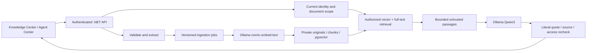

# Phase 11.5 — Local enterprise knowledge

DemoERP now supports authenticated PDF, DOCX, TXT and Markdown ingestion, local Ollama embeddings, PostgreSQL/pgvector hybrid retrieval, a read-only Knowledge Agent and an integrated Knowledge Center. The feature is **disabled by default**. OpenAI, Ollama chat, Development Mock, reporting tools and the Phase 11.4 human-approved workflow remain available.

This phase uses model-selected, verified **literal excerpts**, labelled `model_extract`. It does not present unrestricted model paraphrases as verified policy. Source quotes keep their original language; surrounding interface and evidence messages support Turkish and English. Unsupported questions return an explicit insufficient-evidence result without citations. See [verification](../VERIFICATION.md) for actual executions and remaining limitations.

## Architecture



The modules in `backend/Demo.Api/AI/Knowledge/` separate ingestion (`IKnowledgeIngestion`), extraction (`IDocumentExtractor`), chunking (`IKnowledgeChunker`), embeddings (`IKnowledgeEmbeddingProvider`), storage (`IKnowledgeVectorStore`), authorized retrieval (`IKnowledgeRetriever`, `IDocumentAuthorization`), context (`IKnowledgeContextBuilder`) and grounding (`IKnowledgeGrounding`). Existing `IEmbeddingClient` and `IRagRetriever` contracts have working adapters. The job indexer controls retries, cancellation and publication. Embeddings currently have one local implementation; adding another provider requires implementing the interface, not changing retrieval authorization.

Originals are private PostgreSQL `bytea` values in immutable versions, never public files. PdfPig 0.1.16 and Open XML SDK 3.5.1 perform read-only extraction. Validation checks extension and actual format, strict UTF-8, PDF active/encrypted content, DOCX archive expansion/entries/macros/embedded files/external relationships, page count and extracted length. Image-only PDFs become `ocrRequired`; no OCR is claimed. File streams are bounded before extraction. Parsing is in the backend process with limits and cancellation checks, **not an operating-system-isolated malware analysis sandbox**. A separate parser process is recommended before accepting hostile public uploads.

Default limits: 5 MiB/file, 200,000 extracted characters, 200 PDF pages, 300 chunks, 1,200 characters/chunk with 150 overlap, batches of four, top five passages, 7,000 context characters. Configuration validates bounds; the context character cap is not an exact tokenizer budget. Retention is capped at 100 documents, 20 versions/document and 50 MiB of retained originals per owner. Two upload requests can run concurrently. The library shows the most recently updated 100 authorized documents.

Ingestion stages are validation → queued → processing → indexed; failures, cancellation and OCR have explicit states. A five-minute processing deadline and six-minute stale lease allow interrupted jobs to be reclaimed, up to three attempts. Failed indexing never publishes partial chunks. Replacing/reindexing a document invalidates its searchable chunks immediately. Final publication locks the document and owner, rechecks active permissions, version and lease, and commits all chunks atomically. Deleting cascades private versions, chunks and jobs. Database backups may retain deleted material under the operator's backup retention policy.

## Authorization and agent boundaries

DemoERP currently has a single ERP workspace and Admin/Manager/Viewer roles; it has no organization/tenant model. There is no claim of implemented tenant isolation. Document visibility is either owner-private or workspace-shared. An Admin may publish their own workspace document; Manager uploads are private. All readers may read workspace documents, but only an authorized owner may update/delete/reindex them. Admin status does not grant access to someone else's private documents. Viewer cannot upload or mutate documents. Upload/list/read/versions/reindex/delete/cancel/preview/chat all enforce server authorization and current security version.

The retrieval SQL materializes an authorized, current-version, indexed, matching-model/digest/dimension set **before** ranking or context construction. Vector cosine candidates and PostgreSQL full-text candidates are combined with reciprocal rank fusion, deduplicated and bounded. Embedding model changes require reindexing; incompatible old vectors are excluded. Citation metadata comes from database rows, never model-invented filenames or links. Preview reads recheck permissions; the answer rechecks document/version/text after generation to reject sources changed during a request.

Knowledge inference receives no ERP tools. Uploaded instructions cannot invoke writes, SQL, shell commands or approval actions. The model selects at most three exact quotes, the backend verifies each quote against a numbered retrieved passage, and one repair attempt is allowed. Invalid selection becomes `grounding_failed`, never an invented template labelled as AI. Literal matching proves source provenance, **not universal semantic relevance or that a document's policy is factually correct**. Suspicious instruction quotes are additionally rejected; this heuristic is not the authorization boundary.

The existing orchestrator routes `knowledge` and `inventoryknowledge`. The combined path runs Inventory → Knowledge within existing budgets and audit steps. Verified operational inventory remains separate from quoted policy; the Knowledge path creates no order draft, proposal or database business transaction. Existing human approval requirements are unchanged. The Knowledge Center keeps up to ten turns in component memory; each question is independent, with no server-side cross-turn memory or shared conversation store.

Metadata audit includes KnowledgeDocument create/update/delete with actor, scope/version/status/timestamps. Request tracing records retrieval and embedding latency, retrieved count, provider/model/dimensions, LLM latency/tokens when available, and safe error categories. Coordinator runs retain existing execution/step records. Original text, question bodies, credentials and embedding vectors are not intentionally logged. No hardware utilization dashboard or distributed inference scheduler is implemented.

## Windows: isolated review setup

Examples use `$env:USERPROFILE/source/DemoErp`; adjust it to your clone location.

Prerequisites: Git, .NET **10 SDK**, Node.js **22** with npm, Docker Desktop using Linux containers, and Ollama for Windows. Install using the official installers, or from PowerShell:

```powershell
winget install --id Git.Git --exact
winget install --id Microsoft.DotNet.SDK.10 --exact
winget install --id OpenJS.NodeJS.LTS --exact
winget install --id Docker.DockerDesktop --exact
winget install --id Ollama.Ollama --exact
```

Restart the terminal after installation. Node LTS may change over time; this phase was verified with Node 22. Start Docker Desktop and Ollama. Keep Ollama bound to its normal loopback address, not `0.0.0.0`. Verify and install the separate embedding model:

```powershell
dotnet --version
node --version
docker version
ollama pull qwen3:8b
ollama pull nomic-embed-text
ollama list
Invoke-RestMethod http://127.0.0.1:11434/api/tags | Select-Object -ExpandProperty models | Select-Object name
```

If Ollama is not already running, run `ollama serve` in its own terminal. Do not start a second server when the port is occupied. No OpenAI key, paid API or public Ollama endpoint is required.

From the repository root (adjust the path if cloned elsewhere):

```powershell
Set-Location (Join-Path $env:USERPROFILE 'source\DemoErp')
docker compose --env-file .env.example -p demoerp-rag-review -f docker-compose.yml -f docker-compose.rag-local.yml up -d --wait postgres
```

This creates a **new** pgvector PostgreSQL 17 database on `127.0.0.1:55437` in a separate Compose project/volume. It starts only PostgreSQL. Do not use an existing project's volume, change the normal database connection, or run `down -v` on retained data. The native setup below intentionally uses API **5107** and frontend **3027**, separate from ordinary ERP ports 5101/3021.

### Terminal 1: backend

These commands use the development-only database credentials from `.env.example`; replace them if that file is changed. Bootstrap is for this fresh database only. Its prompt creates an actual Admin; public README demo accounts are not created automatically.

```powershell
Set-Location (Join-Path $env:USERPROFILE 'source\DemoErp')
$env:ASPNETCORE_ENVIRONMENT = 'Development'
$env:ConnectionStrings__Default = 'Host=127.0.0.1;Port=55437;Database=catalog;Username=catalog;Password=development-only-db-password'
$ragSigningBytes = New-Object byte[] 48
$ragRng = [System.Security.Cryptography.RandomNumberGenerator]::Create()
$ragRng.GetBytes($ragSigningBytes)
$ragRng.Dispose()
$env:Jwt__Secret = [Convert]::ToBase64String($ragSigningBytes)
$env:Jwt__Issuer = 'catalog-api'
$env:Jwt__Audience = 'catalog-web'
$env:Cors__Origins__0 = 'http://127.0.0.1:3027'
$env:AiAssistant__Enabled = 'true'
$env:AiAssistant__Provider = 'Ollama'
$env:AiAssistant__TimeoutSeconds = '120'
$env:AiAssistant__MaxOutputTokens = '2000'
$env:AiAssistant__MaxRetries = '0'
$env:OLLAMA_ENDPOINT = 'http://127.0.0.1:11434'
$env:OLLAMA_MODEL = 'qwen3:8b'
$env:OLLAMA_CONTEXT_WINDOW = '8192'
$env:Knowledge__Enabled = 'true'
$env:Knowledge__EmbeddingModel = 'nomic-embed-text'
$env:Bootstrap__Enabled = 'true'
$env:Bootstrap__Name = 'Local knowledge administrator'
$env:Bootstrap__Email = Read-Host 'New isolated ERP administrator email'
$env:Bootstrap__Password = [System.Net.NetworkCredential]::new('', (Read-Host 'New administrator password' -AsSecureString)).Password
try {
    dotnet run --project backend/Demo.Api --no-launch-profile --urls http://127.0.0.1:5107
} finally {
    Remove-Item Env:Bootstrap__Password -ErrorAction SilentlyContinue
}
```

Startup applies migrations to this explicitly selected fresh database. After first provisioning, use `Bootstrap__Enabled=false` and remove bootstrap credentials before later starts. Keep the signing secret stable in your private configuration if sessions should survive restarts. Environment settings belong in the backend terminal; no secrets go into `VITE_*`. Native `Knowledge__*` entries in `.env.example` are examples: Docker Compose does not automatically forward them to the container backend.

### Terminal 2: frontend

```powershell
Set-Location (Join-Path $env:USERPROFILE 'source\DemoErp\frontend')
$env:VITE_API_BASE_URL = 'http://127.0.0.1:5107/api'
npm.cmd ci
node node_modules/vite/bin/vite.js --host 127.0.0.1 --port 3027 --strictPort
```

Open [local Knowledge Center](http://127.0.0.1:3027/knowledge), sign in with the new Admin, upload a short manual, wait for Indexed, select it and ask a documented question. `npm.cmd` avoids Windows blocking `npm.ps1`; these inline commands do not require changing system execution policy. This is local development, not a production deployment.

### Terminal 3: opt-in actual model tests

The API test uploads synthetic private documents to the selected isolated database. It calls actual local embeddings/chat, verifies citation quotes and authorized previews, checks insufficient evidence and the Inventory → Knowledge execution/audit. It does not create ERP orders. The browser test also retains a synthetic private manual. Do not point either at production.

```powershell
Set-Location (Join-Path $env:USERPROFILE 'source\DemoErp')
$env:API_URL = 'http://127.0.0.1:5107'
$env:AI_LIVE_EMAIL = Read-Host 'Existing isolated ERP administrator email'
$env:AI_LIVE_PASSWORD = [System.Net.NetworkCredential]::new('', (Read-Host 'Administrator password' -AsSecureString)).Password
$env:AI_RAG_LIVE_SMOKE = 'true'
try {
    node scripts/ai-rag-live-smoke.mjs
    if ($LASTEXITCODE -ne 0) { throw 'Real RAG smoke failed; inspect safe backend categories.' }
} finally {
    Remove-Item Env:AI_LIVE_PASSWORD -ErrorAction SilentlyContinue
    Remove-Item Env:AI_RAG_LIVE_SMOKE -ErrorAction SilentlyContinue
}
```

Optional installed Microsoft Edge browser acceptance (repeat the credential prompt; the previous block removes the password):

```powershell
$env:FRONTEND_URL = 'http://127.0.0.1:3027'
$env:AI_LIVE_PASSWORD = [System.Net.NetworkCredential]::new('', (Read-Host 'Administrator password' -AsSecureString)).Password
$env:AI_RAG_UI_LIVE_SMOKE = 'true'
try {
    node frontend/node_modules/@playwright/test/cli.js test --config=frontend/playwright.knowledge.config.ts
    if ($LASTEXITCODE -ne 0) { throw 'Real Knowledge Center acceptance failed.' }
} finally {
    Remove-Item Env:AI_LIVE_PASSWORD -ErrorAction SilentlyContinue
    Remove-Item Env:AI_RAG_UI_LIVE_SMOKE -ErrorAction SilentlyContinue
}
```

The browser fixture checks the observed nomic-embed-text dimension **768**. The application itself checks actual response dimensions rather than assuming 768 for every configurable model.

Ordinary automated tests use deterministic model/embedding substitutes and disposable PostgreSQL/pgvector Testcontainers; Docker must be running. Existing live ERP tests remain independently opt-in:

```powershell
dotnet test backend/Demo.Api.Tests
node --test scripts/tests/*.test.mjs
Set-Location frontend
npm.cmd run lint
npm.cmd test -- --run
npm.cmd run build
```

## Existing database: safe migration strategy

The additive `20261021144712_EnterpriseKnowledge` migration creates only KnowledgeDocuments, KnowledgeVersions, KnowledgeChunks and KnowledgeJobs, with their indexes/FKs. It does not recreate ERP tables or seed business records. The model snapshot is updated. Original PostgreSQL installs without pgvector still migrate the metadata tables: the API keeps ERP working and Knowledge indexing reports `knowledgeVectorUnavailable`. Missing extension privileges are handled without pretending vector readiness.

Before changing a retained deployment:

1. Take and verify a PostgreSQL backup using your existing secure credential configuration; for example `pg_dump -Fc --file=demoerp-before-rag.dump "$env:ERP_BACKUP_CONNECTION"`. Keep backups outside the repository. Restore into a separate database and verify ERP records first.
2. Install matching **PostgreSQL 17** pgvector binaries on the restored instance. For Windows native PostgreSQL follow the [official pgvector Windows build instructions](https://github.com/pgvector/pgvector#windows); Visual Studio C++ build tools and the PostgreSQL development environment are required. The Docker review image above already includes those binaries. Do not point a replacement image at the only copy of existing database files without a tested backup/restore plan.
3. Review the migration SQL on that copy: `dotnet ef migrations script --idempotent --project backend/Demo.Api --output rag-migration-review.sql` (install the EF CLI matching EF Core 10 first if needed). Treat generated scripts as deployment artifacts, not committed credentials. Startup currently applies pending migrations, so connect a review API only to the reviewed copy.
4. If metadata migrations ran before pgvector was installed, a database administrator can run `psql "$env:ERP_BACKUP_CONNECTION" -v ON_ERROR_STOP=1 -f scripts/knowledge/enable-pgvector.sql` **against the selected reviewed target**. This creates the extension/vector column only; no ERP rows are changed. Application users need not receive extension installation privileges.
5. Check readiness, upload/index a test document, verify actual dimension/model/digest and ERP regression behavior before scheduling any separately approved production change. No retained or production database migration was performed as part of this delivery.

The embedding column is unrestricted `vector`, with per-row dimension/model/digest metadata and strict matching on retrieval. The initial measured model produced 768 dimensions. Exact cosine scan is used with authorization filtering; full-text has a GIN index. No HNSW/IVFFlat index is claimed: fixed-dimension/model partial indexes and their query plans need a larger authorized corpus benchmark first. The materialized authorization set also limits potential full-text index optimization. This implementation prioritizes correctness on the current bounded local corpus, not unmeasured enterprise-scale throughput.

Rolling back the application migration removes only knowledge tables; it intentionally does not drop a shared vector extension. Back up knowledge before rollback. Never reset the ERP database to fix a missing embedding model.

## Hardware, configuration and troubleshooting

Embeddings call only `http://127.0.0.1:11434/api/embed`, with redirects/proxies disabled. Model tags/digests are checked around requests, vectors must be finite/nonzero with consistent dimensions, and transient 503 is retried once. Runtime never downloads models. Document/query prefixes are `search_document:` and `search_query:`. Batches are bounded and model residency is five minutes. Embedding inference requests CPU (`num_gpu=0`) to leave the RTX 4060's 8 GiB VRAM available for Qwen3; 32 GiB system RAM is still a practical constraint.

Ollama chat and embeddings share an in-process single-operation gate. This avoids concurrent local workloads within one API process; other applications/API instances are not governed by it. Long indexing jobs can delay chat between bounded batches, and cold loading adds latency. Actual token counts are reported when returned by the chat provider. Latency is measured per request, not a hardware performance guarantee. Operators can inspect `ollama ps` and Task Manager; no public monitoring endpoint is added.

| Category | Action |
| --- | --- |
| `knowledgeVectorUnavailable` | Use pgvector binaries, extension and vector column on the correct database; plain PostgreSQL keeps ERP available. |
| `knowledgeEmbeddingModelMissing` | Run `ollama pull nomic-embed-text`, or install the configured embedding model; reindex when identity changes. |
| `knowledgeEmbeddingUnavailable` / `knowledgeTimeout` | Check the loopback Ollama process and model load/resource pressure. |
| `knowledgeEmbeddingInvalid` | Inspect safe model/dimension diagnostics; do not bypass vector validation or mix indexes. |
| `knowledgeOcrRequired` | Use a text PDF/DOCX or a separate trusted OCR workflow; no OCR was executed. |
| `knowledgeGroundingFailed` / `grounding_failed` | Model selection did not match source text after bounded recovery; narrow the question or improve source material. |
| `knowledgeSourcesChanged` | Source version/access changed while answering; reload and ask again. |
| `knowledgeTimeout` | Reduce source/question scope; review configured limits and local resource usage. |
| `knowledgeDocumentLimit` | Remove obsolete retained documents or reduce versions; do not disable quotas to ingest unbounded files. |

Preview and answer text use React text nodes, not uploaded HTML or model-provided arbitrary hyperlinks. An unavailable/deleted source is not silently replaced by another citation. Knowledge infrastructure readiness does not prove a model is loaded; actual embedding/chat requests establish that separately.

## Evaluation and changed files

[rag-evaluation.json](rag-evaluation.json) defines a small synthetic corpus and expected sources for documentation, policy plus inventory, absent knowledge, unauthorized documents and malicious instructions. The live smoke measures scenarios A–C and checks every cited quote against protected source text. Scenarios D–E, stale versions, scope filtering and malformed inputs are deterministic regression tests with real disposable PostgreSQL, not claims of extra live-model passes. This is an acceptance dataset, not a statistically representative retrieval quality benchmark. There is no reranker, relevance classifier or proof that arbitrary valid quotes answer arbitrary questions.

Backend changes: the seven Knowledge modules, KnowledgeController, Program/DI/rate limits, AppDbContext metadata audit, audit filter, shared Ollama gate, agent contracts/orchestrator, additive migration/designer/snapshot and extraction package references. Tests: KnowledgeTests, KnowledgeUnitTests, KnowledgeExtractionTests, KnowledgeEmbeddingTests, KnowledgeUnavailableTests. Frontend: KnowledgeCenter, KnowledgeSources, router/navigation, AgentCenter integration, translations, multipart API support and knowledge browser fixtures/live config. Supporting files: RAG Compose override, extension completion SQL, opt-in API runner/tests, evaluation dataset, environment examples, README links and verification report.

Official implementation references: [Ollama embedding API](https://docs.ollama.com/api/embed), [pgvector](https://github.com/pgvector/pgvector), [PdfPig](https://github.com/UglyToad/PdfPig), [Open XML SDK](https://learn.microsoft.com/en-us/office/open-xml/open-xml-sdk).
