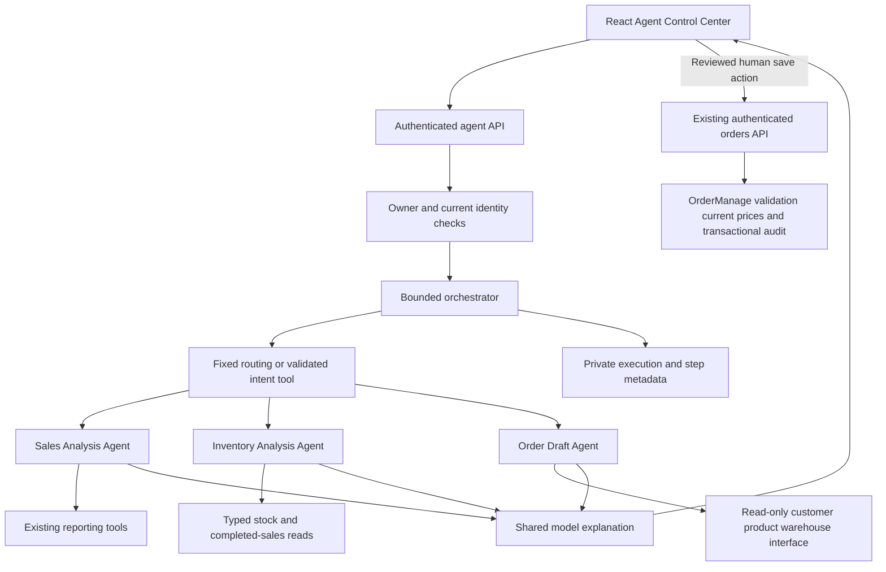

# Phase 11.3 — Intelligent agents and Agent Control Center

> Phase 11.5 adds the read-only Knowledge Agent and Inventory → Knowledge workflow, integrated document library and verified source excerpts. See [local enterprise knowledge](ENTERPRISE_RAG.md) for current scopes, limitations, migration and Windows commands.

> Phase 11.4 replaces the direct draft-save button with durable, expiring, idempotent backend proposals and adds the Sales → Inventory → Purchase workflow. See [secure workflows](SECURE_WORKFLOWS.md) for the current approval path, recovery, limits and isolated review commands. The Phase 11.3 description below is historical context.

[Verified baseline](AGENTS_BASELINE.md) · [Executed results](../VERIFICATION.md) · [Ollama setup](OLLAMA_INTEGRATION.md) · [AI security](AI_SECURITY.md)

## Architecture and responsibilities



These are specialized typed application services using a shared model adapter, not independent unconstrained LLM personas. The existing assistant, private opt-in conversation history and nine read-only tools remain available at `/ai-assistant`. New `/agent-center` integrates into the existing sidebar and provides independent one-request analyses with real step polling, verified factual tables, separate model interpretations and non-submitted order previews. Reloading agent history retrieves metadata only, not a saved conversation or draft. The original assistant still offers opt-in conversations.

- **Orchestrator:** chooses a fixed workflow, validates model plans, executes sequentially and enforces limits. Simple explicit inventory/sales requests bypass model planning. Auto routing recognizes bounded Turkish/English stock/sales phrases; other requests use one strict native `route_erp_request` tool call. Unsupported requests ask for clarification. There is no model-defined executable graph or free-form inter-agent messaging.
- **Inventory:** reads active current stock, includes zero and low/equal-threshold quantities, retrieves completed sales for those product IDs and computes replenishment in C#. Returns at most ten rows, total matches, truncation flag, query period and retrieval timestamp. This small additional application read is necessary because the original tools expose neither product IDs nor replenishment targets.
- **Sales:** reuses `get_sales_summary` with preceding-period comparison and `get_top_products`, including stored completed-order prices and existing legacy exclusions. Facts and model comments remain separate. Three months means calendar `AddMonths(-3)` through current UTC; comparison is the equal-length preceding interval. No forecasting accuracy is claimed.
- **Order draft:** the model extracts only customer/product names and integer quantities from the request. `IOrderDraftReader` exposes typed authorized reads, never SaveChanges/OrderService. Exact active matches are preferred; otherwise up to five partial-name candidates are returned. Ambiguous/missing identities and quantities require clarification. Prices, IDs, default active warehouse, availability, line totals and grand total come exclusively from ERP/C#; insufficient warehouse stock is flagged. Nothing is submitted, reserved or stored as a business order. No automatic creation action is exposed in the UI. The previous ID-based preparation endpoint remains compatible.

## Deterministic replenishment policy

### Save a reviewed customer order

The Agent Control Center now provides **Save order / Siparişi kaydet** under an order draft. Admin and Manager (operations manager) users review the customer, fulfillment warehouse, products and quantities, check the review checkbox, then click Save order. A complete draft needs resolved customer/warehouse IDs, distinct valid product quantities and no outstanding clarifications. Viewer users can inspect drafts but cannot save them. Clarification requests must be resolved by submitting a more specific draft request.

This explicit browser action calls the existing `POST /api/orders`, outside the AI tool executor. Only customer ID, warehouse ID and product IDs/quantities are submitted. The existing backend rechecks authorization and active entities, recalculates current product prices and commits the order with the authenticated audit actor. It creates a **Pending** order even if stock is insufficient; stock is deducted only by the existing separate confirmation action. The success receipt displays the actual saved total and a link to the order. No AI provider receives a write tool or automatic order creation ability.

The UI blocks concurrent double clicks, disables a new analysis/history selection while saving and removes the save action after success. It does not automatically retry a failed write. The ordinary orders endpoint does not provide global idempotency: if connectivity is lost after the server commits, check the order list before deliberately retrying. Draft previews remain ephemeral; execution history does not restore them. No new schema or migration is required.

### Replenishment calculation

The configured demonstration policy targets the greater of minimum stock plus one unit (clears the existing low-stock threshold) and ceiling(14 × rounded daily completed quantity over the selected interval). Suggested quantity is max(0, target − current stock). Daily average is rounded to four decimals. This is a constant-historical-demand policy, not a demand forecast, lead-time calculation or purchasing decision. When neither a positive minimum nor completed demand exists, the quantity is null rather than invented. Targets outside supported integer bounds also return null. Inventory uses current aggregate stock; the order preview uses the default warehouse's stock. These scopes are deliberately distinguished.

The coordinated example runs Sales → Inventory → consolidated explanation, passing an AgentWindow and typed results. Its replenishment target is based on the same completed-sales semantics used by the Sales Agent. It does not invent a customer to turn replenishment into a sales order; customer order drafts are a separate explicit request. Supplier purchasing automation is out of scope.

## Structured contracts and execution limits

`AgentPlan`: kind, period, nullable customer name, up to ten product/quantity lines. Strict parsing rejects extra/duplicate fields, unknown tools/kinds, generated prices/IDs and out-of-range quantities. Missing quantities are null and trigger clarification. Supported periods: last30days, last3months, thismonth, previousmonth; the UI can select them explicitly. Free-form date ranges and arbitrary periods are not supported in this phase.

`AgentWindow`, `SalesAnalysis`, `InventoryAnalysis`, `ReplenishmentRow` and `ResolvedOrderDraft` are the validated agent-to-agent/result contracts. Resolved drafts always carry notSubmitted=true, persisted=false, requiresHumanReview=true; partial drafts have null total until identity/quantity clarification is complete.

Hard limits: 5 steps, 6 audited report/preparation operations, 3 actual model attempts including retries, 2000 input characters, 10 draft lines/10000 units per line, 10 inventory/best-seller rows, 28000 model input characters and 24000 serialized-fact characters. Each run uses the existing configurable 1–120 second overall deadline and per-user quota. The small number of fixed steps is nonrecursive; there is no autonomous loop. Model calls and report reads are sequential. The budget is also checked before retries and before every operation. Ollama adapter history/arguments have a separate 32000-character rejection limit.

## API and persistence

| Endpoint | Purpose |
| --- | --- |
| GET `/api/ai/agents/status` | Provider/model and safe readiness state |
| POST `/api/ai/agents/runs` `{mode}` | Create owner-scoped queued metadata, consume quota, return ID |
| POST `/api/ai/agents/runs/{id}/execute` `{message,language,period}` | Atomically claim a queued run exactly once and execute synchronously |
| GET `/api/ai/agents/runs/{id}` | Existing private execution/tool metadata plus bounded agent steps |
| GET `/api/ai/agents/runs` | At most twenty owned, unexpired run summaries |

The two-request protocol lets React display real running steps while the execution POST is in progress. A client AbortSignal flows to the linked backend cancellation token. Steps and run outcomes finalize with independent short-lived metadata contexts. Invalid input after claiming a run is finalized as a failure. No background job or unattended autonomous execution is started. A request cancelled before execute reaches the server can leave queued metadata with no prompt; it expires under the existing retention policy. After a client request settles, polling stops and a final metadata refresh is requested. A process/database failure can leave an interrupted run's last metadata state until retention; durable recovery is a future improvement.

One additive `AgentControlCenter` migration creates AiAgentRuns and AiAgentSteps linked to existing AiExecutions with cascading AI-only retention. Unique execution/sequence and 0..4 sequence constraints enforce step bounds. Old migration sources/designers are unchanged. Existing AI executions without a new child row are not relabeled as agent runs. Results, prompts, extracted plan arguments, candidate data and order contents are not persisted; only fixed agent names, statuses, timings, provider usage and approved tool names are recorded. Successful API return is not inferred from a UI animation.

## Security and provider compatibility

All endpoints require BusinessRead. Current IsActive/role/SecurityVersion is checked before/after each agent and operation, before delivering results and when reading private run metadata. Runs are owner/expiry filtered; foreign IDs return 404. ERP data continues to follow the existing shared-business role model; no tenant boundary or per-customer ownership was added or claimed.

The original nine reporting tools retain their schemas and execution policy. Agent-specific `analyze_replenishment` and `resolve_order_draft` are fixed server-side read/preparation operations, not arbitrary model tool dispatch. The routing tool is a parsing boundary and never executes an ERP action. No SQL text, shell, arbitrary URL/file, user management, audit retrieval or business mutation is exposed to the model. Names are parameterized EF queries. Prompts and all names/results are untrusted; permissions and pricing are enforced outside prompts. Final explanations remain locally schema/language/secret checked and are displayed as plain text; report links are server supplied and allowlisted.

OpenAI uses the existing Responses adapter; its settings and transport tests are preserved. Development Mock stays explicit and Development-only. It supports fixed inventory/sales/coordinated factual reads with a mock explanation; natural-language order extraction asks for clarification rather than pretending to have understood the request. Mock cannot satisfy live acceptance. RAG interfaces remain unregistered; no pgvector extension or ingestion is introduced.

## Local Ollama behavior

Keep the backend native on Windows and Ollama at exactly `http://127.0.0.1:11434`. Redirects/proxies remain disabled and no listener/GPU configuration is changed. `OLLAMA_CONTEXT_WINDOW=8192` is the initial setting, validated within 2048..16384; actual VRAM feasibility depends on quantization, model and load. `think=false`, bounded output and keep_alive=5m remain in place. A process-wide cancellable semaphore serializes model generations across assistant/agent requests in the same backend process. It does not coordinate multiple backend processes; Ollama remains responsible for actual model residency. No separate models are loaded for individual agents.

A cached 3-second `/api/show` probe checks that the configured local model supports tools. It does not generate text or download models. Cache lifetime is 15 seconds. OpenAI status is explicitly configuration-only, not a live access guarantee. Provider token counts and total run duration are visible; no cloud price estimate is fabricated for Ollama. These controls do not establish a throughput/latency guarantee for the RTX 4060.

## Windows startup after reviewing the change

Use three separate PowerShell windows. Existing 5101/3021 processes keep the older backend until you explicitly restart it. The commands below intentionally upgrade the existing local Ollama database through committed additive migrations; they are not executed automatically by development work. Use your existing database settings if different. Back up important existing data first. Do not delete volumes.

Optional backup of the existing local demo (from repository root):

```powershell
New-Item -ItemType Directory -Force .tools/backups | Out-Null
$backup = Join-Path (Resolve-Path .tools/backups) ("demoerp-before-phase113-" + (Get-Date -Format 'yyyyMMdd-HHmmss') + '.dump')
docker exec demoerp-local-ollama-postgres-1 pg_dump -U catalog -d catalog -Fc -f /tmp/before-phase113.dump
docker cp demoerp-local-ollama-postgres-1:/tmp/before-phase113.dump $backup
```

Terminal 1: stop the older backend with Ctrl+C before running:

```powershell
Set-Location (Join-Path $env:USERPROFILE 'source\DemoErp')
$env:ConnectionStrings__Default = 'Host=127.0.0.1;Port=55433;Database=catalog;Username=catalog;Password=development-only-db-password'
$env:Jwt__Secret = 'local-development-only-signing-key-change-before-sharing'
$env:OLLAMA_CONTEXT_WINDOW = '8192'
powershell.exe -NoProfile -ExecutionPolicy Bypass -File .\scripts\start-ollama-backend.ps1
```

This preserves the existing administrator and example data; no Bootstrap flag is needed for that existing database. See the [Phase 11.2 guide](OLLAMA_INTEGRATION.md) for a fresh database/bootstrap. Process-scoped ExecutionPolicy avoids a permanent Windows policy change.

Terminal 2: stop the old Vite process before running:

```powershell
Set-Location (Join-Path $env:USERPROFILE 'source\DemoErp\frontend')
$env:VITE_API_BASE_URL = 'http://127.0.0.1:5101/api'
npm.cmd ci
node .\node_modules\vite\bin\vite.js . --host 127.0.0.1 --port 3021 --strictPort
```

Open http://127.0.0.1:3021/agent-center and sign in normally. New UI examples: inventory replenishment; last-three-month sales; a clearly named customer/product draft; combined sales and inventory analysis. Names must correspond to active ERP records; use full names when ambiguous.

Terminal 3: explicit live acceptance, using existing local ERP credentials only:

```powershell
Set-Location (Join-Path $env:USERPROFILE 'source\DemoErp')
$env:API_URL = 'http://127.0.0.1:5101'
$env:AI_AGENTS_LIVE_SMOKE = 'true'
$env:AI_LIVE_EMAIL = Read-Host 'ERP email'
$env:AI_LIVE_PASSWORD = [System.Net.NetworkCredential]::new('', (Read-Host 'ERP password' -AsSecureString)).Password
try { node scripts/ai-agents-live-smoke.mjs } finally {
  Remove-Item Env:AI_LIVE_PASSWORD -ErrorAction SilentlyContinue
  Remove-Item Env:AI_AGENTS_LIVE_SMOKE -ErrorAction SilentlyContinue
}
```

Optional AI_AGENT_CUSTOMER and AI_AGENT_PRODUCT select exact existing names. Otherwise the script selects an active unique-name customer/product from authorized APIs. It never seeds or mutates business data, prints credentials or ERP rows, or accepts Mock as live success. It executes inventory, sales, resolved order draft and collaboration scenarios; checks provider/model, positive usage, steps and tool outcomes; compares orders and stock before/after. Run against an isolated dataset without concurrent writers for the final state comparison. Without opt-in it skips without network access. Only actually executed results are recorded in VERIFICATION.

## Automated tests and next phase

```powershell
$dotnet = if (Test-Path '.tools/dotnet/dotnet.exe') { (Resolve-Path '.tools/dotnet/dotnet.exe').Path } else { 'dotnet' }
& $dotnet test
node --test scripts/tests/ai-live-smoke.test.mjs scripts/tests/ai-agents-live-smoke.test.mjs
Set-Location frontend
npm.cmd run lint
npm.cmd test
npm.cmd run build
npm.cmd run test:ai
```

Regular CI uses intercepted/mock model responses, PostgreSQL Testcontainers and mocked UI data. Live browser acceptance requires AI_AGENTS_LIVE_SMOKE=true plus existing ERP test credentials and a real ready Ollama provider. See [verification](../VERIFICATION.md) for precise counts, skipped cases and actual live metadata.

Phase 12 recommendations: document-level authorization and evaluated RAG/pgvector retrieval; a separately authorized human-approved order submission flow with fresh pricing/stock checks and idempotency; durable run interruption/recovery and distributed quotas if deploying multiple instances; wider multilingual intent/date-range evaluations and measured GPU concurrency. Purchasing/forecasting automation requires its own business rules and evaluation, not merely another prompt.
