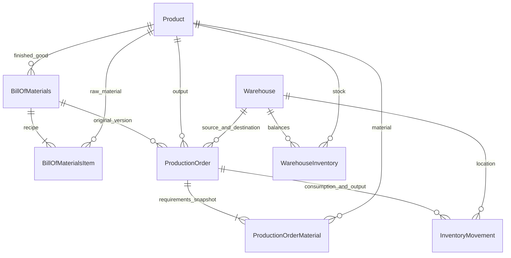
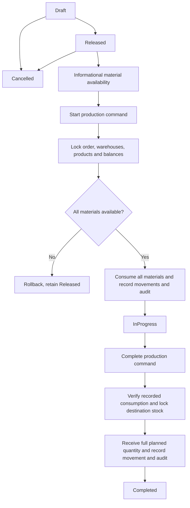

# Manufacturing and basic material requirements

Phase 9 adds single-level, whole-unit manufacturing to the existing .NET 10 / EF Core 10 / PostgreSQL 17 application. It uses the same Product, WarehouseInventory, authorization, audit and stock-writing services as sales, procurement and transfers. This is **basic BOM-based material requirements calculation**, not a full enterprise MRP engine.

## Classification and recipe versions

`ProductType` is `RawMaterial` or `FinishedGood`; there is no separate material catalog. Existing products receive the explicit `RawMaterial` default. Names and categories are never used to infer classification, and existing stock and business references are not rewritten. Admin/Manager can classify an unreferenced product using the existing product editor. Once referenced by a recipe, recipe item, production order or material snapshot, classification changes are rejected by the service and database trigger.

A `BillOfMaterials` belongs to one active FinishedGood and has a trimmed, case-sensitive Version, Name, positive integer BaseQuantity, timestamps and creator. Its items refer to distinct active RawMaterials with positive integer QuantityRequired. Self-consumption and nested BOMs are rejected. The same product/version pair is unique; a partial unique product index WHERE IsActive enforces one active version per finished good.

`ActivatedAt == null` means Draft. Drafts may be edited by Admin/Manager and deleted by Admin. Activation is Admin-only and atomically retires the prior active version before activating the new version. Once activated, the version and recipe lines are immutable even after deactivation; retired versions cannot be reactivated. Create another version to change the recipe. The database protects activated headers/items and prohibits deletion of historical or referenced recipes. All recipe edits, activation and order snapshot creation share a transaction-level governance advisory lock (7419202609); the unique index remains a second defense.

## Calculation and persisted requirements

For each material:

`required = (item.QuantityRequired × order.PlannedQuantity) / bom.BaseQuantity`

Multiplication is checked Int64 arithmetic over positive Int32 inputs. Reject a nonzero remainder before division; reject results outside 1..Int32.MaxValue. No rounding, fractional consumption or unit conversion is performed. For BaseQuantity=2, item requirement=6 and planned quantity=10, the snapshot requirement is 30. For BaseQuantity=2, requirement=1 and planned quantity=1, reject the fractional requirement.

Creating or editing a Draft ProductionOrder requires its selected product's currently active BOM. The server copies the calculated requirements into ProductionOrderMaterials and stores the precise BOM id/version. The preview endpoint invokes the same calculation. Later recipe activation/deactivation cannot change a saved order; release/start/completion use its persisted snapshot, including an order based on a now-retired recipe. Resaving a Draft requires selecting the current active BOM and explicitly rebuilds its snapshot. Release freezes the snapshot and planning fields.

## Domain model

## Lifecycle and transaction boundaries

- **Create/Edit Draft:** one transaction for header, material snapshot and audit. No stock change. Sequence-backed `MFG-yyyyMMdd-000001` numbers are unique; sequence gaps are normal on rollback.
- **Release:** Draft → Released, validates snapshot and active warehouses/products; no stock change and no reservation.
- **Start:** Released → InProgress. Lock the order row FOR UPDATE, verify snapshot, acquire common stock locks, validate every material before applying any deduction. Each material generates one ProductionConsumption movement in SourceWarehouse. QuantityConsumed becomes QuantityRequired; record UTC StartedAt, StartedByUserId and one ProductionStart audit. Save and commit together.
- **Complete:** InProgress → Completed. Verify each snapshotted material was fully consumed and matches a committed movement with the original product, quantity and source warehouse. Lock destination stock, receive entire PlannedQuantity with one ProductionOutput movement, set ProducedQuantity=PlannedQuantity, UTC completion time/actor and one ProductionComplete audit. Save and commit together.
- **Cancel:** Draft/Released → Cancelled, records audit, no invented stock return. InProgress cannot be cancelled through the normal workflow; materials are already consumed.
- **Retry:** a repeated start after InProgress/Completed or completion after Completed returns the persisted result without changing stock or creating another audit. Repeated release in Released and cancel in Cancelled also return the existing result. Other invalid transitions return 409. A completed order can never produce again.

No independent nested transaction is created. `InventoryService.Apply` stages the balance change and immutable movement within the caller's transaction. On stock shortage, overflow, invalid consumption or audit FK failure, disposal/commit failure rolls back the entire operation. An InProgress order is real work in progress: consumed materials are no longer stock and output is not available until completion.

## Compatible concurrency and inventory integrity

All stock writers use the shared order: document row → sorted Warehouse ids FOR SHARE → sorted Product ids FOR UPDATE → sorted (WarehouseId,ProductId) balance rows FOR UPDATE. Product locks serialize company totals even across different warehouses. Missing stock pairs initialize to zero using INSERT ON CONFLICT before locking. Sales confirmation, cancellation, transfers, receipts, manual stock and manufacturing share the same locks and stock-changing function. Manufacturing start locks all material/product ids deterministically; completion also locks the referenced material/product ids before output.

Two production orders demanding 80 and 70 from 100 cannot both start: one commits, the other observes the new balance and returns insufficientStock. The order row serializes concurrent/retried commands, including different API instances. A unique filtered (ProductionOrderId,ProductId,MovementType) index prevents duplicate consumption/output at the database level.

WarehouseInventory remains authoritative; company Inventories remains the read-only SUM view. No manufacturing writer edits that view or the frozen LegacyInventories table. The existing company-wide Int32 stock cap and nonnegative constraints remain active. Source and destination may be equal, but no stock is borrowed from another warehouse. Warehouse deactivation checks open production orders as well as existing sales/transfers. Active products and the relevant active warehouse are checked inside stock-changing transactions.

Additional database defenses: positive recipe/planned quantities; produced and consumed bounds; unique versions/material lines/order numbers; valid lifecycle/timestamp combinations; restricted historical FKs; no edits/deletes of finalized orders; frozen released planning fields and consumed material history. Deferred constraint triggers validate complete recipe and order snapshots, exact integral scaling, expected consumption/output movements and warehouse references at transaction commit. Immutable movement/audit triggers from earlier phases remain intact.

## Availability, shortages and KPIs

`GET /api/production-orders/{id}/material-availability` reads only SourceWarehouse's stock. Before start, shortage is max(required - available,0); after consumption, it is max(required - consumed - available,0), so fulfilled historical requirements do not appear as fresh shortages. Required and consumed quantities remain visible separately. A missing pair means zero. Status is Available, Insufficient or OutOfStock.

Availability is informational and can change immediately. Refresh before starting; the start transaction performs the authoritative check. Released orders do not reserve stock and individual green checks do not promise sufficient stock for every order simultaneously.

Material requirements and shortage reports include only Draft/Released orders and show order number, finished product, material, required/current/shortage quantities and source warehouse. They can select one order or filter open orders, and are paginated in SQL. Shortages are **per order**, not an aggregate allocation of scarce materials across orders. No purchase order or stock transfer is created automatically.

Manufacturing KPIs are independent database counts for Draft, Released, InProgress and Completed orders, plus Int64 sum of ProducedQuantity. They appear on the dashboard and production list. They are separate from sales/procurement values. Listing/report queries filter, sort and page server-side and project DTOs rather than navigation graphs; list collection data is queried in bulk, not one request per order.

## API and RBAC

All endpoints require a currently valid JWT and the existing database-backed session/role validation.

| Endpoint | Viewer | Manager | Admin |
|---|---|---|---|
| GET /api/boms, /api/boms/{id} | Read | Read | Read |
| POST /api/boms, PUT /api/boms/{id} | 403 | Draft only | Draft only |
| DELETE /api/boms/{id} | 403 | 403 | Unused draft only |
| POST /api/boms/{id}/activate or deactivate | 403 | 403 | Yes |
| GET /api/production-orders, /{id}, /{id}/material-availability, /{id}/movements | Read | Read | Read |
| POST /api/production-orders/preview | Read | Read | Read |
| POST /api/production-orders, PUT /{id} | 403 | Draft only | Draft only |
| POST /{id}/release, start, complete, cancel | 403 | Valid transition | Valid transition |
| GET /api/reports/manufacturing, material-requirements, material-shortages | Read | Read | Read |

BOM filters: productId, version, bomStatus=Draft/Active/Inactive, search, sort=newest/oldest/version. Production filters: search (number/product), productId, status, sourceWarehouseId, destinationWarehouseId, paired UTC start/end creation dates, productionOrderId. Both use page 1..1,000,000 and pageSize 1..100; date range at most 366 days. Forms use at most 100 distinct material rows. Quantity/date/id/recipe validations use FluentValidation; states and stock conflicts return safe ProblemDetails (409), invalid input 400, missing ids 404, unauthenticated 401 and denied roles 403.

Audit uses explicit allowed fields and the authenticated actor/correlation id. BillOfMaterials actions include Create/Update/Delete/BomActivate/BomDeactivate; ProductionOrder includes Create/Update/ProductionRelease/ProductionStart/ProductionComplete/ProductionCancel. Metadata-only edits have an edit marker; notes, passwords and tokens are excluded. Stock detail belongs in InventoryMovements instead of copying it into every audit. Draft line edits produce one edit audit.

## UI

Reuses React, TanStack Query, React Hook Form, Zod, the green design, accessible confirmation dialog and common WarehouseSelect. New routes: /boms, /boms/new, /boms/:id, /boms/:id/edit; /production-orders equivalents; /reports/material-requirements and /reports/material-shortages. Product editor exposes classification. Production form obtains its material preview from the backend. Detail includes source/destination, original BOM, required/consumed/current/shortage quantities, actual actors/times and related movements. Stock-changing commands refresh availability and require confirmation. Mutations invalidate all related stock, report, dashboard and audit queries. TR/EN uses the existing translation layer. Mobile material data uses cards; wide lists keep contained horizontal scroll.

## Migration and verification

`20261010091341_Manufacturing` adds Products.ProductType, four manufacturing tables, ProductionNumbers and nullable InventoryMovements.ProductionOrderId, preserving existing rows and enum ordering. Historical movements remain unchanged and need no fake production link. No old migration is rewritten and no existing database is reset. Down intentionally rejects an unsafe downgrade; restore a verified backup or apply a forward migration.

Before upgrading the main stack, take a custom pg_dump backup, restore it to an isolated database, compare all 19 old table/view signatures, start the current backend against that restored Phase 8 database, then compare signatures again. Fresh schema and populated prior migrations are also covered by Testcontainers. See [verification](../VERIFICATION.md) for executed commands and acceptance results. Test fixtures intentionally keep synthetic data in isolated Compose projects; the main database is not seeded with demonstration manufacturing data.

Tests use real PostgreSQL 17, never EF InMemory as concurrency proof. Coverage includes BOM validation/version activation/immutability/draft deletion, scaling/fraction/overflow/snapshots, all transitions, warehouse shortages, atomic failures, repeat commands, separate API instances, competing production/sales/transfers/receipts, audit rollback, DB guards, JWT revocation, roles, reports and migration preservation. Playwright covers schemas, rows, previews, status actions, role visibility, loading/retry, TR/EN and an actual full manufacturing workflow.

## Limits

No fractional units (kg/meters), conversions, nested BOM explosion, semi-finished dependencies, partial production, scrap, quality rejection, production reversal, shop-floor/work-center/machine scheduling, lead times, forecasts, reservation/allocation, safety-stock planning, cost accounting or automatic purchasing/transfers. All quantities are Int32 whole units, reports use Int64 totals where appropriate. Coarse product locks and global recipe governance favor clear correctness over maximum throughput; no load benchmark is claimed. Existing AI Assistant code is unchanged and no AI credentials/features are introduced.
