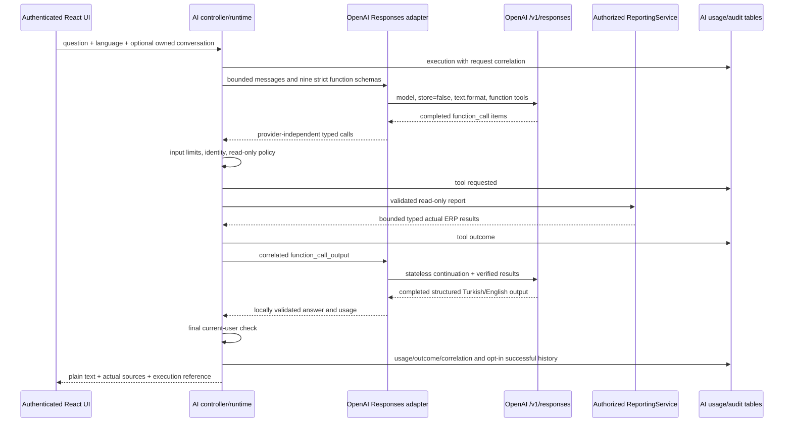

> Phase 11.2 adds the optional Development-only [local Ollama provider](OLLAMA_INTEGRATION.md), Inventory Agent and review-only order drafts. Existing OpenAI behavior remains available.

# Phase 11.1: OpenAI Responses integration

[AI foundation](AI_FOUNDATION.md) · [AI security](AI_SECURITY.md) · [Executed verification](../VERIFICATION.md)

## Verified baseline and scope

The clean `codex/phase11-ai-foundation` checkout was verified at `1cad4d83686fee7b17bb3859a259f97fde64933f` before creating `codex/phase11-1-openai-responses`. Existing IAiModelClient contracts, nine reporting tools, current-user checks, read-only policy, owner-scoped history, expiry/deletion and Development Mock remain in place. The only schema addition is CorrelationId on the existing AiExecutions table; historical migrations are unchanged. Existing AI records receive an empty correlation value rather than invented historical identifiers.

The adapter now uses `/v1/responses` through the official OpenAI .NET SDK 2.14.0, already pinned in the project and compatible with .NET 10. That SDK marks its Responses surface OPENAI001 (evaluation/preview); a suppression is localized to the provider adapter, not applied project-wide. Package/API upgrades must therefore include transport contract regression tests. This implementation is not a production certification or proof of live account/model access.

## Architecture and request flow



IAiModelClient signatures and business services are unchanged. The scoped adapter keeps opaque reasoning/function output items only in request memory so reasoning-capable models can continue after tool outputs without previous_response_id or provider-stored conversation state. `reasoning.encrypted_content` is requested, carried forward transiently and never persisted/logged/exposed to clients. Only existing validated successful question/answer pairs are saved if the user opts in. No model-specific branch is placed in business logic; configured model capabilities and account access still need verification.

Both tool schemas and final `answer`/`language` schema are strict. Final JSON is also validated locally for missing/extra/duplicate fields, length and language. Tool arguments and result DTOs retain Phase 11 checks. Non-function hosted tool items are rejected; web search, shell, computer use, SQL and business mutations are not offered. Multiple requested functions execute sequentially and obey the same total five-call/two-round ceiling. Function outputs use call_id (not the SDK output item's id). Server-generated sources are attached only after successful validated tool execution.

BusinessRead is evaluated against the current active user's role and SecurityVersion. Conversation and execution metadata are private to the owner. ERP reports themselves follow the existing shared-business-data role policies; this phase does not introduce tenants or pretend to provide per-customer row ownership.

## Configuration and local setup

Use an existing ignored `.env`; if none exists, copy `.env.example` first. Keep normal PostgreSQL/JWT/bootstrap settings from the installation guide. Set:

```dotenv
AI_ENABLED=true
AI_PROVIDER=OpenAI
OPENAI_API_KEY=
OPENAI_MODEL=gpt-4.1-mini-2025-04-14
AI_MAX_RETRIES=1
AI_TIMEOUT_SECONDS=30
```

Fill OPENAI_API_KEY **locally** with a provider API key or supply it through backend secret/environment management. The blank example deliberately contains no working credential. Never put it in a VITE variable, source file, frontend request or test fixture. A nonempty OPENAI_API_KEY takes precedence over legacy AiAssistant:ApiKey / AI_API_KEY; a nonempty OPENAI_MODEL takes precedence over AiAssistant:Model / AI_MODEL. Empty canonical values fall back to legacy values. Legacy keys remain compatible. Model names are configurable; the existing default is retained, not a claim that a particular account can use it.

Compose explicitly forwards the canonical names only to backend. Host development reads OPENAI_API_KEY / OPENAI_MODEL directly from its environment. OpenAI endpoint remains restricted to the official HTTPS endpoint to prevent credential forwarding to arbitrary hosts. Selecting Mock remains Development-only and requires no API key.

After configuring the backend:

```sh
docker compose up -d --build --wait
```

Startup applies the additive AiRequestCorrelation migration. Back up an existing database before an upgrade. Do not remove its volume. Sign in with an existing authorized account, open AI Assistant and ask a sales/order/inventory question. Select Turkish or English using the existing language control. History remains off by default; enable it explicitly to continue an owned saved conversation. UI shows loading/cancellation and translated safe error categories. No UI change claims an ERP write occurred.

## Error, cancellation and retry semantics

| Category | Public behavior |
| --- | --- |
| Refusal output | aiRefused / 422; no raw refusal text or tool execution |
| Incomplete response | aiIncompleteResponse / 502; partial function calls are not dispatched |
| Malformed schema/envelope or unsupported output | aiInvalidResponse / 502 |
| Missing/unavailable model | aiModelUnavailable / 503; not retried |
| Provider authentication/permission | aiProviderAuthentication / 503; not retried |
| Insufficient provider quota | aiProviderQuota / 503; not retried |
| Invalid provider configuration/request | aiProviderRejected / 502; not retried |
| Provider 429 | aiProviderRateLimit / 429; bounded retry |
| Network/transient 408/409/5xx | aiProviderUnavailable / 503; bounded retry |
| Deadline / caller cancellation | safe aiTimeout / aiCancelled; existing API behavior retained |

SDK automatic retries remain zero. The existing runtime owns 0–2 additional attempts per provider turn (default one) under a linked overall deadline. Retry-After seconds/HTTP dates are honored as cancellable delays, bounded defensively to one day; the main deadline normally ends earlier. No tool is executed inside the retry loop. A failed provider request after a tool result resends the same input and cannot redispatch the earlier tool. Duplicate call IDs across rounds are rejected by the runtime. Retries can still incur provider usage on ambiguous failures; no exactly-once billing guarantee is claimed.

Provider error bodies are read only to classify an allowlisted code, then discarded. No provider message, inner exception, credential, prompt or tool payload is returned/logged. Recognized refusal/incomplete usage is retained when reported. Cost remains null without a verified price snapshot; successful/known token totals do not establish exact billed usage on failed calls.

## Observability and privacy

The existing AI tables retain provider/configured model, request count, known tokens, latency, outcomes and tool names. CorrelationId now links the HTTP trace identifier, returned requestId and execution record. Tool records join through ExecutionId. Historical runs have no fabricated correlation IDs. Plain response IDs or encrypted reasoning are not stored.

`GET /api/ai/executions/{id}` exposes **only the caller's unexpired execution summary**: correlation, provider/model, outcome, known tokens, provider calls, duration and safe tool outcomes. It requires BusinessRead/current identity, returns 404 for foreign/missing/expired records and sends no-store headers. It is not an administrative search/export API and has no prompt, arguments, raw report rows, provider key/body or chain-of-thought field. Existing conversation content deletion and seven-day default content/metadata retention remain unchanged.

`store=false` and stateless continuation avoid deliberate provider conversation storage but do not themselves guarantee zero provider retention, residency or contractual compliance. Provider/organization terms, logging, backup retention, HTTPS and database protection require deployment review. Local secret-pattern checks are not complete DLP. Source execution and valid JSON do not prove the factual correctness of every sentence; verify current reports.

## Deterministic tests and opt-in live acceptance

Ordinary CI uses mocked HTTP through the real official SDK and real PostgreSQL. It covers Responses wire format, strict schema parsing, functions/reasoning continuation, multiple calls, invalid arguments, authentication, current identity/history isolation, retries without repeated tool execution, cancellation/timeouts, safe failures, metadata privacy and migration preservation. Frontend tests cover the new error categories and existing history/cancellation. No real key is committed or needed.

```sh
node --test scripts/tests/ai-live-smoke.test.mjs
node scripts/ai-live-smoke.mjs
```

The second command prints SKIP and performs no request unless explicitly enabled. The first tests the smoke command against intercepted local HTTP; it is **not** proof of live OpenAI integration.

For a real, authorized acceptance check, first configure the running backend with a valid key and accessible model. Then, from the repository root in PowerShell:

```powershell
$env:AI_LIVE_SMOKE='true'
$env:API_URL='http://localhost:5080'
$env:AI_LIVE_EMAIL=Read-Host 'Existing ERP email'
$env:AI_LIVE_PASSWORD=[System.Net.NetworkCredential]::new('', (Read-Host 'ERP password' -AsSecureString)).Password
node scripts/ai-live-smoke.mjs
Remove-Item Env:AI_LIVE_PASSWORD
Remove-Item Env:AI_LIVE_SMOKE
```

This authenticates the real user, requires an available non-Mock OpenAI provider, reads the actual low-stock report, asks **Which products currently have low inventory?** with language tr, verifies the successful get_low_stock_products source and the owner-only persisted execution metadata. It does not seed stock, invent products or modify business records. Its output excludes credentials and report bodies. No low-stock rows is a legitimate empty result, explicitly labeled. A separate human check must assess the Turkish prose against source figures, especially if data changes during the requests. Only the existing AI metadata is written by this stateless request.

## Known limits and next phase

No live success is claimed without executing the opt-in authenticated request against real OpenAI. Account keys, billing, model capability/access and network availability are external prerequisites. The pinned Responses SDK surface is marked preview. Retention cleanup and final metadata completion retain the existing outage/crash limitations. Usage limits remain per process and are not financial guarantees. A narrow provider adapter does not make the local Compose setup a fully operated production platform.

Next: an explicitly authorized live acceptance with real data, approved model/capability evaluation, provider spend controls and distributed quotas, and operational review. RAG and human-approved writes remain separate future work; no authority expansion is bundled with this transport change.

Official references: [Responses migration guide](https://developers.openai.com/api/docs/guides/migrate-to-responses), [function calling](https://developers.openai.com/api/docs/guides/function-calling), [structured outputs](https://developers.openai.com/api/docs/guides/structured-outputs).
