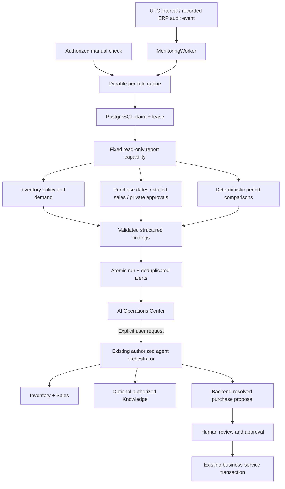

# Phase 11.6 — Proactive operations

DemoERP adds a durable monitoring worker, deterministic inventory/order/sales checks, deduplicated in-app alerts and an AI Operations Center. Monitoring is opt-in and independent of Ollama. Model explanations and purchase proposals require a deliberate authenticated user action. Order persistence still requires the existing explicit approval endpoint and current-price/stock/supplier/identity revalidation.

## Verified baseline

Before edits, the existing Phase 11.5 source and tests were inspected, not inferred from a plan. The code contained InventoryAnalysisAgent, SalesAnalysisAgent, order draft resolution, bounded AgentOrchestrator, private execution/step records, durable proposals and approval idempotency. Knowledge ingestion, actual local embeddings, authorized pgvector/full-text retrieval and verified source excerpts were present. Read-only tools recheck current identity and role/security version. The baseline passed **634 tests with one opt-in live test skipped**, 635 total. Copies are under ignored `.tools/phase11-6/baseline/`.

There was no previous proactive scheduler or alert center. Existing committed-style business audits provide events to observe; there is no domain event bus/outbox. The ERP is a single shared workspace with Admin/Manager/Viewer roles, **not a tenant-enabled system**. Sales Order has statuses Pending/Confirmed/Completed/Cancelled and no delivery deadline. PurchaseOrder is a separate entity with optional ExpectedDeliveryDate. These facts determine supported monitoring behavior.

The repository had no HEAD commit and untracked project sources. Work continued on dedicated unborn branch `codex/phase11-6-proactive-ai` without staging/resetting prior work. No remote publication or automatic deployment is part of this phase. The already running local 11.5 application and its database remain separate from verification services.

## Design



`MonitoringAnalysisService` is a fixed report capability: no arbitrary SQL, shell, model-selected tools or business write method. It reuses ReportingService and InventoryAnalysisAgent.Calculate. The service identity is **`service:erp-monitor-v1`**, restricted in the code contract to **`workspace:reporting-read`**. It is not a human account or a synthetic administrator ClaimsPrincipal. The background path writes only monitoring state/alerts/history. It uses the application's existing PostgreSQL connection; it does **not** claim a separate database-enforced least-privilege role. The interface boundary should be combined with a dedicated read/metadata DB role before a stricter production deployment.

The worker creates a new DI scope per iteration. It polls at a configurable interval (default five seconds), enqueues due enabled rules, observes applicable business audit rows when event checks are enabled, and executes one bounded check. Scheduled monitoring makes **zero LLM calls**. This protects interactive model capacity and ensures alerts still work when Ollama or the AI provider is disabled.

### Rules and quantities

| Check | Actual behavior |
| --- | --- |
| Inventory | Reads up to 200 authorized aggregate inventory rows; zero stock is critical, stock at/below its configured minimum is a warning. Uses existing warehouse-derived minimum levels, not fabricated thresholds. |
| Replenishment | Uses the existing deterministic policy: max(minimum + 1, 14 days of constant historical completed-order demand). No quantity is invented when threshold and demand are both missing. It is a review suggestion, not a forecast or approved purchase. |
| Consumption | Compares two adjacent configurable periods of recorded stock-outs, order deductions and production consumption. Requires sample, absolute-unit and percentage gates; transfer movements, adjustments and returns are excluded. Flags observed increases, without inferring their cause. |
| Purchase dates | Submitted/PartiallyReceived purchases with an actual ExpectedDeliveryDate before now are overdue; actual dates within the configured warning window are approaching. Draft/Received/Cancelled purchases and missing dates do not become overdue alerts. |
| Sales order age | Pending/Confirmed orders whose last UpdatedAt (or CreatedAt) exceeds the configured age are stalled. This is status age, not an invented shipping deadline. |
| Approvals | Unexpired pending proposals from successful, unexpired executions generate owner-private alerts. Other users, including another Admin, cannot read their content/history. No proposal payload is copied into notifications. |
| Sales | Compares adjacent equal-length CompletedAt windows using existing reporting definitions. Workspace, product and customer sales values must meet minimum samples in **both** periods, minimum absolute USD difference and minimum percentage change. No division by zero or inferred cause. |

Default comparison period is 30 days, five samples per period, 50% change, absolute difference 100 (USD for sales; units for consumption). A zero baseline or too few orders produces an insufficient-history explanation, not a confirmed anomaly. Each period supports 7–90 days, interval 1–1,440 minutes, stalled age 1–365 days and delivery warning 1–30 days. Existing stock thresholds can be edited through Inventory by existing authorized roles.

Each scan publishes at most 250 findings. Candidate collections have explicit bounds: up to 200 inventory/consumption/order/approval rows and up to 101 candidates per sales group/period. Results indicate truncation. Product/customer comparisons are bounded candidates, not an exhaustive enterprise anomaly detector. The reports use read-committed queries at one reference time, not a single repeatable-read business snapshot; subsequent business changes are expected and order approval always revalidates current data.

### Queue and recovery

Five additive tables are introduced: MonitoringRules, MonitoringRuns, OperationalAlerts, OperationalAlertHistory and MonitoringReviews. The additive migration `20261021165224_ProactiveOperations` seeds only three **disabled** monitoring configurations. ERP records, stock thresholds and users are not seeded or recreated.

Each queue operation locks its rule row. A partial unique index allows at most one queued/running/retry run per rule, and a unique rule/request-key index makes repeated manual operation keys idempotent. Different users cannot reuse another operator's request key to obtain their request result. A PostgreSQL `FOR UPDATE SKIP LOCKED` claim permits different API instances to claim work without the same active lease. Workers validate the lease under a row lock before publishing a transaction containing alerts and terminal run state.

Default execution deadline is 45 seconds (configurable 5–90). A running lease older than two minutes is recoverable. A paused old process may still finish computation, but its obsolete lease cannot publish results. Transient database/timeouts use bounded exponential backoff (4 then 8 seconds for the first two failed attempts). At most three analysis attempts are executed; an exhausted interrupted lease records terminal failure without another analysis. Permanent/exhausted failures create one deduplicated execution-failure alert.

Cancellation persists a terminal cancelled state. Queries already in flight may finish until cancellation/timeout is observed, but they cannot publish after the run is cancelled. Cancellation is not rolled back by worker failure handling. Admin can cancel service jobs; a Manager can cancel their own manual job. Shutdown interruption is recoverable rather than silently deleting work. These semantics are **at-least-once computation with fenced/idempotent publication**, not an exactly-once execution guarantee.

Audit-based event observation is best-effort polling, debounced to at most once a minute per rule. It is not a transactional outbox; unusual timestamp/commit races or audit retention can miss an event. Enabled scheduled checks provide eventual re-evaluation. No external event broker or distributed orchestration framework was introduced.

### Alert lifecycle

One row per rule/condition key prevents repeated active alerts. Repeated unchanged checks update LastSeenAt without a new alert or history event. Changed facts are recorded as a history event. Acknowledge, resolve and dismiss actions persist an authenticated actor; they suppress reopening while the same condition remains present. A complete later scan can mark the condition cleared. If it reappears after clearing, the same alert row reopens with an incremented occurrence and history. Partial scans never automatically clear unseen prior conditions.

Turning off warning preferences suppresses **new warning creation**; it does not erase existing history or suppress critical zero-stock/execution failures. In-app delivery is implemented by `IOperationalNotifications` / OperationalAlerts; there is no email, Slack, push provider or paid channel. Future outbound adapters require separate authorization and a suitable sensitive-data policy.

### User-directed collaboration and approvals

Inventory alerts offer three explicit paths: Inventory + Sales explanation, Inventory + Knowledge policy evidence, or Inventory + Sales + backend-resolved purchase proposals. These use the existing orchestrator, tool validation, identity rechecks, execution budgets and audit journal. Knowledge remains read-only and retains verified excerpt semantics. Policy documents are those the current user is authorized to read; there is no new invented document-approval system.

A private review record binds alert + occurrence + authenticated owner + purpose to one execution, protected by a transaction-scoped advisory lock and unique index. Repeated clicks reuse the same execution. If interrupted, the existing Agent Center recovery/retry controls remain available. An occurrence retains its first review per purpose; for substantially changed facts during that same occurrence, a user may initiate a fresh analysis from Agent Center. Saved proposals expire and stale approval facts are rejected normally. Monitoring never invokes Approve or directly creates/cancels/modifies sales/purchase orders.

## UI, permissions and observability

`/operations` integrates with existing navigation and Agent Center. It shows critical/open alerts, active jobs, **my** pending approvals, provider health, verified facts, record links, alert history, run outcome/attempts/timing, insufficient-history/truncation messages and Admin rule configuration. Source-backed Knowledge excerpts and explicit existing approval cards are reused. Text is rendered as React text or the established safe AI renderer; uploaded entity labels are never interpreted as HTML. Turkish/English and mobile accessibility checks are included.

BusinessRead permits workspace findings and owner-private approval findings. BusinessWrite permits manual checks/alert actions and authorized proposals. Only UserManage/Admin configures schedules; every operation rechecks the active user's role and security version on the server. Schedules are global to the actual single workspace. Cross-tenant isolation cannot be claimed until the ERP implements tenants. No other user's execution or approval becomes visible through a notification link.

Run records store identity, trigger, settings snapshot, attempts, lease, safe error category, timings, diagnostics and **workspace-only** finding counts (private approval counts are omitted). Alert lifecycle and configuration/cancellation audit metadata are retained. Model calls retain existing provider/model/token/step metrics in the user's private agent journal. Secrets, prompts, chain-of-thought, source documents and customer contact details are not deliberately logged. Monitoring history is currently bounded on reads, not automatically purged; a retention policy is Phase 11.7 work.

Chat and embedding calls share a bounded `LocalModelGate`: `LocalInference__Concurrency=1` and `LocalInference__QueueLimit=8` by default. Up to two concurrent local operations are configurable, but **keep one on the RTX 4060 8 GiB**. Overflow returns safe `aiBusy`; cancellation releases queue capacity. Existing provider deadlines, output/context/tool-call budgets and model health probes remain. Scheduled checks never enter this queue. Resource limits are per API process, not a cross-process GPU scheduler; external Ollama clients are outside it. Embeddings retain CPU placement and bounded batches from Phase 11.5. No GPU utilization dashboard or throughput guarantee is claimed.

## Windows local demonstration

Use the prerequisites from [local RAG setup](ENTERPRISE_RAG.md): .NET 10 SDK, Node 22/npm, Docker Desktop Linux containers and local Ollama. Existing Ollama installation can be verified with `ollama list`. Pull models explicitly if absent:

```powershell
ollama pull qwen3:8b
ollama pull nomic-embed-text
```

Do not publish Ollama or set OLLAMA_HOST to a public address. From the repository root, start only a **new** review database/volume. This does not point at the normal local or production database:

```powershell
Set-Location (Join-Path $env:USERPROFILE 'source\DemoErp')
docker compose --env-file .env.example -p demoerp-monitor-review -f docker-compose.yml -f docker-compose.monitoring-local.yml up -d --wait postgres
```

Terminal 1 — native backend on 5117; the fresh database is 55440:

```powershell
Set-Location (Join-Path $env:USERPROFILE 'source\DemoErp')
$env:ASPNETCORE_ENVIRONMENT = 'Development'
$env:ConnectionStrings__Default = 'Host=127.0.0.1;Port=55440;Database=catalog;Username=catalog;Password=development-only-db-password'
$monitorSigningBytes = New-Object byte[] 48
$monitorRng = [System.Security.Cryptography.RandomNumberGenerator]::Create()
$monitorRng.GetBytes($monitorSigningBytes)
$monitorRng.Dispose()
$env:Jwt__Secret = [Convert]::ToBase64String($monitorSigningBytes)
$env:Jwt__Issuer = 'catalog-api'
$env:Jwt__Audience = 'catalog-web'
$env:Cors__Origins__0 = 'http://127.0.0.1:3037'
$env:Monitoring__Enabled = 'true'
$env:Monitoring__PollSeconds = '5'
$env:Monitoring__TimeoutSeconds = '45'
$env:LocalInference__Concurrency = '1'
$env:LocalInference__QueueLimit = '8'
$env:AiAssistant__Enabled = 'true'
$env:AiAssistant__Provider = 'Ollama'
$env:AiAssistant__TimeoutSeconds = '120'
$env:AiAssistant__MaxOutputTokens = '2000'
$env:AiAssistant__MaxRetries = '0'
$env:OLLAMA_ENDPOINT = 'http://127.0.0.1:11434'
$env:OLLAMA_MODEL = 'qwen3:8b'
$env:OLLAMA_CONTEXT_WINDOW = '8192'
$env:Knowledge__Enabled = 'true'
$env:Knowledge__EmbeddingModel = 'nomic-embed-text'
$env:Bootstrap__Enabled = 'true'
$env:Bootstrap__Name = 'Local operations administrator'
$env:Bootstrap__Email = Read-Host 'New isolated ERP administrator email'
$env:Bootstrap__Password = [System.Net.NetworkCredential]::new('', (Read-Host 'Administrator password' -AsSecureString)).Password
try {
    dotnet run --project backend/Demo.Api --no-launch-profile --urls http://127.0.0.1:5117
} finally {
    Remove-Item Env:Bootstrap__Password -ErrorAction SilentlyContinue
}
```

After first provisioning, disable Bootstrap and remove its password before later starts. Native .NET `Monitoring__*` / `LocalInference__*` environment examples are not automatically forwarded to Docker's backend service. Keep a stable private signing secret if sessions should survive restarts. Optional Knowledge requires pgvector; deterministic monitoring itself works on plain PostgreSQL too.

Terminal 2 — frontend:

```powershell
Set-Location (Join-Path $env:USERPROFILE 'source\DemoErp\frontend')
$env:VITE_API_BASE_URL = 'http://127.0.0.1:5117/api'
npm.cmd ci
node node_modules/vite/bin/vite.js --host 127.0.0.1 --port 3037 --strictPort
```

Open [AI Operations Center](http://127.0.0.1:3037/operations). Sign in as the fresh Admin. Rules start disabled: enable each desired schedule in the UI, configure frequency/limits, or explicitly Run check now. Create a synthetic active product and set its existing minimum in Inventory to demonstrate a zero-stock alert. Do not automatically seed retained databases. If no sales history exists, the UI reports insufficient history. Upload an authorized replenishment manual in Knowledge Center to enable a policy review with real source citations. Only the explicit proposal approval card may persist an order.

### Automated and opt-in live checks

Ordinary CI uses deterministic models and disposable PostgreSQL/pgvector containers; Docker must run:

```powershell
dotnet test backend/Demo.Api.Tests
node --test scripts/tests/*.test.mjs
Set-Location frontend
npm.cmd run lint
npm.cmd test -- --run
npm.cmd run build
```

The backend live test creates isolated test data in Testcontainers, calls actual local Qwen3 through the authenticated .NET API, verifies persisted alerts/deduplication/model tokens and unchanged order counts:

```powershell
Set-Location (Join-Path $env:USERPROFILE 'source\DemoErp')
$env:PROACTIVE_LIVE_SMOKE = 'true'
try {
    dotnet test backend/Demo.Api.Tests --filter-class '*Monitoring*'
    if ($LASTEXITCODE -ne 0) { throw 'Monitoring/live model tests failed.' }
} finally {
    Remove-Item Env:PROACTIVE_LIVE_SMOKE -ErrorAction SilentlyContinue
}
```

The optional API runner tests a **running isolated local API**. It explicitly creates a labelled synthetic category/product and minimum-level fixture, plus monitoring/alert/private execution records. It does not call order creation or approval. Both opt-ins are required:

```powershell
$env:API_URL = 'http://127.0.0.1:5117'
$env:AI_LIVE_EMAIL = Read-Host 'Existing isolated administrator email'
$env:AI_LIVE_PASSWORD = [System.Net.NetworkCredential]::new('', (Read-Host 'Administrator password' -AsSecureString)).Password
$env:PROACTIVE_API_LIVE_SMOKE = 'true'
$env:PROACTIVE_ALLOW_SYNTHETIC_FIXTURES = 'true'
try {
    node scripts/proactive-live-smoke.mjs
    if ($LASTEXITCODE -ne 0) { throw 'Real API monitoring acceptance failed.' }
} finally {
    Remove-Item Env:AI_LIVE_PASSWORD -ErrorAction SilentlyContinue
    Remove-Item Env:PROACTIVE_API_LIVE_SMOKE -ErrorAction SilentlyContinue
    Remove-Item Env:PROACTIVE_ALLOW_SYNTHETIC_FIXTURES -ErrorAction SilentlyContinue
}
```

Optional installed Edge browser acceptance also creates labelled synthetic product/threshold fixtures in this isolated API. Traces/screenshots are disabled:

```powershell
$env:FRONTEND_URL = 'http://127.0.0.1:3037'
$env:AI_LIVE_PASSWORD = [System.Net.NetworkCredential]::new('', (Read-Host 'Administrator password' -AsSecureString)).Password
$env:PROACTIVE_UI_LIVE_SMOKE = 'true'
try {
    node frontend/node_modules/@playwright/test/cli.js test --config=frontend/playwright.operations.config.ts
    if ($LASTEXITCODE -ne 0) { throw 'Real UI monitoring acceptance failed.' }
} finally {
    Remove-Item Env:AI_LIVE_PASSWORD -ErrorAction SilentlyContinue
    Remove-Item Env:PROACTIVE_UI_LIVE_SMOKE -ErrorAction SilentlyContinue
}
```

Never point fixture/live verification at retained operational or production databases. Public README demo accounts are not automatically created on a fresh database. Native Windows uses `npm.cmd` to avoid npm.ps1 execution-policy issues. No global PowerShell execution-policy change is needed.

## Migration and limitations

Before any retained database upgrade, verify a private backup and restore it into a separate review instance. Review the additive migration SQL with matching EF Core 10 tools, run against the copy, and compare existing business records before approving rollout. Application startup applies pending migrations, so its connection string is the deployment boundary. No production/local-user database was upgraded during this implementation. The currently running old local build continues using its existing schema.

Monitoring is rule-based and bounded, not an unrestricted autonomous agent loop. Historical completeness and minimum-level quality affect usefulness. Sales changes are signals, not statistical significance tests, forecasts or inferred causes. Model/RAG unavailability can prevent optional explanations, but not deterministic monitoring. UI runs history reads the latest 50; alert pages contain 25 and per-alert history up to 100. No automatic monitoring retention/purge, email escalation, business-calendar deadlines or tenant administration is implemented. A process-local inference gate is not a distributed GPU reservation mechanism.

Recommended **Phase 11.7**: tested monitoring retention/archive rules, transactional outbox, workload-specific evaluation and paging, durable per-user notification preferences, role-separated database credentials, refreshable review versions when facts change, calendar-aware SLA fields if business requirements justify them, and a multi-instance inference admission service only when measured workload requires it. Add externally delivered notifications only after explicit channel authorization and data policy review.

Changed source: `AI/Monitoring/{MonitoringModel,MonitoringAnalysis,MonitoringAlerts,MonitoringEngine}.cs`, MonitoringController, Program/DI/rate limits, AppDbContext/audit filter, shared bounded Ollama/embedding gate, additive migration/designer/snapshot; React OperationsCenter/router/navigation/AgentCenter link handling/translations; MonitoringTests, operations browser fixtures/live config; smoke runner/tests, environment and review Compose files. No paid dependency was added.

Execution results are recorded in [VERIFICATION.md](../VERIFICATION.md). Implementation references: [Microsoft scoped hosted background services](https://learn.microsoft.com/en-us/aspnet/core/fundamentals/host/hosted-services?view=aspnetcore-10.0), [PostgreSQL 17 locking SELECT and SKIP LOCKED](https://www.postgresql.org/docs/17/sql-select.html).
