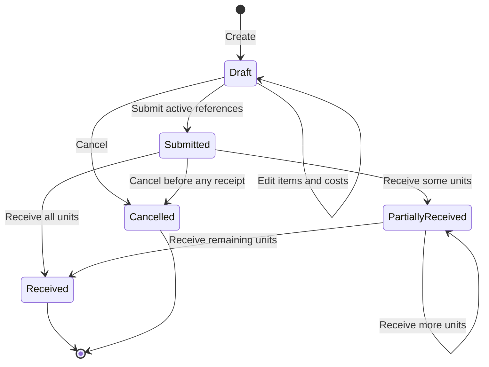
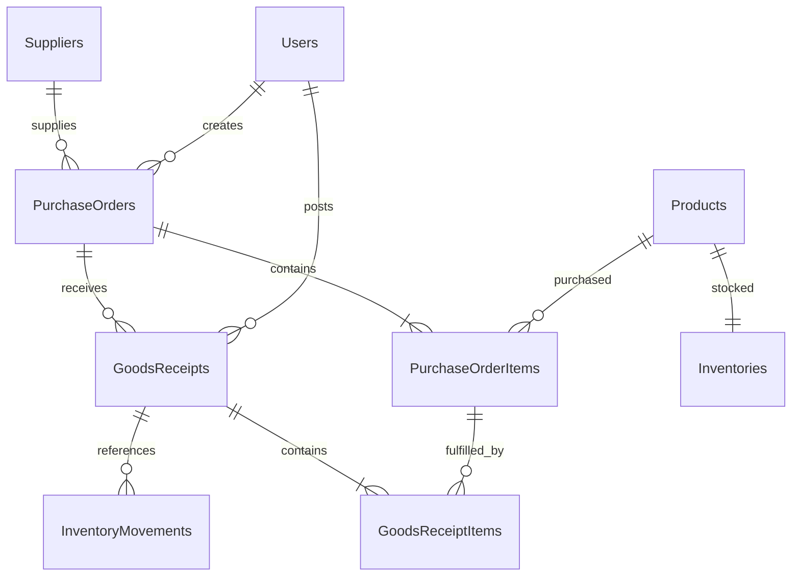

# Procurement and supplier management

Phase 8 receipts now store their destination warehouse; separate partial receipts can target different warehouses. Fingerprint version 2 includes resolved warehouse identity while old fingerprints remain version 1. [Warehouse receipt behavior](WAREHOUSE_MANAGEMENT.md).

[README](../README.md) · [Database](DATABASE.md) · [API](API.md) · [Verification](../VERIFICATION.md)

Phase 7 extends the existing single ASP.NET Core API, EF Core/Npgsql persistence,
React application, JWT policies and audit writer. `SupplierService` owns supplier
changes; `ProcurementService` owns draft editing, lifecycle transitions, receipt
posting and small SQL report projections. There is no separate purchasing service,
message bus, generic idempotency framework or financial settlement module.

## Business flow

Only Draft orders can be edited. Creation and submission never change inventory.
Each draft contains 1–100 distinct products with whole quantities 1–100,000. The
caller enters UnitCost, a nonnegative decimal with at most two decimal places and
precision 12,2. It is independent of Product.Price. The server calculates
LineTotal = QuantityOrdered × UnitCost and TotalAmount = sum(LineTotal), both
precision 18,2. Client totals are estimates; extra total/status/actor fields in
requests cannot override server decisions. Editing retains IDs for retained
products and removes only unreceived Draft lines.

Supplier codes are trimmed, uppercased ASCII identifiers (1–40 letters, numbers,
hyphens or underscores), unique in PostgreSQL. Contacts are bounded and optional;
nonempty email must be valid. Deactivate instead of deleting historical suppliers:
there is deliberately no Supplier DELETE endpoint. Inactive suppliers/products
cannot be selected for a new draft or submitted order. Receiving an already
submitted order remains possible after reference deactivation, to preserve real
delivery history. Cancellation is allowed for Draft or Submitted with no receipts;
PartiallyReceived/Received cannot be cancelled. Returned goods/corrections are
outside this phase; a posted receipt has no edit/delete API.

## Relationships and migration

`20261010072904_Procurement` is the seventh additive migration. It creates
Suppliers, PurchaseOrders, PurchaseOrderItems, GoodsReceipts and GoodsReceiptItems,
plus independent bigint PO/GR number sequences. UTC date prefixes and sequence
values generate readable unique numbers; rolled-back attempts can leave sequence
gaps. Numbers are identifiers, not gapless accounting documents.

All five entities have UUID keys. All new foreign keys use Restrict. Received
quantities satisfy 0 ≤ received ≤ ordered; costs/totals are nonnegative; line
totals equal quantity × cost. Receipt quantities must be positive. Unique indexes
cover supplier code, document numbers, (PO, Product), (Receipt, POItem),
(User, IdempotencyKey) and (Receipt, Product) on stock movements. PO date/ID and
status/date indexes support lists and status counts. Receipt PO/date and FK
indexes support navigation. Filtering and aggregates execute in PostgreSQL;
DTO projections use AsNoTracking with bounded Count/Skip/Take pagination.

InventoryMovement appends `PurchaseReceipt` without changing existing enum
values or manual/sales semantics. Existing ReferenceId remains a real Orders FK.
New nullable GoodsReceiptId is a separate real FK; reference checks enforce the
correct movement type and exactly the appropriate reference. No polymorphic FK
is introduced. Existing immutable movement and audit triggers remain intact.
New UPDATE/DELETE triggers protect receipts and receipt items, and an INSERT
trigger verifies each receipt item belongs to the receipt's order.

The migration does not reset, backfill, reinterpret or seed any existing stock,
sales or audit rows. Upgrade tests compare the full nine pre-existing tables,
excluding only the newly added nullable movement column, before and after upgrade.
The application still migrates on startup. Back up an existing volume before an
upgrade; do not use `down -v`. Downgrading a database with purchase movement history
is intentionally unsuitable because immutable history and restrictive FKs prevent
discarding posted documents.

## Atomic receipt posting and concurrency

1. Validate the typed request and required nonempty UUID `Idempotency-Key` header.
2. Start a Read Committed PostgreSQL transaction. Acquire a transaction-scoped
   advisory lock derived from SHA-256 of authenticated user ID + operation key.
3. Check for a prior committed receipt for that user/key. Matching fingerprint
   returns the original receipt before any current-status check. A changed
   fingerprint returns 409. This also makes a retry safe after full receipt.
4. Lock the PO row using SELECT FOR UPDATE. Load its lines and validate the latest
   status and remaining quantities. Every selected line must belong to that PO;
   duplicates, zero/negative quantities and over-receiving are rejected.
5. Allocate the receipt number and stage receipt/items. Lock inventory rows by
   sorted ProductId, matching the existing sales/stock strategy. Increase stock
   using `InventoryService.Apply` and stage one immutable PurchaseReceipt movement
   per product, referring to the new receipt and authenticated actor.
6. Increase line QuantityReceived and derive PartiallyReceived or Received from
   all line quantities. Stage allowlisted PO/receipt audit entries through the
   existing DbContext SaveChanges override. Save once and commit once.

Any failure rolls back receipt, items, quantities, inventory, movements, status,
audit and the operation key together. No key is reserved on a failed transaction.
Audit insertion failure and a later product's inventory overflow are covered by
real PostgreSQL rollback tests. Inventory is bounded by Int32; overflow returns a
safe 409. No external calls occur inside this transaction.

At 60 received of 100 ordered, two competing receipts of 30 serialize on the PO
row. The second observes 90 and rejects 30; it cannot commit 120. Different POs
sharing products serialize their inventory updates in consistent product order.
Locks live in PostgreSQL and therefore coordinate separate API processes.
The advisory lock serializes only the same authenticated user/key. The unique
index remains a database backstop. An unlikely hash collision causes extra
serialization, not an incorrect idempotency match.

## Idempotency contract and UI

The fingerprint is SHA-256 over PO ID, trimmed notes, and receipt lines sorted by
POItemId (each ID and whole quantity). Order and whitespace changes normalize to
the same operation; another PO, quantity or notes is a conflict for a reused key.
The key is scoped to the authenticated user, not an untrusted actor request field.
The original complete receipt DTO is reconstructed from immutable records.
First success returns 201 with Location; replay returns 200. The response includes
`Idempotency-Replayed: false|true`. Keys persist with their receipt and do not expire.

The receive form starts every quantity at zero, shows ordered/received/remaining,
validates at least one positive line, and requires confirmation. It keeps a UUID
in a React ref for the normalized payload, reuses it after a failed send, and
creates a new UUID when a reviewed payload changes. Pending controls prevent
double clicks. Success refreshes PO, receipts, inventory, dashboard and reports,
then navigates to the permanent receipt. The key is **not persisted across page
reloads or navigation**: after an uncertain response, retry in the same form or
check receipt history before starting a new operation. The API supports callers
that persist their key independently; the server does not guess identical new
deliveries from equal content.

Supplier lists and lookup use server search and pagination. Draft selection shows
active suppliers; history/report filters include inactive suppliers. PO lists show
unit-weighted progress: sum(received) / sum(ordered), never average percentages.
Forms use React Hook Form/Zod; read-only Viewer controls and routes are guarded.
All screens and business errors support EN/TR, locale dates and USD formatting.
Tables scroll within their panel on small screens. Receipt detail links to PO,
supplier and inventory; stock movements link back to their actual receipt.

## Authorization, audit and reports

BusinessRead permits Admin, Manager and Viewer for every new read, including
receipt detail, procurement report and summary. BusinessWrite permits Admin and
Manager for supplier/PO/receipt changes. JWT role, active status and security
version are still checked against Users on every request. UI permissions are only
presentation; APIs enforce the policies independently. Actor IDs come from JWT sub.

Audit uses Supplier Create/Update/Activate/Deactivate, PO Create/Update/
PurchaseSubmit/PurchaseCancel/PurchaseReceive and GoodsReceiptPost. Snapshots
allowlist supplier code/name/active; PO number, supplier, status, expected date and
total; and receipt number/PO. Metadata-only edits use an operation marker. Contact
PII, notes, full receipts, movement objects, fingerprints and keys are not dumped.
Stock quantities retain their precise history in InventoryMovements. Audit,
business and stock writes commit in the same transaction.

`GET /dashboard/procurement-summary` is a separate small SQL summary: submitted or
partially received open POs, partial count, received count, active suppliers and
outstanding units for open POs. Draft/cancelled units are excluded. This is a
current operational snapshot, independent of the sales dashboard date range.
`GET /reports/procurement` and `/reports/procurement` UI reuse the PO DTO/page
framework with supplier, status, number search, stable sort and optional half-open
UTC order-date interval (both endpoints required, maximum 366 days). This phase
does not introduce procurement CSV export, payments, invoices, tax calculation,
currency conversion, returns or valuation accounting. AI tools are unchanged.
