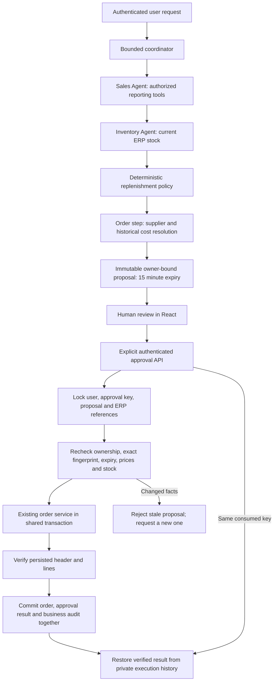

# Phase 11.4 — Secure agent workflows

[Executed results](../VERIFICATION.md) · [Agent architecture](INTELLIGENT_AGENTS.md) · [Local Ollama setup](OLLAMA_INTEGRATION.md)

## Verified baseline

Before edits, the complete backend suite reported **571 passed, one opt-in live test skipped, zero failed** (572 total). The actual source contained bounded Sales, Inventory and natural-language Order Draft services, private run/step metadata and nine allowlisted reporting tools. Read-only inference already had schema checks, bounded recovery, authorization rechecks, timeouts, quotas and a sequential Ollama generation gate. Normal customer and purchase order services already provided transactions and business audit.

The previous Agent Center save button was a human action calling ordinary `POST /api/orders`. The model itself had no business write tool. There was no server-owned approval proposal, expiry, exact-content binding or durable idempotency for that button. The source repository had no HEAD commit and all project files were untracked; development switched its unborn branch to `codex/phase11-4-secure-workflows` without staging, resetting or overwriting existing work. A local source backup and baseline logs are retained under ignored `.tools/phase11-4/`.

## Architecture



Agents are typed application services, not unconstrained model personas. Model tools still cannot execute SQL, shell commands, arbitrary URLs or writes. The new approval endpoints are browser/user operations, never model tools. OpenAI and explicit Development Mock remain compatible; Mock is not a live-model verification.

## Sales and purchase proposals

For customer sales drafts, the backend resolves actual active customers/products, default warehouse, prices and available stock. A complete successful draft produces a `sales` proposal; ambiguous or missing fields produce clarification only. Normal manual order creation remains available and keeps its existing behavior.

The explicit Turkish request is supported:

> Son 30 günlük satışları analiz et, mevcut stokları kontrol et ve eksik ürünler için satın alma siparişi hazırla.

It deterministically selects `procurement`, executes **orchestrator → sales → inventory → order → summary** and uses the same 30-day window for Sales and Inventory. The order step groups eligible shortages by supplier. Supplier and unit cost come from the latest submitted, partially received or received purchase item for that product with an active supplier. Draft/cancelled purchases are excluded. Ties use item ID order. These are historical costs, **not current supplier quotations**, and are labelled accordingly.

Missing supplier/cost evidence is returned as `missingPurchaseReferences`; the backend never uses a sales price as purchase cost, invents a supplier, or sends a replenishment request to the customer sales-order API. Requests with no eligible shortages produce no purchase proposal. The existing ten-product inventory bound and truncation indicator apply; this is not a complete MRP allocation or forecast.

Approving a sales proposal creates a **Pending** customer order. Approving a purchase proposal creates a **Draft** purchase order. Neither action reserves or changes stock. Sales confirmation, purchase submission and goods receipt remain separate ordinary ERP actions.

## Approval guarantees

* Proposals are prepared solely from typed backend facts. Their SHA-256 fingerprint binds proposal ID, execution ID, initiating user, action kind and exact serialized facts. It is a content binding, not a secret bearer credential.
* The authenticated initiating user must also currently satisfy `OrderManage` (Admin/Manager). A different administrator cannot approve another user's proposal. Viewer can analyze but cannot approve. Current identity/security-version checks run again inside the transaction; the actor row is locked through commit.
* The parent execution must have finished successfully. The UI also disables pending approval controls when execution success is not verified. Incomplete, cancelled and interrupted workflows cannot be approved.
  A proposal prepared before a later summary failure can remain in history, but this parent-state gate prevents its use; it expires normally. Recovery never turns an incomplete proposal into an executable order.
* Pending proposals expire after 15 minutes. History derives expiry even before an approval attempt. Changed stock, product prices/names, customer/supplier names or warehouse names reject the old proposal. Purchase approval also checks the referenced cost and whether the historical price source is still the latest eligible source.
* Approval accepts only proposal ID, fingerprint and a nonempty UUID idempotency key. Quantities, prices, counterparty or warehouse cannot be supplied through the approval body to override the stored proposal.
* A PostgreSQL transaction advisory lock serializes the operation key; a row lock serializes proposal consumption. A unique `(UserId, IdempotencyKey)` index prevents reusing a consumed key on a different proposal. Same key + same already approved proposal returns the verified original result. A different key cannot re-execute a consumed proposal. Expired, cancelled or stale proposals cannot create an order.
* Existing order services join the approval transaction when one exists and retain their original standalone transaction behavior for manual calls. Order creation, approval consumption/result and business audit commit or roll back together. An actual PostgreSQL audit-FK failure regression verifies that no order or approval consumption survives rollback.
* Result verification checks persisted counterparty, warehouse (sales), item IDs, quantities, unit prices/costs and total. History reload performs verification again. Later manual edits that no longer match the proposal are reported as unverified; the UI does not label them a verified success. Ordinary lifecycle status changes are reflected without creating another order.
* Failed approval attempts keep a bounded, owner-scoped error category and structured backend log entry. This metadata is recorded separately after rollback; it does not commit a failed order. If the database is unavailable, failure recording is best effort.

The UI keeps one key for repeated attempts in the current view, blocks concurrent double clicks and removes consumed approval controls. After losing connectivity, reopen execution history to discover the durable server result. A fresh key after reload still cannot create a second order for a consumed proposal. Separate executions deliberately generate separate proposals; there is no global deduplication of semantically similar natural-language requests.

## Execution state and recovery

`AiAgentRuns` now persists actual start/end timestamps, cancellation request and retry parent. Existing execution/step/tool metadata retains provider, model, usage, latency, outcome and safe error categories. Tool status exposes start and derived end time. Initiating user ID and execution ID are visible without storing the question or raw provider response in this history.

The coordinator preserves five steps, six trusted read operations, three model calls and bounded context. Fixed routing, demand calculations and supplier lookup do not need an LLM. Existing provider transport/selection/final-answer retries remain bounded; business writes are never blindly retried. A database-backed cancellation monitor cancels an active generation, including cancellation from another API instance. Request disconnects and the execution timeout are also linked.

A running execution can be explicitly marked `interrupted` only after its persisted start exceeds configured timeout plus 30 seconds. Recovery marks running steps interrupted and requests cancellation; journal finalization cannot overwrite that recovered outcome. It never repeats an uncertain transaction. Approved results are restored from proposals. A failed/cancelled/interrupted run can prepare a new queued run linked by `RetryOf`, with at most two retries after the original run. The user submits the request again, so fresh facts and a new approval are required. Quotas apply to new runs as before.

This is durable interruption detection and safe restart, not autonomous process-resuming background execution. Questions and full historical report snapshots are not stored here. A retry does not restore a lost prompt, and separate model processes are not coordinated by the in-process generation gate. Proposal details are private to the initiating user and are purged with the existing execution retention (default seven days); regular business audit and actual orders have their normal retention.

## API additions

All routes require authentication; read/cancel/recovery/history are owner scoped. Approval additionally requires `OrderManage`.

| Method | Path under `/api/ai/agents` | Behavior |
| --- | --- | --- |
| GET | `runs/{id}/proposals` | Restore owner-only proposals and verified results |
| POST | `proposals/{id}/approve` | `{ idempotencyKey, fingerprint }`; atomic approval or idempotent original result |
| POST | `proposals/{id}/cancel` | Consume a pending proposal without a business write |
| POST | `runs/{id}/cancel` | Persist cancellation and stop active processing |
| POST | `runs/{id}/recover` | Recover an actually stale running execution |
| POST | `runs/{id}/retry` | Prepare a bounded, linked queued retry; no automatic execution |

The additive `20261021134822_SecureWorkflowProposals` migration creates `AiOrderProposals` and adds workflow metadata columns. It does not alter existing orders, prices, users, password hashes or inventory. It adds an allowlisted proposal audit type; payloads, credentials and prompts are excluded from audit/logs. The migration preservation regression upgrades a real populated PostgreSQL database from the previous migration and checks its original rows and credentials.

## Windows: review on an isolated copy

These commands are instructions for a manual local review; they were not used to deploy the change to the user's running 5101/3021 application. They assume the existing local PostgreSQL container is `demoerp-local-ollama-postgres-1`. Adjust the source container if yours differs. The dump is private ERP data and must stay in ignored `.tools/`, never Git. Use a fresh target container name/port if already occupied; do not remove an existing database.

From the repository root, with Docker Desktop and Ollama already running:

```powershell
New-Item -ItemType Directory -Force .tools/phase11-4 | Out-Null
docker exec demoerp-local-ollama-postgres-1 pg_dump -U catalog -d catalog -Fc -f /tmp/phase114-review.dump
docker cp demoerp-local-ollama-postgres-1:/tmp/phase114-review.dump .tools/phase11-4/review.dump
docker run -d --name demoerp-phase114-review-db -p 127.0.0.1:55435:5432 -e POSTGRES_DB=catalog -e POSTGRES_USER=catalog -e POSTGRES_PASSWORD=development-only-review-password --health-cmd "pg_isready -U catalog -d catalog" --health-interval 2s --health-retries 30 postgres:17-alpine
docker inspect --format '{{.State.Health.Status}}' demoerp-phase114-review-db
# Continue only after this reports healthy.
docker cp .tools/phase11-4/review.dump demoerp-phase114-review-db:/tmp/review.dump
docker exec demoerp-phase114-review-db pg_restore -U catalog -d catalog --no-owner /tmp/review.dump
```

Backend, terminal 1 (the target copy receives the additive migration on startup):

```powershell
$env:ASPNETCORE_ENVIRONMENT = 'Development'
$env:ConnectionStrings__Default = 'Host=127.0.0.1;Port=55435;Database=catalog;Username=catalog;Password=development-only-review-password'
$workflowKeyBytes = New-Object byte[] 48
$workflowRng = [System.Security.Cryptography.RandomNumberGenerator]::Create()
$workflowRng.GetBytes($workflowKeyBytes)
$env:Jwt__Secret = [Convert]::ToBase64String($workflowKeyBytes)
$workflowRng.Dispose()
$env:Jwt__Issuer = 'catalog-api'
$env:Jwt__Audience = 'catalog-web'
$env:Bootstrap__Enabled = 'false'
$env:Cors__Origins__0 = 'http://127.0.0.1:3025'
$env:AiAssistant__Enabled = 'true'
$env:AiAssistant__Provider = 'Ollama'
$env:OLLAMA_ENDPOINT = 'http://127.0.0.1:11434'
$env:OLLAMA_MODEL = 'qwen3:8b'
$env:AiAssistant__TimeoutSeconds = '120'
$env:AiAssistant__MaxOutputTokens = '2000'
$env:AiAssistant__MaxRetries = '0'
$workflowDotnet = if (Test-Path '.tools/dotnet/dotnet.exe') { (Resolve-Path '.tools/dotnet/dotnet.exe').Path } else { 'dotnet' }
& $workflowDotnet run --project backend/Demo.Api -c WorkflowReview --no-launch-profile --urls http://127.0.0.1:5105
```

Frontend, terminal 2 from the repository root:

```powershell
Set-Location frontend
$env:VITE_API_BASE_URL = 'http://127.0.0.1:5105/api'
npm.cmd ci
node node_modules/vite/bin/vite.js --host 127.0.0.1 --port 3025 --strictPort
```

Use the copied database's existing Admin account. In Agent Control Center choose Automatic, select the Turkish purchasing example, inspect the supplier/cost evidence and check the appropriate review box. Click **Siparişi kaydet** to save a purchase Draft. Missing history is shown instead of invented purchasing data: create/submit a legitimate synthetic purchase in the isolated copy first if an acceptance fixture is needed.

Opt-in real write smoke, terminal 3 from the repository root. It writes **one purchase Draft** in this target database, repeats the same approval key and verifies persistence, exact facts, audit, history and unchanged stock/customer orders. Do not run it against production or concurrently with other writers. It never seeds data or downloads a model.

```powershell
$env:API_URL = 'http://127.0.0.1:5105'
$env:AI_LIVE_EMAIL = Read-Host 'Isolated ERP administrator email'
$env:AI_LIVE_PASSWORD = [System.Net.NetworkCredential]::new('', (Read-Host 'ERP password' -AsSecureString)).Password
$env:AI_WORKFLOW_LIVE_SMOKE = 'true'
$env:AI_WORKFLOW_ALLOW_WRITE = 'true'
try { node scripts/ai-workflow-live-smoke.mjs }
finally {
  Remove-Item Env:AI_LIVE_PASSWORD -ErrorAction SilentlyContinue
  Remove-Item Env:AI_WORKFLOW_LIVE_SMOKE -ErrorAction SilentlyContinue
  Remove-Item Env:AI_WORKFLOW_ALLOW_WRITE -ErrorAction SilentlyContinue
}
```

For the optional real browser acceptance, use the same isolated API/credentials, set `FRONTEND_URL=http://127.0.0.1:3025`, `AI_WORKFLOW_UI_LIVE_SMOKE=true` and `AI_WORKFLOW_ALLOW_WRITE=true`, then run `node frontend/node_modules/@playwright/test/cli.js test --config frontend/playwright.workflow.config.ts` from the root. The default browser is installed Microsoft Edge on Windows; `PLAYWRIGHT_CHANNEL` can select another installed supported channel. Traces and screenshots are disabled for this credential-bearing live test. It also creates a separate purchase Draft; it is not a read-only test. Clear the password and opt-in variables afterwards.

Ordinary regression commands (mocks/intercepted model responses, Docker for isolated PostgreSQL):

```powershell
.\.tools\dotnet\dotnet.exe test --project backend/Demo.Api.Tests/Demo.Api.Tests.csproj -c Workflow
npm.cmd --prefix frontend run lint
npm.cmd --prefix frontend test
node --test scripts/tests/*.test.mjs
```

The existing `OLLAMA_LIVE_SMOKE=true` opt-in additionally enables the real backend inventory/audit test; CI without it skips that single live case. Actual results, including failed setup attempts and final live evidence, are in [VERIFICATION.md](../VERIFICATION.md).

## Changed files

* `backend/Demo.Api/AI/Agents/WorkflowProposals.cs`: trusted sales/purchase proposals, content binding, approval, cancellation, idempotency, result verification and safe failure metadata.
* `backend/Demo.Api/AI/Agents/AgentOrchestrator.cs`, `AgentContracts.cs`, `AgentPersistence.cs`: fixed procurement dependencies, additive contracts, cancellation/recovery and durable timestamps/retry links.
* `backend/Demo.Api/Controllers/AgentsController.cs`, `AuditLogsController.cs`: owner-scoped operations and allowlisted proposal audit filtering.
* `backend/Demo.Api/Services/BusinessServices.cs`, `ProcurementService.cs`: join an existing approval transaction while preserving manual transactions.
* `backend/Demo.Api/AI/AiContracts.cs`, `AiExecutionJournal.cs`: tool timing and interruption-safe finalization.
* `backend/Demo.Api/Data/AppDbContext.cs`, `Data/Migrations/*SecureWorkflowProposals*`, `Data/Migrations/AppDbContextModelSnapshot.cs`, `Program.cs`: persistence, additive migration, safe audit fields and DI.
* `backend/Demo.Api.Tests/WorkflowTests.cs`, `WorkflowMigrationTests.cs`, `AgentControlTests.cs`: security, recovery, purchase, rollback and migration regressions; previous no-business-write test now distinguishes proposal audit from business writes.
* `frontend/src/WorkflowProposalCard.tsx`, `OrderDraftPreview.tsx`, `pages/AgentCenter.tsx`, `translations.ts`: secure review controls, purchase evidence, verified receipts, private history and TR/EN feedback.
* `frontend/tests/agent-center.spec.ts`, `frontend/playwright.workflow.config.ts`: fixture regressions and a separate opt-in real purchase UI test.
* `scripts/ai-workflow-live-smoke.mjs`, `scripts/tests/ai-workflow-live-smoke.test.mjs`: opt-in loopback-only write acceptance and intercepted CI/guard tests.
* This document, README links, agent documentation and `VERIFICATION.md` record the design and actual results.

## Limits and proposed Phase 11.5

There is no autonomous order creation, supplier communication, stock reservation or automatic goods receipt. Historical supplier costs are not contractual quotes; supplier choice is a documented deterministic heuristic, not optimization. Inventory analysis is bounded to ten rows and does not allocate scarce stock across other orders. Similar proposals from different executions can both be deliberately approved. Backend final-answer semantic checks cover supported phrases rather than proving every generated sentence.

Identity isolation applies to executions/proposals; the existing ERP is a shared business workspace, not a newly implemented multi-tenant system. Approvals cannot be delegated to another user in this phase. Recovery requires an explicit stale-run recovery and resubmission; it is not a durable job queue. If a database outage prevents finalization, persisted running state may need recovery once connectivity returns. Network responses after commit can still be lost, but same-proposal idempotency and history retrieval prevent repeating the write.

Recommended Phase 11.5: a durable worker/outbox with distributed quotas and leases; evaluated supplier quotation/lead-time policies; explicit approval delegation and separation of duties; production-grade approval/retention policy and tenant boundaries where required; broader Turkish intent/date-range and model-semantic evals. Keep business execution allowlisted and human approved throughout.
