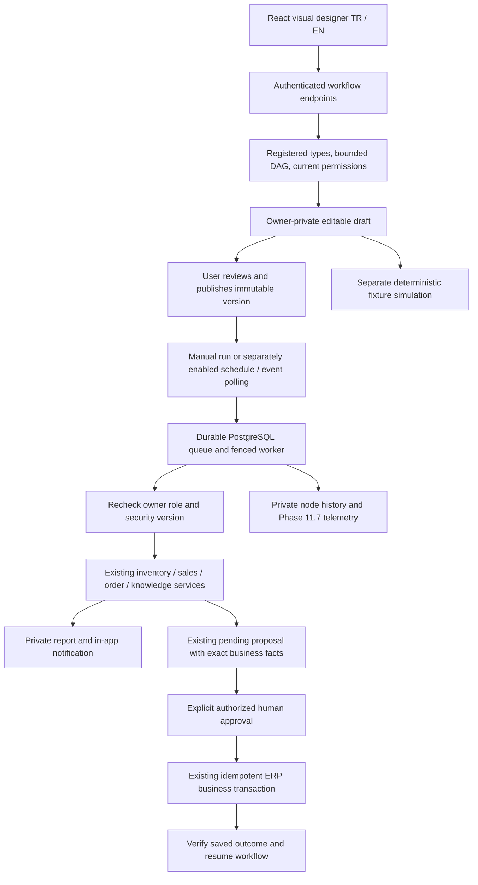

# Phase 11.8 — Visual workflow designer

DemoERP now has an owner-private visual automation designer at `/workflows`, using pinned React Flow 12.12.0. The existing OpenAI, Ollama and Development Mock providers, nine read-only reporting tools, business services and human approval mechanisms remain available. Ordinary ERP operations and deterministic workflow nodes do not require a running model.

The verified Phase 11.7 baseline was 674 backend tests passed, two opt-in live tests skipped (676 total). Work was performed on `codex/phase11-8-workflow-designer`; the checkout had an unborn HEAD and untracked project files. Existing files were preserved without committing or publishing them. See [executed verification](../VERIFICATION.md) for current results.

## Architecture



`backend/Demo.Api/AI/Workflows/` contains typed contracts and EF mappings (`WorkflowModel`), the fixed node registry/templates (`WorkflowRegistry`), owner-scoped lifecycle and approval operations (`WorkflowService`), compiled handlers (`WorkflowHandlers`), the durable worker (`WorkflowEngine`) and optional model-assisted draft selection (`WorkflowDrafting`). There is no script interpreter, generated executable code, dynamic SQL or model-selected shell command.

The additive migration `20261021201217_VisualWorkflowDesigner` creates five tables: workflow definitions, versions, runs, node runs and notifications. Existing business tables and previous migrations are retained. `InventoryAnalysisAgent` gained optional product/threshold parameters; existing callers retain their behavior. Quality telemetry gained allowlisted workflow operations. The UI adds a lazy route, navigation, typed canvas helpers, node configuration, execution results and translations.

## Lifecycle and editor

1. Select a starter template or blank workflow.
2. Configure the trigger, product/customer, threshold, conditions and actions. Drag nodes from the palette, connect handles, zoom or pan. The minimap and controls support larger diagrams.
3. Save an owner-private draft. Incomplete connections can be saved; full graph validation is required before simulation or publication.
4. Validate and test with explicitly labelled synthetic fixtures. Inspect every node result.
5. Review the steps, schedule and permissions, then publish an immutable version. Publication leaves automation disabled.
6. Activate the published version separately, or run it manually. Later draft edits cannot change an existing run's version.
7. Inspect execution/version history and private notifications. Copy a historical version into a new draft, disable future triggers, cancel an unfinished run, or archive the definition.

Draft revisions use optimistic concurrency. Published version numbers are positive; negative draft-revision snapshots are reserved for simulations. Archiving preserves history. Disabling prevents future scheduled runs; use cancellation to stop an already queued/running/waiting run. Viewers can inspect their authorized data but cannot edit, publish, enqueue or approve.

## Registered nodes

| Group | Types |
| --- | --- |
| Triggers | Manual, weekly UTC schedule, inventory threshold, sales order status, overdue purchase order |
| Conditions | Numeric, status, date and approved boolean comparisons |
| Agents | Existing Inventory, Sales, Order Draft and Knowledge agents |
| Actions | Private in-app notification, structured report, order proposal, request human approval, verify an approved ERP action |
| Controls | End, true/false branch, bounded retry for safe reads |

There are 21 registered types. Graphs require one trigger, reachable nodes, no cycles, and supported transitions. Multiple inputs are allowed only for an End node. A branch has exactly one true and one false edge. Conditions operate on typed facts, not arbitrary expressions. A retry control can precede only a safe read. An order write path must be Order Draft → Proposal → Human Approval → Verify Approved Outcome; multiple ambiguous proposal/approval chains are rejected.

| Starter template | Verified behavior |
| --- | --- |
| Critical inventory | Stock below a configurable threshold, actual demand analysis, replenishment recommendation and private notification. Product filters and threshold propagate to the agent. |
| Overdue purchase order | Submitted/partially received purchase orders with their actual `ExpectedDeliveryDate` in the past. Sales orders have no due-date field and are not assigned invented dates. |
| Weekly sales | Friday 09:00 UTC by default, configurable weekday/time, authorized metrics for the configured period, structured report, optional model summary and private notification. |
| Inventory policy | Actual inventory plus authorized knowledge retrieval, cited recommendation when evidence exists, explicit fallback when optional knowledge is unavailable. |

The critical-stock recommendation preserves the actual ERP minimum separately. A workflow threshold is a monitoring policy; its target uses the configured threshold plus one and the existing 14-day constant-demand estimate. The UI explains the policy and shows verified stock and suggested quantity. A replenishment recommendation does not automatically become a sales or purchase order.

## Execution, limits and recovery

The worker uses PostgreSQL row locks, a database-wide advisory lock, lease fencing and persisted checkpoints. Only one workflow executes at a time per database. Pending runs are durable and recover after restart. Safe reads may retry; an interrupted unsafe step with an uncertain outcome requires manual review instead of automatic replay. Notification identity is unique per run/node; proposal creation and checkpointing share a database transaction. Cancellation is rechecked under a row lock before persisting a step result or notification/proposal.

Limits: 25 nodes, 40 edges, 60 KB serialized graph, 40 KB node output, 50 active definitions per owner, 20 unfinished runs per owner, at most three agents and ten logical ERP tool reads per run. Policies allow 10–120 seconds per execution attempt and 0–2 read retries. Recovery allows at most three claims with three-minute leases; timeouts therefore bound each active attempt, not total wall-clock time across restarts or human waits. The worker checks at most 100 due definitions per poll. Event sources poll no more often than once per minute; changed fact fingerprints plus occurrence counters deduplicate deliveries and allow a later recurrence.

Schedules use UTC weekly times. Event polling is not a transactional event bus: an event that appears and disappears between polls can be missed, and bounded report windows are not an exhaustive event stream. There are no arbitrary cron expressions, loops, parallel fan-in, shared workflow ownership or cross-database scheduler coordination.

## Security and approval

All endpoints recheck current database-backed identity. Admin/Manager business-write authority is required for editing, publishing, activation, simulation and enqueueing. Definitions, versions, histories, reports and notifications are owner-scoped. Published versions capture the owner's role and security version; execution fails if the current user is inactive or the role/security version changed. A new review/publication is then required. The explicit service identity contains only that validated owner's claims. Session JWT expiration alone does not revoke an activated schedule; disable it or revoke the owner's authorization/security version. No tenant boundary is claimed: this repository has no tenant domain; cross-user isolation is tested.

For an order, the model cannot supply executable instructions. The draft agent resolves actual active customer/product IDs and current prices. The existing proposal service persists exact pending changes, fingerprint, expiry and approval status. The UI shows those facts and requires a separate review checkbox plus approval click. Approval rechecks current permissions and business facts, uses the existing idempotent business transaction, and records a verified result. Repeated approval keys return the existing result; mismatched replay keys are rejected. The engine's final action only verifies that saved result; it never approves on the user's behalf. Saving creates a Pending sales order, not an automatic confirmation or stock deduction. Pending proposals expire after 15 minutes; expired proposals require renewed review.

Simulation uses deterministic fixtures without live ERP business reads, model/embedding calls, notifications, approval proposals or ERP business writes. Its durable simulation history is clearly labelled. It still requires the current owner's write authority; simulated approval cannot be used on a live order.

Node histories intentionally contain private authorized report facts. Backend logs/telemetry record safe IDs, version, category, timings, attempts and available counters without prompts, raw tool arguments, hidden reasoning or secrets. Notifications remain inside the owner's Workflow Designer inbox; they are not external email/messages. Token counts are reported only when provided; deterministic operations do not claim model generation.

## Optional AI draft assistance

The model selects one of four approved templates and bounded schedule/threshold settings through a local typed `suggest_workflow_draft` function. It cannot define executable handlers. The server requires exactly the five selector properties, rejects unknown or duplicate fields, wrong numeric types and unsupported tools, constructs the trusted template and validates the graph. Output is saved only as an inactive, unpublished draft with a provenance/review notice. Provider unavailability leaves manual editing, templates and deterministic execution usable.

A live compatibility issue was confirmed during implementation: the existing Ollama final-answer phase explicitly forbids JSON inside its natural-language answer, so asking it to return a nested JSON draft failed validation. Draft selection now uses the existing native function phase instead. This preserves provider/security validation. A strict JSON-answer compatibility path remains for existing Mock clients. Actual Qwen execution evidence is recorded in [verification](../VERIFICATION.md).

## Windows local setup

Examples assume a clone at `$env:USERPROFILE/source/DemoErp`; adjust that directory to your clone.

Prerequisites: Git, .NET 10 SDK, Node.js 22+, Docker Desktop with Linux containers, and Ollama for optional local inference. Run these blocks in **separate PowerShell terminals** as indicated. Ports/project names below intentionally create a new isolated database. Do not point live acceptance tests at production or a personal business database.

Database terminal, repository root:

```powershell
Set-Location (Join-Path $env:USERPROFILE 'source\DemoErp')
docker compose --env-file .env.example -p demoerp-workflow-review -f docker-compose.yml -f docker-compose.workflow-local.yml up -d --wait postgres
ollama list
# Only if these models are missing:
# ollama pull qwen3:8b
# ollama pull nomic-embed-text
```

Backend terminal, repository root (administrator credentials are entered locally):

```powershell
Set-Location (Join-Path $env:USERPROFILE 'source\DemoErp')
$env:ASPNETCORE_ENVIRONMENT = 'Development'
$env:ConnectionStrings__Default = 'Host=127.0.0.1;Port=55444;Database=catalog;Username=catalog;Password=development-only-db-password'
$env:Jwt__Secret = 'local-workflow-development-signing-key-change-before-sharing'
$env:Jwt__Issuer = 'catalog-api'
$env:Jwt__Audience = 'catalog-web'
$env:Cors__Origins__0 = 'http://127.0.0.1:3041'
$env:Workflows__Enabled = 'true'
$env:Workflows__PollSeconds = '1'
$env:AiAssistant__Enabled = 'true'
$env:AiAssistant__Provider = 'Ollama'
$env:OLLAMA_MODEL = 'qwen3:8b'
$env:AiAssistant__TimeoutSeconds = '120'
$env:AiAssistant__MaxOutputTokens = '2000'
$env:AiAssistant__MaxRetries = '0'
$env:Knowledge__Enabled = 'true'
$env:Knowledge__EmbeddingModel = 'nomic-embed-text'
$env:Bootstrap__Enabled = 'true'
$env:Bootstrap__Name = 'Local workflow administrator'
$env:Bootstrap__Email = Read-Host 'Local administrator email'
$securePassword = Read-Host 'Local administrator password (minimum 12 characters)' -AsSecureString
$env:Bootstrap__Password = [System.Net.NetworkCredential]::new('', $securePassword).Password
try {
  dotnet run --project backend/Demo.Api --no-launch-profile --urls http://127.0.0.1:5121
} finally {
  Remove-Item Env:Bootstrap__Password -ErrorAction SilentlyContinue
}
```

The API applies additive migrations on startup. This fresh database has no demo business records; create synthetic products/customers using normal ERP pages, or run the explicitly opted-in synthetic UI acceptance below. Ollama uses the existing loopback default `http://127.0.0.1:11434`. It is not published by Docker or exposed publicly. Knowledge retrieval additionally needs its embedding model. Use `AiAssistant__Enabled=false` and `Knowledge__Enabled=false` for a model-free deterministic review. `Workflows__Enabled` defaults to false; the base Compose backend does not automatically forward native workflow environment variables. This guide runs the API natively.

Frontend terminal:

```powershell
Set-Location (Join-Path $env:USERPROFILE 'source\DemoErp\frontend')
npm.cmd ci
$env:VITE_API_BASE_URL = 'http://127.0.0.1:5121/api'
node node_modules/vite/bin/vite.js --host 127.0.0.1 --port 3041 --strictPort
```

Open `http://127.0.0.1:3041/workflows`. Use `npm.cmd` to avoid the Windows `npm.ps1` execution-policy issue. Native `dotnet` commands do not need a PowerShell script policy change.

## Tests

Ordinary CI requires neither a GPU nor paid API access. Existing Phase 11.4 `WorkflowTests.cs`, the older purchase approval smoke script and its explicit write guard are preserved. New tests use distinct names: `VisualWorkflowTests.cs`, `workflows.spec.ts`, `workflows-live.spec.ts` and `visual-workflow-live-smoke.mjs`. Backend tests use isolated Testcontainers databases and verify publishing, version binding, scheduler deduplication, current permissions, retries/recovery/cancellation, fixtures, approval replay, business write protection, strict arguments and unavailable models. UI tests cover real drag/drop, configuration, labels, publication, approval controls, TR/EN, mobile layout and accessibility. The CI browser step includes deterministic designer fixtures.

Ordinary checks, repository root (Docker required for backend tests):

```powershell
dotnet test backend/Demo.Api.Tests
node --test scripts/tests/*.test.mjs
Push-Location frontend
try {
  npm.cmd run lint
  npm.cmd run typecheck
  npm.cmd test
  npm.cmd run build
} finally { Pop-Location }
```

For actual Ollama/API/UI verification use the isolated API/frontend above, a running local model and an existing administrator. This test creates labelled synthetic customer/product/category and workflow records in that isolated database. It does not approve or save an ERP order. Install Microsoft Edge or set `PLAYWRIGHT_CHANNEL` to an installed Playwright browser.

```powershell
Set-Location (Join-Path $env:USERPROFILE 'source\DemoErp')
$env:API_URL = 'http://127.0.0.1:5121'
$env:FRONTEND_URL = 'http://127.0.0.1:3041'
$env:AI_LIVE_EMAIL = Read-Host 'Existing isolated administrator email'
$livePassword = Read-Host 'Existing isolated administrator password' -AsSecureString
$env:AI_LIVE_PASSWORD = [System.Net.NetworkCredential]::new('', $livePassword).Password
$env:VISUAL_WORKFLOW_LIVE_SMOKE = 'true'
$env:VISUAL_WORKFLOW_UI_LIVE_SMOKE = 'true'
try {
  node scripts/visual-workflow-live-smoke.mjs
  if ($LASTEXITCODE -ne 0) { throw 'Actual Ollama workflow draft verification failed.' }
  node frontend/node_modules/@playwright/test/cli.js test --config frontend/playwright.visual-workflow.config.ts
  if ($LASTEXITCODE -ne 0) { throw 'Actual workflow UI acceptance failed.' }
  dotnet test backend/Demo.Api.Tests --filter-class '*VisualWorkflowTests*'
  if ($LASTEXITCODE -ne 0) { throw 'Workflow backend regression failed.' }
} finally {
  Remove-Item Env:AI_LIVE_PASSWORD -ErrorAction SilentlyContinue
  Remove-Item Env:VISUAL_WORKFLOW_LIVE_SMOKE -ErrorAction SilentlyContinue
  Remove-Item Env:VISUAL_WORKFLOW_UI_LIVE_SMOKE -ErrorAction SilentlyContinue
}
```

The script verifies actual provider/model provenance and token usage, the Friday 09:00 UTC draft, no automatic publication/activation/run and unchanged order IDs. The UI acceptance separately verifies actual inventory/schedule/history/simulation and a waiting approval without clicking approval. A live assertion is successful only when these commands actually pass; a skipped opt-in is not a live success. The older `AI_WORKFLOW_ALLOW_WRITE` purchase-order test is not invoked here.

Stop the native API/frontend with Ctrl+C, then stop only the isolated database (volume retained):

```powershell
docker compose --env-file .env.example -p demoerp-workflow-review -f docker-compose.yml -f docker-compose.workflow-local.yml stop postgres
```

## Current limitations and next improvements

History queries are bounded and private, but workflow history does not yet have automatic deletion/compaction; establish a retention policy before long-running deployment. Phase 11.7 telemetry retention remains independent. There is no full multi-tenant model, multi-owner collaboration, distributed high-throughput scheduler or arbitrary calendar/timezone editor. AI drafting deliberately selects safe starter patterns rather than synthesizing unrestricted graphs. Model text remains an interpretation alongside verified ERP facts; no invented numerical facts are accepted as business state. Read retry, attempt timeouts, lease recovery and manual uncertainty handling intentionally favor correctness over throughput.

Recommended follow-up work: workflow history retention/export, stronger operator tooling for uncertain checkpoints, transactional domain-event delivery, timezone-aware calendars, and broader accessibility/usability trials with nontechnical users. None requires weakening authorization or bypassing explicit business approval.
