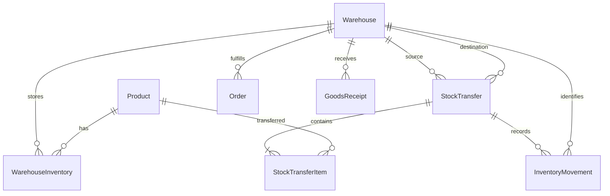
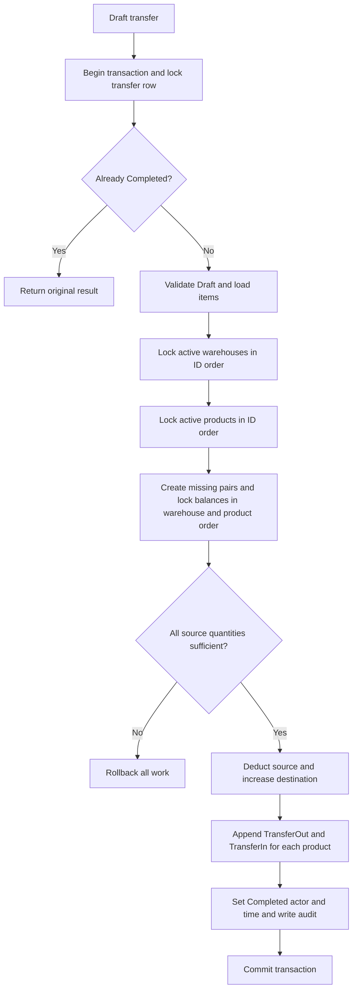

# Multi-warehouse inventory and stock transfers

Phase 9 adds production source/destination references, ProductionConsumption/ProductionOutput and open-production deactivation protection. Manufacturing uses the same deterministic locks and stock writer, allows equal source/destination, and never combines different depots implicitly. [Manufacturing integration](MANUFACTURING.md).

[README](../README.md) · [Database](DATABASE.md) · [API](API.md) · [Verification](../VERIFICATION.md)

## Model and invariants

`WarehouseInventories` is the authoritative balance table. Each `(WarehouseId, ProductId)` pair is unique; quantities and minimum levels are non-negative integers. A missing pair reads as zero, without materializing every warehouse/product combination. The first stock write inserts the pair with `ON CONFLICT DO NOTHING` inside its transaction and then locks it.

The `Inventories` **view** supplies the existing company-level DTO and AI reporting contracts. Quantity and minimum level are the sums of warehouse balances; `UpdatedAt` is the latest warehouse update. No independently writable company total exists. Existing contracts use Int32, so a deferred PostgreSQL constraint enforces company quantities and summed minimum levels at or below 2,147,483,647 per product. Intermediate transfer updates are allowed; only the committed total is checked. Company low stock means `0 < SUM(quantity) <= SUM(minimum)`, which can differ from warehouse shortage. Warehouse low stock means `0 < quantity <= minimum`. Out of stock includes missing zero balances. Warehouse report totals cover all products and warehouses, including inactive records; list filters affect distribution only.

Warehouse codes are trimmed, uppercase ASCII identifiers, unique in PostgreSQL. Admins create, edit, activate/deactivate, and change the default. There is no hard-delete API: warehouse history remains referenced. A partial unique index enforces at most one default; a deferred constraint enforces exactly one active default at commit. Switching defaults takes a governance advisory lock and sorted warehouse locks, clears the previous default, and sets the selected warehouse in one transaction. It never moves stock. The default, positive-stock warehouses, and warehouses referenced by Pending/Confirmed sales orders or Draft transfers cannot be deactivated.

## Transfer lifecycle and atomicity

Transfers have sequence-backed unique numbers, source and destination warehouses, notes, creator, completion actor/time, and 1–100 distinct active products. Quantities are whole units from 1 to 100,000 per item. Source and destination must differ and both must be active at create/edit/complete. Drafts do not reserve or change stock. Drafts can be edited or cancelled. Completion is all-or-nothing; no in-transit or partial transfer state is implemented. Completed and Cancelled transfers cannot be edited, deleted, or reopened; database triggers also protect finalized headers/items. Repeating completion of the same Completed resource returns the original result without changing balances, movements, audit actor, or timestamp.

All stock writers use the same order: document row when applicable, warehouses sorted by ID (`FOR SHARE`), products sorted by ID (`FOR UPDATE`), then balance rows ordered by warehouse/product (`FOR UPDATE`). Product locks coordinate overall limits and serialize operations involving the same product across warehouses. Warehouse shared locks coordinate stock writes with warehouse administration. The product-lock trigger also guards direct balance inserts/updates. Sales, receipts, manual changes, and transfers use these common helpers. Deadlocks/serialization failures return HTTP 409 without blind retry. Locks live in PostgreSQL, so they coordinate separate API processes. This conservative product-level serialization favors correctness over maximum write throughput.

Every completed item has two immutable, typed movements sharing `StockTransferId`: `TransferOut` at the source and `TransferIn` at the destination. Each records positive movement quantity, its own before/after balance, warehouse, actor, and timestamp. Order/receipt foreign keys remain null on transfer movements. Stock movement and completion audit insertions share the transaction; a failure in any of them rolls everything back.

## Sales, receipts, and manual stock

Sales orders store their fulfillment warehouse at creation. The UI preselects the active default; callers may explicitly supply `warehouseId`. Legacy callers omitting it resolve the current default. Confirmation deducts only that warehouse, never splits or borrows from other depots. Cancellation restores the warehouses in the actual original `OrderDeduction` movements, even after the default changes. Historical orders with no recorded deduction never receive invented return stock. The database prevents changing fulfillment warehouse after a recorded deduction.

Each goods receipt stores one destination warehouse. A purchase order can be partially received into different warehouses through separate receipts. The idempotency fingerprint includes the resolved destination warehouse. Reusing an operation key with a different warehouse returns 409. An omitted warehouse on retry resolves to the receipt's original warehouse, preserving retry behavior across default changes. Legacy receipt fingerprints retain version 1; new receipts use version 2. Stock increases only in the selected active destination. Manual stock-in, stock-out, adjustments, and minimum levels use warehouse-specific endpoints and the shared stock form. Company inventory screens display aggregated stock and require selection of an actual warehouse for writes.

## Migration and rollback policy

Migration `20261010081430_MultiWarehouse` is additive to the eight-migration history. It renames the original `Inventories` table to `LegacyInventories`, preserving opening IDs, quantities, minimums, and timestamps. It creates one active default `MAIN` warehouse and copies every legacy balance exactly once into it. The old table is frozen against updates; new products receive a zero opening identity and zero default-depot balance through the existing initialization trigger. Zero-balance products without history remain deletable through the original product flow; referenced products remain protected.

Existing Orders, GoodsReceipts, and InventoryMovements receive MAIN as their warehouse **administrative backfill assumption** because no historic warehouse information existed. All other fields, quantities, timestamps, statuses, fingerprints, actors, and relationships remain unchanged. Column defaults populate historic rows without firing update triggers on immutable history; defaults are removed afterward so new inserts must specify a warehouse. Receipts are not replayed. No synthetic transfer or opening movement is generated. Reapplying migrations does not duplicate balances.

Before upgrading an existing environment, create a verified database backup and compare fixed-allowlist row signatures before/after, excluding only the new association/version columns. Do not reset volumes. The migration refuses automatic downgrade because collapsing warehouse history would lose meaning; restore a verified backup or create a reviewed forward migration. The local verification backup and signatures are ignored artifacts under `.tools/phase8/`.

## API and authorization

All endpoints require authentication. Admin/Manager/Viewer can read warehouses, inventories, movements, transfers, and reports. Only Admin can create/edit/status/default warehouses. Admin and Manager can create/edit/complete/cancel transfers and perform manual stock changes. Viewer mutations return 403; frontend controls and protected routes follow the same rules.

| Resource | Operations |
| --- | --- |
| `/api/warehouses` | GET paged search/status/default filters; POST create |
| `/api/warehouses/{id}` | GET details; PUT edit |
| `/api/warehouses/{id}/status` | PUT `{isActive}` |
| `/api/warehouses/{id}/set-default` | POST |
| `/api/warehouses/{id}/inventory` | GET paged search/category/Low-Out-Healthy filters |
| `/api/warehouses/{id}/inventory/{productId}` | GET balance (missing pair returns zero) |
| `/api/warehouses/{id}/inventory/{productId}/stock-in` | POST `{quantity,reason}` |
| `/api/warehouses/{id}/inventory/{productId}/stock-out` | POST `{quantity,reason}` |
| `/api/warehouses/{id}/inventory/{productId}/adjust` | POST `{quantity,direction,reason}` |
| `/api/warehouses/{id}/inventory/{productId}/minimum-level` | PUT `{minimumStockLevel}` |
| `/api/warehouses/{id}/movements` | GET paged recent history with optional product-name/category filters |
| `/api/products/{productId}/warehouse-stock` | GET paged warehouse balances |
| `/api/stock-transfers` | GET paged number/source/destination/status/UTC date filters; POST Draft |
| `/api/stock-transfers/{id}` | GET details; PUT Draft edit |
| `/api/stock-transfers/{id}/complete` | POST atomic idempotent completion |
| `/api/stock-transfers/{id}/cancel` | POST Draft cancellation |
| `/api/reports/warehouses` | GET global metrics and paged distribution |

Reads use DTO projections, `AsNoTracking`, bounded pagination (1–100), and stable ID tie breakers. SQL aggregates run in PostgreSQL without per-row application queries. Warehouse report out-of-stock uses `warehouse count × product count − positive balance pairs` without materializing the Cartesian product. Transfer date filters require both endpoints, an exclusive UTC end, and at most 366 days. UI filters include entire chosen end date.

Audit records cover warehouse create/edit/status/default and transfer create/edit/complete/cancel. Completion includes products/quantities, source/destination identity from the transfer record and completion actor/time. Manual audits include warehouse ID. Metadata notes are not copied into audit JSON; movement history remains separate. Audit APIs and filters include new events/entities.

## UI and supported limits

The TR/EN interface includes warehouse list/edit/details, inventory search/category/status, shared manual forms, product stock distribution, recent movement references, transfer list filters, React Hook Form/Zod Draft editor with source-stock lookup, completion confirmation, immutable completion details, sales fulfillment selection, receipt destination selection, and warehouse reports. Queries invalidate inventory, warehouses, transfers, reports, orders, products, procurement, and audit after stock changes. Backend rules remain authoritative when source stock changes after a form loads.

No bins, reservations, cross-company stock, serial/batch tracking, partial shipping, transfer reversals, or hard warehouse deletion are implemented. The existing all-products selector follows the original ERP pattern; warehouse and stock lists use server pagination. The AI Assistant/RAG application files are unchanged; their existing report sources now see summed warehouse stock through the read-only compatibility view.
