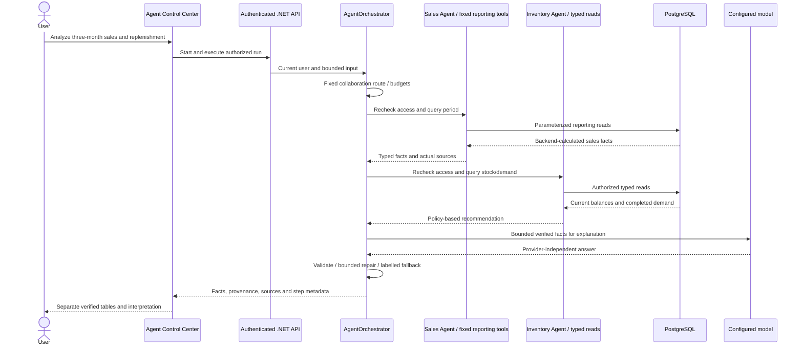
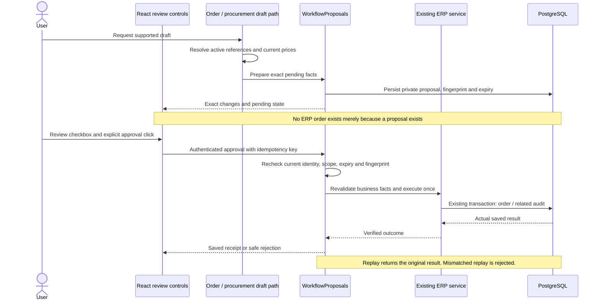

# Agent orchestration and approval

[Diagram index](README.md) · [Agent guide](../AI_AGENTS.md)

## Agent orchestration

Execution is sequential and bounded, not open-ended inter-agent chat. Some explicit requests use deterministic routing; supported ambiguous intents use one restricted routing tool. Sales and Inventory calculations are backend operations, not model arithmetic. The summary model may fail or produce unsafe output; validation and a clearly labelled deterministic fallback protect factual presentation. Model text remains an interpretation requiring source review.

## Secure order approval

Sales approvals create a Pending sales order; order confirmation and stock deduction remain distinct business operations. Purchase proposals create the supported purchase document through procurement services; they do not auto-receive stock. Changed prices/references/permissions invalidate stale approval. The visual workflow's approved-result node verifies the saved result and never substitutes for human approval.

Source anchors: [orchestrator](../../backend/Demo.Api/AI/Agents/AgentOrchestrator.cs), [plan validation](../../backend/Demo.Api/AI/Agents/AgentPlanner.cs), [proposal service](../../backend/Demo.Api/AI/Agents/WorkflowProposals.cs), [business services](../../backend/Demo.Api/Services/BusinessServices.cs). [Detailed proposal lifecycle and limits](../SECURE_WORKFLOWS.md).
