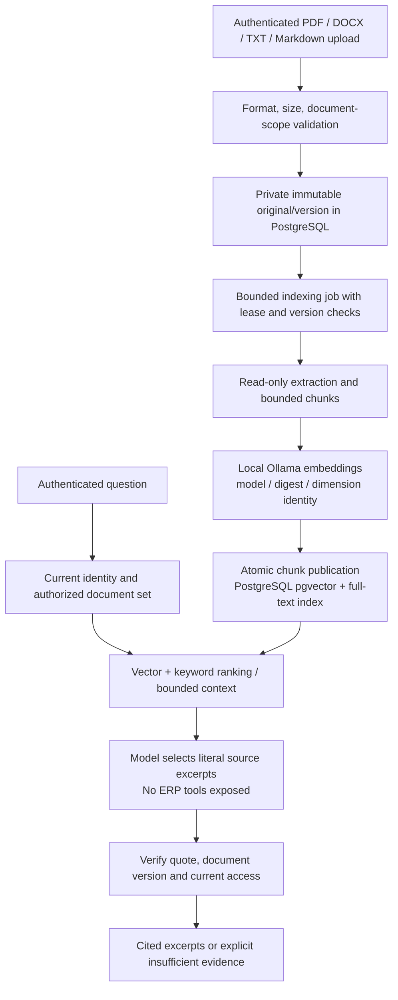
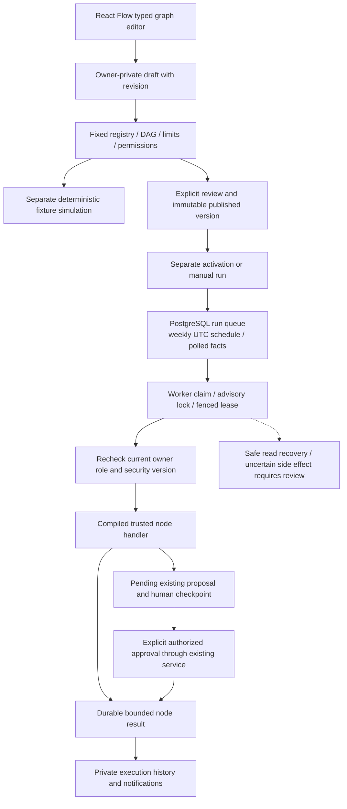

# Knowledge and workflow execution

[Diagram index](README.md)

## RAG pipeline

Private documents are owner-scoped; workspace-shared publication requires Admin authority. Both vector and keyword ranking filter authorization before ranking. Source access/version is rechecked before delivery. Literal quote validation establishes provenance, not universal relevance or correctness of the source policy. Uploaded instructions are untrusted data and cannot authorize tool execution or writes.

The current implementation has no OCR, image-only PDF understanding, arbitrary web ingestion or claimed ANN index. The PostgreSQL migration uses vector support when available and creates a full-text GIN index; actual retrieval uses bounded hybrid ranking. [Full ingestion and security specification](../ENTERPRISE_RAG.md).

## Visual workflow execution

The workflow engine is an in-process hosted service using database durability, not an external queue product. It runs at most one workflow per database and binds each run to an immutable version. Safe reads may retry within bounds; interrupted unsafe operations with uncertain outcomes require manual review. Simulation writes only labelled workflow metadata, never ERP business records, proposals or notifications, and does not call a model or embedding service.

Proactive monitoring is a separate existing subsystem: scheduled checks there are deterministic and invoke no LLM. Visual workflows can explicitly include optional model steps when configured and user-published. Neither scheduler can auto-approve a business proposal. [Workflow bounds/recovery](../VISUAL_WORKFLOWS.md) · [Monitoring design](../PROACTIVE_OPERATIONS.md).

Source anchors: [knowledge retrieval](../../backend/Demo.Api/AI/Knowledge/KnowledgeRetrieval.cs), [grounding](../../backend/Demo.Api/AI/Knowledge/KnowledgeAgent.cs), [workflow engine](../../backend/Demo.Api/AI/Workflows/WorkflowEngine.cs), [registry](../../backend/Demo.Api/AI/Workflows/WorkflowRegistry.cs).
