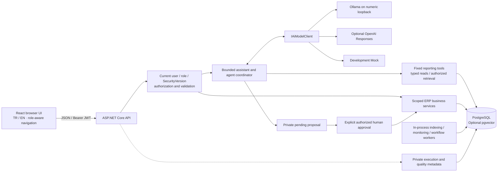
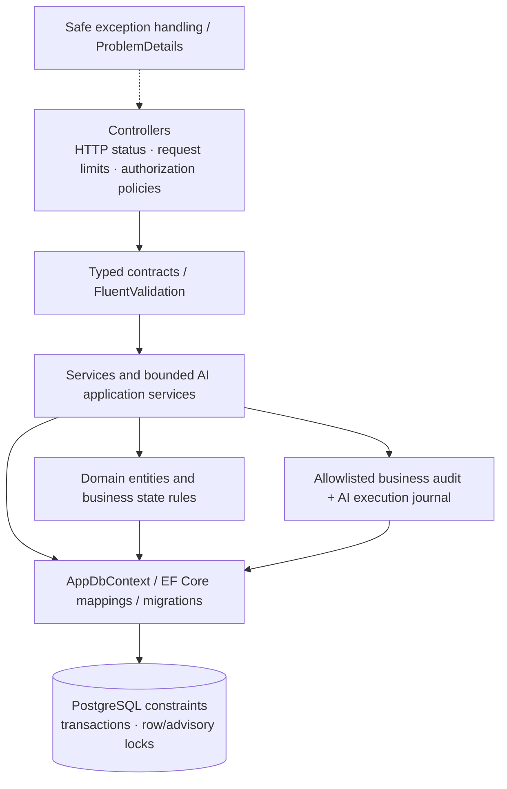
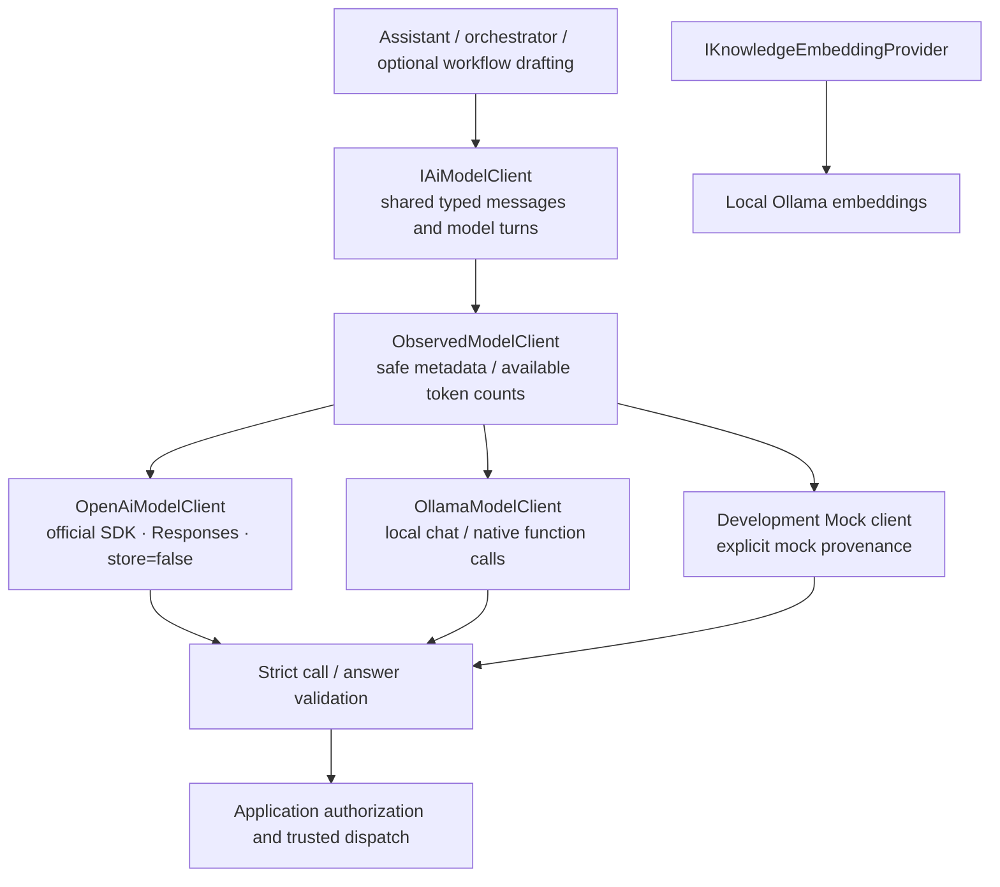

# System and provider boundaries

[Diagram index](README.md) · [Source overview](../ARCHITECTURE.md)

## System architecture

The browser never receives provider credentials or a direct Ollama connection. Stock/document/audit writes share the existing transactional business services. Local Compose has three services: PostgreSQL, the API and an unprivileged Nginx frontend. Native Windows AI development uses a host API and Vite with explicit loopback/CORS settings. No public deployment or cloud inference topology is assumed.

## Backend layers

These are directories within `backend/Demo.Api`, not separate deployable assemblies. `Services/` owns existing ERP transactions; `AI/Agents`, `AI/Knowledge`, `AI/Monitoring`, `AI/Quality` and `AI/Workflows` add bounded capabilities without replacing them. EF Core is the data access layer; there is no invented repository/CQRS or distributed transaction infrastructure.

## Provider abstraction

The chat provider abstraction is separate from the embedding abstraction. OpenAI and Ollama preserve provider-independent contracts; validation does not authorize an operation by itself. Current identity, fixed tool dispatch and business revalidation remain backend responsibilities. Known provider-specific output differences are handled by adapters and bounded repair paths, with explicit fallback provenance.

`AiAssistantOptions` permits Ollama/Mock only in Development and restricts the Ollama endpoint to `http://127.0.0.1:11434`. OpenAI uses the configured supported model ID and backend-only key. Successful live OpenAI generation is not verified; local Qwen generation is. [Provider configuration](../LOCAL_OLLAMA.md) · [Responses implementation](../OPENAI_INTEGRATION.md).

Source anchors: [Program](../../backend/Demo.Api/Program.cs), [services](../../backend/Demo.Api/Services/BusinessServices.cs), [contracts](../../backend/Demo.Api/AI/AiContracts.cs), [options](../../backend/Demo.Api/AI/AiAssistantOptions.cs), [data context](../../backend/Demo.Api/Data/AppDbContext.cs).
