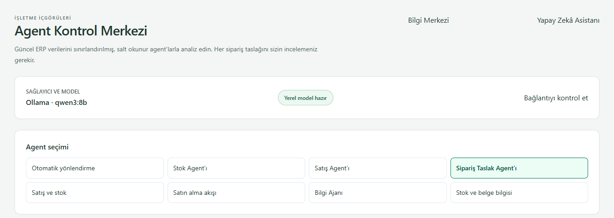
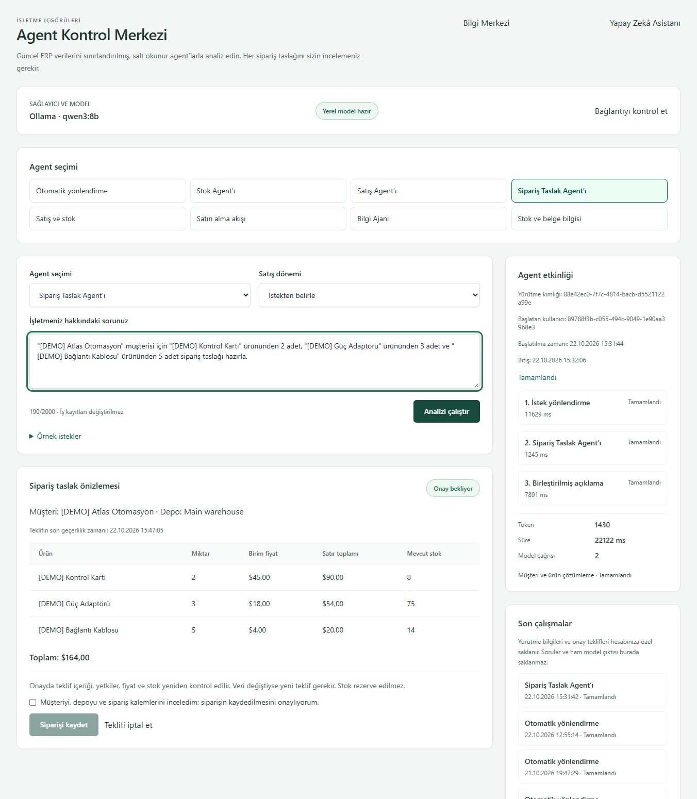
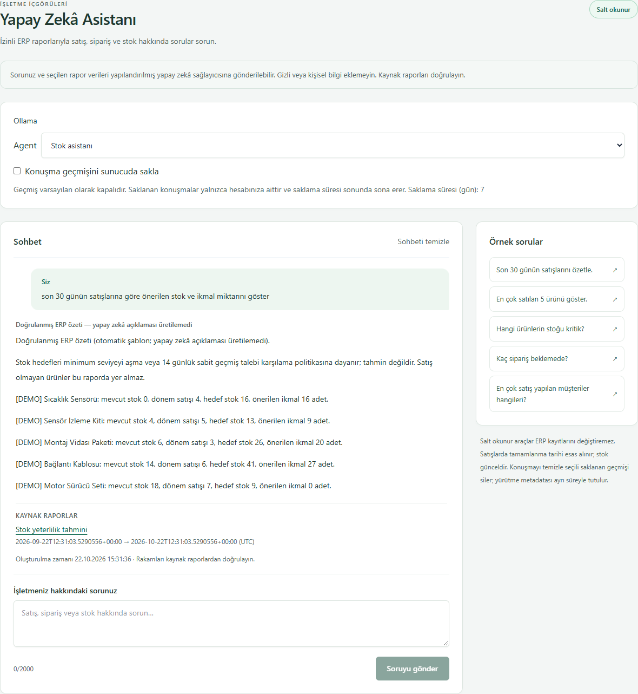
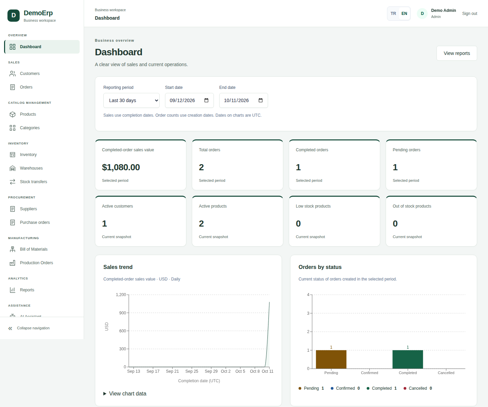
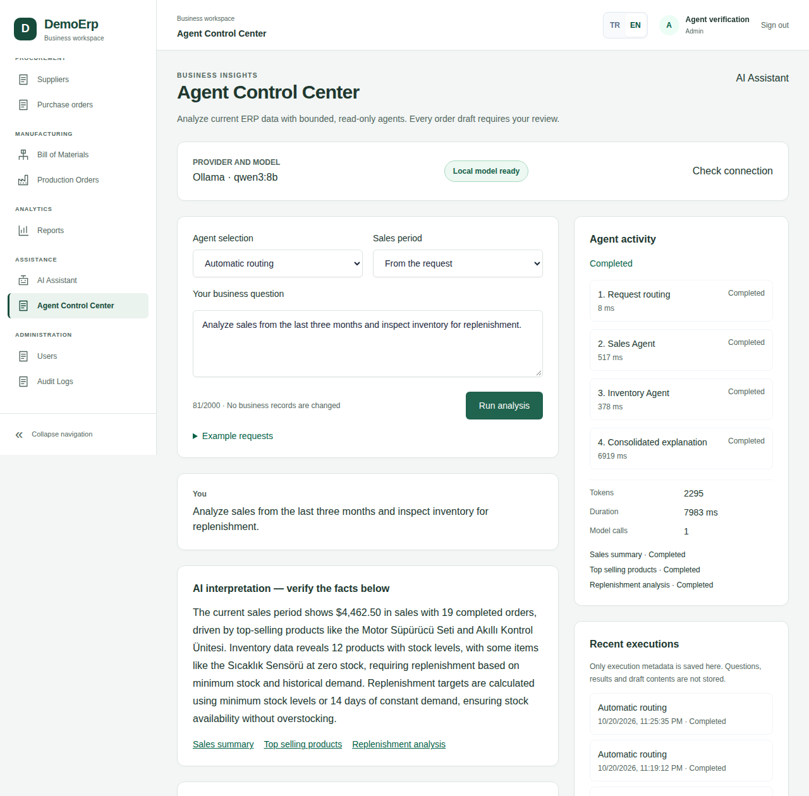
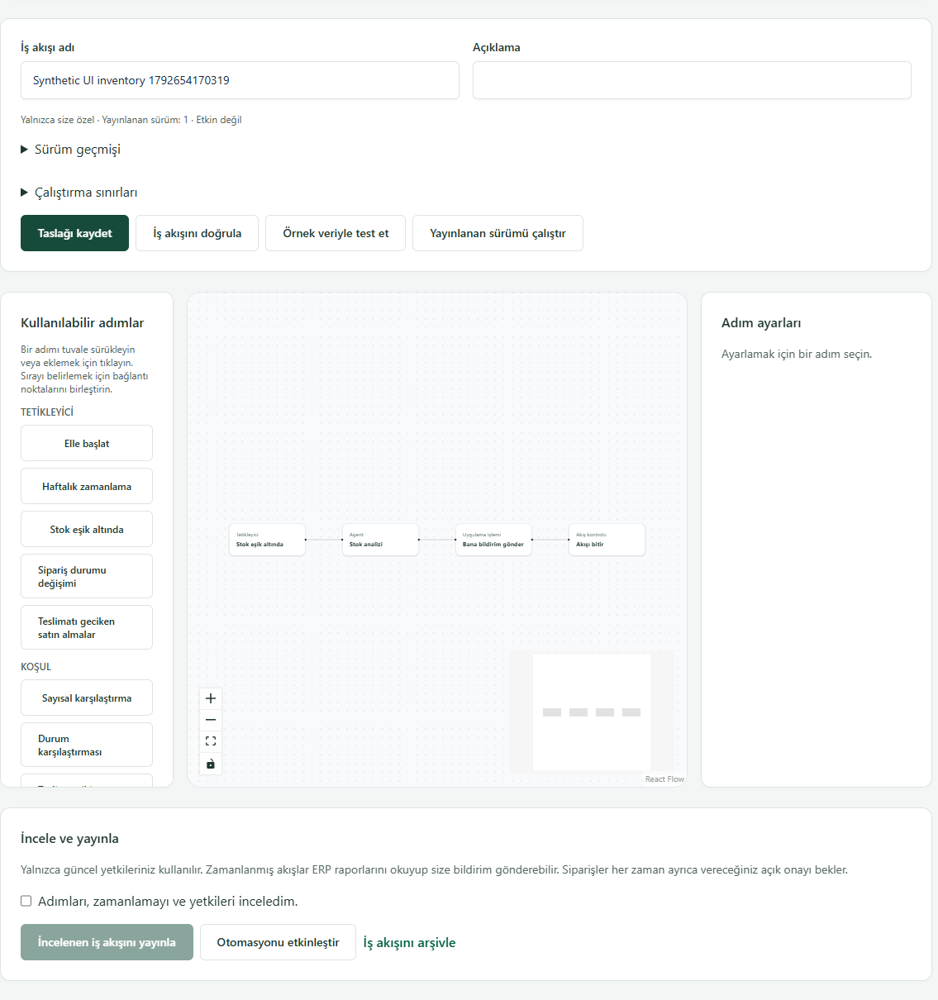
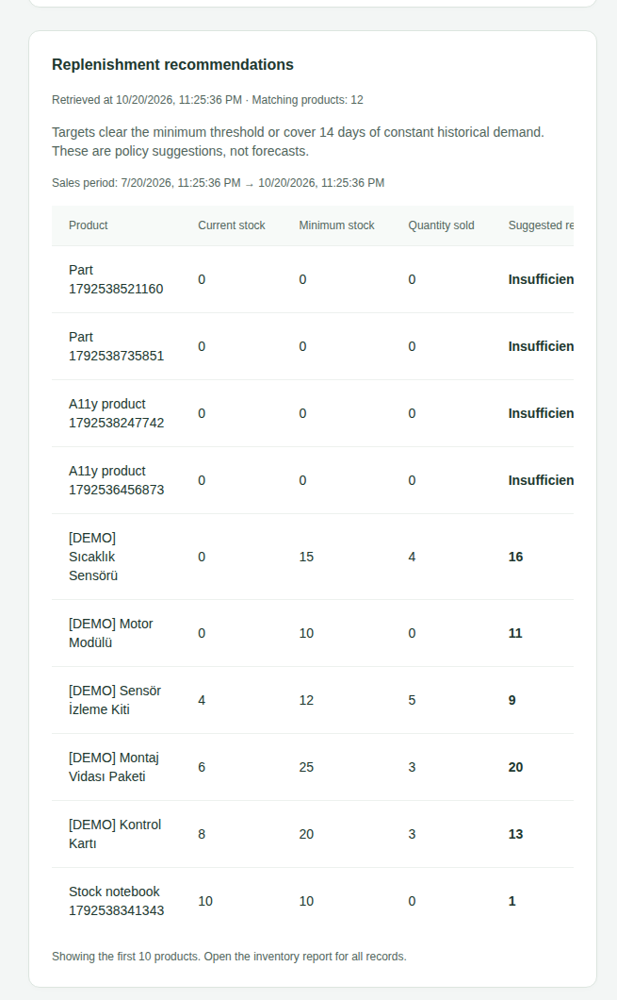
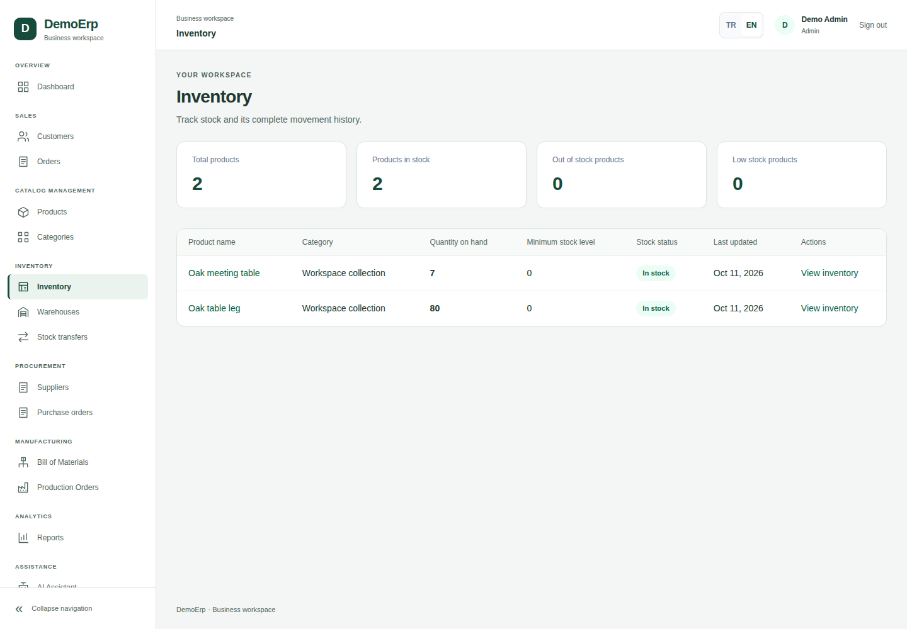
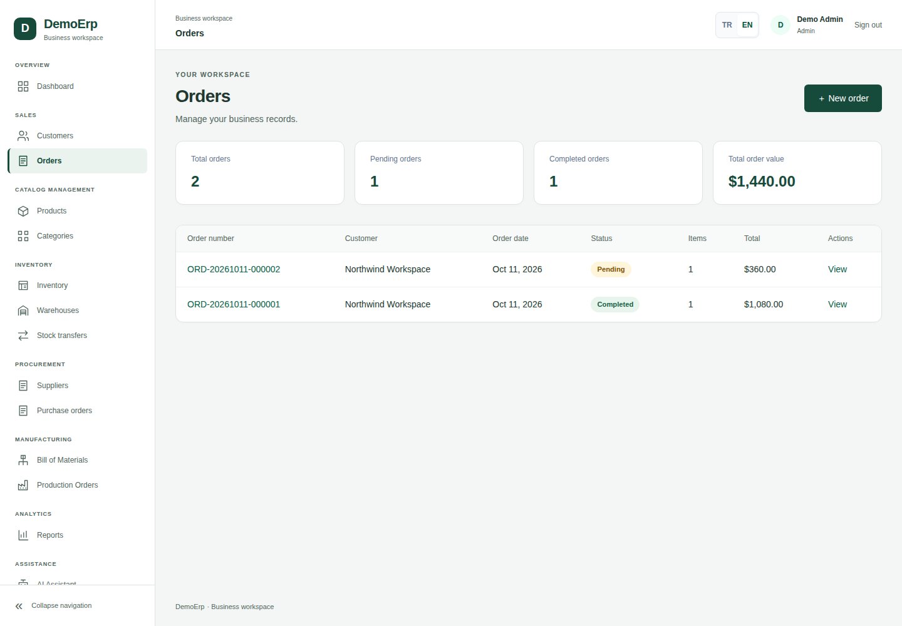
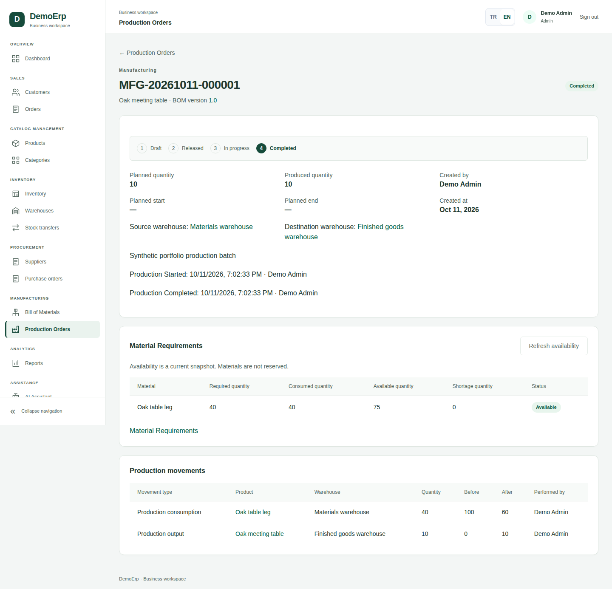

# Authentic application gallery

[Project overview](../../../README.md) · [Documentation](../../README.md)

Every image below originated in a real browser capture of DemoERP using synthetic records. No image-generation tool, fake UI, edited numerical value or fabricated result was used. Crops preserve original pixels; PNG files were compressed losslessly. Widths and height differ by captured content; all assets use ordinary GitHub Markdown image links, with full-width rendering and readable alt text.

## Current agent and assistant captures — October 22, 2026

The current Agent Control Center exposes eight real mode-selection buttons. This is the running application, including local Ollama provider readiness.

Authenticated Admin execution with actual `qwen3:8b`; synthetic Atlas Otomasyon customer, 2 control boards, 3 power adapters and 5 cables. Backend-resolved total: 164 USD. The approval box was not checked and Save order was not clicked. After the execution, the same prompt was restored in the normal input while the pending proposal and execution were reloaded from the backend. The image is a continuous pixel-preserving browser crop, not a composite.

The exact requested prompt ran through React → authenticated .NET → Ollama → authorized stock-risk report. Final model text failed validation, so the displayed result explicitly uses the deterministic fallback label. The existing Inventory Agent policy calculates target and replenishment. No inference success is claimed for the final explanation. Completed-sales demand, stock and thresholds are real synthetic ERP records.

All three images are actual browser captures; only cropping and lossless compression are used. The read-only request and pending proposal do not create sales orders or stock movements.

## Featured views

**Dashboard, English.** Cropped upper section of the existing 1440-pixel-wide synthetic browser capture. [Full page](dashboard-full-en.png).

**Agent Control Center, English, October 20, 2026.** Actual local `qwen3:8b` run with Sales, Inventory and a consolidated explanation. This historical capture represents that observed run, not a new performance measurement or a promise that every model interpretation is correct. It precedes later Knowledge/Quality navigation additions. Current behavior and later live checks are recorded in [verification](../../../VERIFICATION.md).

**Workflow Designer, Turkish, October 22, 2026.** Cropped detail from the actual Phase 11.8 browser acceptance. [Full page](workflow-designer-full-tr.png). The example's test name and notifications are synthetic.

## ERP workspaces

**Inventory Agent detail.** A pixel-preserving 655 × 1060 crop from the same actual October 20 Sales + Inventory browser capture, focusing on current stock, minimum levels and demand-based recommendations. The original panel has horizontally overflowing columns; the crop does not invent or reflow values. These are historical synthetic facts, not a live data feed.

## Provenance and publication boundaries

| Asset | Original source | Treatment |
| --- | --- | --- |
| `dashboard-overview-en.png` | Existing `docs/screenshots/dashboard-en.png` | Upper 1440 × 1200 crop |
| `dashboard-full-en.png` | Same existing dashboard capture | Full original content, lossless compression |
| `agent-control-center-en.png` | Preserved Phase 11.3 actual-model browser capture | Upper 1280 × 1260 crop; no text/result changes |
| `agent-inventory-results-en.png` | Same actual-model browser capture | Stock/demand/replenishment result panel, 655 × 1060 crop |
| `workflow-designer-tr.png` | Preserved Phase 11.8 actual-browser capture | Canvas/review detail, 1135 × 1210 |
| `workflow-designer-full-tr.png` | Same Phase 11.8 capture | Full 1440 × 2738 page |
| `inventory-en.png`, `orders-en.png`, `production-order-en.png` | Corresponding original `docs/screenshots/` assets | Full content, lossless compression |

Twelve optimized PNG assets retain authentic application content. Original ERP screenshots remain in `docs/screenshots/`; private local execution evidence stays ignored. The gallery contains synthetic demo records. The current draft capture shows pending human approval and is not presented as an already saved order.
